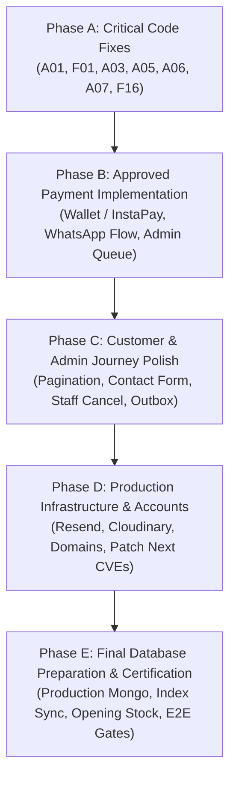

# NEST ELECTRO — FULL INDEPENDENT PROJECT AUDIT
## Comprehensive Technical, Security, Functional & Production Readiness Assessment

- **Audit Date:** 21 November 2026 (Africa/Cairo)
- **Auditor Role:** Principal Software Architect, Senior Full-Stack Engineer, Application Security Auditor, QA Lead, Database Architect, and DevOps Reviewer
- **Target Repository:** `D:\eng-mina\nest-electronics-muse` (Active Branch: `phase-1-2-overnight`, Head Commit: `de8a353808c74b3885c2700ab89d756176dcecc7`)
- **Audit Scope:** Full repository source code, architecture, Next.js storefront, Next.js admin dashboard, NestJS API, MongoDB schemas, shared packages, testing suites, security posture, business workflows, and operational readiness.
- **Audit Mode:** Pure independent forensic assessment. No application source code or tests modified. No database dropped, truncated, migrated, or provisioned.

---

## 1. Executive Summary

### 1.1 Overall Project Verdict
**STATUS: 🔴 NOT READY / PRODUCTION BLOCKED**

Nest Electro possesses a solidly engineered core architectural foundation—particularly its NestJS modular API, MongoDB Mongoose schema design, transactional order placement, atomic stock decrements, and newly implemented defensive security primitives (HTML sanitization, JSON-LD escaping, Content Security Policy headers, and SUPER_ADMIN write fencing).

However, **the project is currently blocked from production release by critical architectural, functional, security, and operational defects**:
1. **The Backend API Cannot Bootstrap in Full Application Context (P0 Blocker A01):** `UsersModule`, `FulfilmentModule`, and `MediaModule` fail NestJS dependency resolution because their services (`CustomersAdminService`, `ShippingRatesAdminService`, `MediaService`) inject `TransactionService`, but none of these modules import `DatabaseModule` (which is not decorated with `@Global()`). While isolated unit tests pass by mocking dependencies, any attempt to start the full API or run end-to-end integration tests crashes with `UnknownDependenciesException`.
2. **Approved Payment & Order Model Is Only 50% Implemented:** While Cash on Delivery (COD) order placement and delivery-triggered cash collection are cleanly implemented, the approved **Electronic Wallet / InstaPay Manual Verification Flow is completely absent across the entire stack**. There are no enum values for Wallet or InstaPay, no checkout payment selector, no payment instruction display, no WhatsApp handoff mechanism, no evidence ingestion or reference capture, no `PENDING_VERIFICATION` or `REJECTED` state, and no admin verification queue or approve/reject actions.
3. **Storefront Server-Side Rendering Session Crash (F01):** When a customer with an expired access token visits an authenticated server-rendered page (e.g. `/account` or `/checkout`), `apps/storefront/src/lib/api/client.ts` attempts to call `writeSession()` (`cookies().set()`) during Server Component rendering. Next.js App Router forbids cookie modification during component render and throws an unhandled exception, causing returning customers to experience immediate 500 errors.
4. **Routine Admin Operations Crash or Corrupt Data (A03, A05, A06, A07):**
   - Uploading images between 1 MB and 5 MB in the admin product editor crashes the route with a 500 error because Next.js Server Actions default to a 1 MB body limit (A03).
   - Concurrent product edits overwrite previously saved prices without optimistic locking or version checking (A05).
   - If derived recount or redirect operations fail during product updates, the product change has already committed, yet the admin UI promises "Nothing was changed" (A06).
   - The product form's slug availability checker requests `/api/check-slug` instead of `/admin/api/check-slug`, generating 404 errors on every keystroke (A07).
5. **Simulated and Broken Customer Journeys (F08, F17, F18, F38):**
   - The `/contact` page is a purely synthetic client-side `setTimeout` dummy with a placeholder phone number (`+20 100 000 0000`) that sends no email and records no data (F17).
   - The `/blog` route directly queries legacy Supabase and crashes with 500 in standard runtimes (F08).
   - Category, brand, and customer order history pages are hardcoded to page 1 with limits of 20–24 items, lacking pagination controls and truncating customer records (F18).
   - Product detail pages display unverified "38 verified reviews" generated from synthetic seeds, directly violating owner decision D23 prohibiting unsubstantiated review claims (F38).
6. **Zero Shipping Rates in Database (F16):** The development database contains zero rows in `shippingRates`. Because `FulfilmentService` strictly fails closed and the admin UI cannot create new governorate rows (only edit existing ones), checkout fails with a 500/`SHIPPING_RATE_MISSING` error unless seeded via CLI.
7. **Production Operations and Infrastructure Absence:** No durable notification outbox or email retry mechanism exists (failed emails are dropped permanently). Known high-severity CVEs in Next.js 16.2.4 remain unpatched. Automated backups, restore drills, APM telemetry, and staging deployment environments have not been provisioned.

---

## 2. Actual Architecture vs. Documented Architecture

### 2.1 The Actual Architecture
The repository is structured as a pnpm Turborepo monorepo with three Next.js/NestJS applications and six shared packages:

```text
Browser (Customer / Administrator)
   │
   ├─► Storefront (Next.js 16.2.4 / React 19.2.4 - Port 3200)
   │     ├─ Server Components (SSR) & Server Actions
   │     ├─ Server-Only Client (apps/storefront/src/lib/api/client.ts)
   │     ├─ CSP Nonce Injection & Proxy (apps/storefront/src/proxy.ts)
   │     └─ Legacy Supabase Integration (apps/storefront/src/lib/services.ts -> BlogService)
   │
   ├─► Admin Dashboard (Next.js 16.2.4 / React 19.2.4 - Port 3201, BasePath: /admin)
   │     ├─ Server Components & Server Actions (apps/admin/src/actions/*)
   │     ├─ Server-Only Admin Client (apps/admin/src/lib/api/client.ts)
   │     ├─ Session Renewal Route Handler (apps/admin/src/app/session/renew/route.ts)
   │     └─ Legacy Supabase Direct Client (Coupons & Reviews -> @supabase/supabase-js)
   │
   └─► Backend API (NestJS 11.2.3 / Express - Port 3002, BasePath: /api/v1)
         ├─ Security Pipeline: Helmet, CORS, ThrottlerGuard, JwtAuthGuard, RolesGuard
         ├─ Modular Domain Structure: Auth, Users, Catalog, Cart, Orders, Fulfilment, Inventory, Media, Notifications, Audit
         ├─ Infrastructure: DatabaseModule (Mongoose 8.24.4, TransactionService, IndexHealthService)
         ├─ Providers: Resend / Brevo (EmailSenderPort), Cloudinary / Memory (MediaStoragePort)
         │
         ▼
     MongoDB (Development Instance: mongodb://localhost:27017/nest-dev)
         ├─ 14 Core Collections: users, refreshTokens, products, categories, brands, slugRedirects,
         │                       carts, orders, orderCounters, idempotencyKeys, shippingRates,
         │                       inventoryEvents, mediaAssets, auditLogs
```

### 2.2 Deviations from Intended Single-Authority Architecture
1. **Split Authority for Legacy Domains:**
   - **Blog:** Storefront (`/blog` and `/blog/[slug]`) still bypasses NestJS and directly queries Supabase PostgreSQL via `packages/services/src/blog.service.ts` and `packages/providers/src/supabase.ts`.
   - **Coupons & Reviews:** Admin pages (`/admin/coupons` and `/admin/reviews`) bypass NestJS API and issue direct PostgREST queries to Supabase.
   - **Wishlist:** Storefront wishlist is purely browser `localStorage` (which matches approved Owner Decision D12 for launch MVP), while legacy Supabase wishlist tables and actions remain dead code in packages.
2. **Missing Global Database Provider in NestJS:**
   - Documented architecture states that connection lifecycle and `TransactionService` are cross-module infrastructure. However, `DatabaseModule` was never decorated with `@Global()`, and feature modules (`UsersModule`, `FulfilmentModule`, `MediaModule`) omit `DatabaseModule` from their imports, causing DI resolution failure.
3. **Storefront vs. Admin Session Handling Divergence:**
   - While Admin resolved SSR cookie mutation errors by creating a dedicated Route Handler (`/admin/session/renew`), Storefront retains the legacy inline renewal inside `apiFetch()`, causing 500 errors on token expiration during SSR.
4. **Absence of Flutter Mobile Application:**
   - No Dart/Flutter codebase exists in the repository; mobile app development is deferred.

---

## 3. Payment & Order Business Rules Audit

Per approved Owner Decisions (D01, D02, D03, D16) and Project Owner Guidelines, this section audits the actual state of the approved payment models:

### 3.1 Cash on Delivery (COD) Flow
| Step / Rule | Expected Behavior | Actual Implementation State | Verdict | Evidence |
|---|---|---|---|---|
| Selection at Checkout | Customer can select COD | Default and only selectable payment method | **IMPLEMENTED** | `apps/storefront/src/components/checkout/CheckoutForm.tsx:195` |
| Order Creation | Order created with `method: COD`, `status: PENDING` | Created with `PaymentMethod.COD`, `PaymentStatus.PENDING`, `INITIAL_ORDER_STATUS: PLACED` | **VERIFIED CORRECT** | `apps/api/src/modules/orders/application/checkout.service.ts:577-585` |
| Stock Commitment | Stock decremented atomically upon placement | `InventoryService.commitSale()` decrements stock and writes `SALE` ledger event in placement transaction | **VERIFIED CORRECT** | `apps/api/src/modules/orders/application/checkout.service.ts:544-554` |
| Collection Invariant | COD orders must NOT be marked PAID before actual collection | `payment.status` remains `PENDING` through `CONFIRMED`, `SHIPPED`, and `DELIVERY_FAILED` | **VERIFIED CORRECT** | `apps/api/src/modules/orders/application/order-lifecycle.service.ts:408-419` |
| Delivery Transition | Courier delivers goods and collects cash; order becomes `DELIVERED` and payment becomes `PAID` atomically | `DELIVERED` transition atomically sets `payment.status = PAID` and `payment.collectedAt = Date()` | **VERIFIED CORRECT** | `apps/api/src/modules/orders/application/order-lifecycle.service.ts:413-419` |
| Failed Delivery | Failed delivery moves to `DELIVERY_FAILED`, stock retained, attempts incremented | `DELIVERY_FAILED` records reason, increments `deliveryAttempts`, keeps payment unpaid | **VERIFIED CORRECT** | `apps/api/src/modules/orders/application/order-lifecycle.service.ts:421-424` |
| Return / Cancellation | Restores stock to catalog | Entering `CANCELLED` or `RETURNED` atomically restores inventory | **VERIFIED CORRECT** | `apps/api/src/modules/orders/application/order-lifecycle.service.ts:357-377` |

### 3.2 Electronic Wallet / InstaPay Manual Verification Flow
| Step / Rule | Expected Behavior | Actual Implementation State | Verdict | Evidence |
|---|---|---|---|---|
| Checkout Selection | Customer can choose Electronic Wallet or InstaPay | **NOT IMPLEMENTED:** No option exists in UI or API DTOs | **MISSING** | `apps/storefront/src/components/checkout/CheckoutForm.tsx`, `PlaceOrderDto` |
| Payment Instructions | Display approved wallet numbers / InstaPay addresses | **NOT IMPLEMENTED:** No instructions rendered | **MISSING** | `apps/storefront/src/app/checkout/page.tsx` |
| WhatsApp Handoff | Redirect customer to WhatsApp with order ref prefilled | **NOT IMPLEMENTED:** No WhatsApp redirect button or URL builder | **MISSING** | `apps/storefront/src/components/checkout/` |
| Evidence Capture | Customer submits sender phone/identifier & screenshot | **NOT IMPLEMENTED:** No fields or storage for payment evidence | **MISSING** | `apps/api/src/modules/orders/infrastructure/schemas/order.schema.ts` |
| Status Vocabulary | Order/Payment status set to `PENDING_VERIFICATION` | **NOT IMPLEMENTED:** `PaymentStatus` enum only contains `PENDING`, `PAID`, `REFUNDED` | **MISSING** | `apps/api/src/modules/orders/domain/order-status.ts:52-56` |
| Customer Invariant | Customer must NEVER be able to mark an order paid | **VERIFIED PROTECTED:** Status cannot be set by client | **PROTECTED** | `PlaceOrderDto` forbids non-whitelisted fields |
| WhatsApp Invariant | Clicking WhatsApp link must NOT mark payment paid | **VERIFIED PROTECTED:** No webhooks or unverified writers exist | **PROTECTED** | Architecture boundary |
| Admin Queue | Dedicated queue for manual payment verification | **NOT IMPLEMENTED:** Admin queue only filters by lifecycle status | **MISSING** | `apps/admin/src/components/orders/QueueFilters.tsx` |
| Admin Verification Actions | Admin endpoints to Approve or Reject submitted evidence | **NOT IMPLEMENTED:** `AdminOrdersController` only contains lifecycle actions (`confirm`, `ship`, `deliver`, `delivery-failed`, `retry-shipment`, `return`) | **MISSING** | `apps/api/src/modules/orders/presentation/admin-orders.controller.ts` |
| Verification Audit | Auditable attribution for approve/reject decisions | **NOT IMPLEMENTED:** No audit action codes for payment approval/rejection | **MISSING** | `apps/api/src/modules/audit/domain/audit-action.ts` |
| Fulfillment Hold Invariant | Unverified manual orders must NOT be treated as paid or shipped | **CRITICAL DEFECT:** If an unverified order is advanced to `DELIVERED`, the engine unconditionally marks it `PAID` | **INSECURE / BROKEN** | `apps/api/src/modules/orders/application/order-lifecycle.service.ts:415` |

---

## 4. Full Storefront Audit

Audit of all customer-facing routes, components, and user journeys:

### 4.1 Route & Journey Analysis
| Route | Functionality | UI / UX | Security & Performance | Findings & Verdict |
|---|---|---|---|---|
| `/` (Homepage) | Hero section, category navigation, featured products, benefit highlights. | Responsive, clean styling. Images render placeholder icons if catalogue images empty. | Safe SSR, dynamic headers. | **PARTIAL:** Operable, but product images fall back to placeholders. |
| `/products` | Catalog listing, price display, stock status, sorting, mobile filter drawer. | Grid layout responsive. Filter reset works. | Fast SSR, parameterized query validation. | **PARTIAL:** Operable; dependent on real catalogue content. |
| `/products/[slug]` | Product details, specification table, stock indicator, add-to-cart, related items. | Clean typography, accordion tabs. | XSS-safe JSON-LD (P1.1); React text rendering for descriptions. | **PARTIAL (F38):** Displays unsubstantiated "38 verified reviews" label from seed data. |
| `/categories` | Taxonomy grid with category cards and counts. | Clean grid, responsive card hover states. | Safe data projections. | **VERIFIED WORKING.** |
| `/categories/[slug]` | Category product listing with category banner. | Clean layout. | **TRUNCATED (F18):** Hardcodes `page: 1, limit: 24`. No pagination UI. Cannot view product 25+. | **PARTIALLY BROKEN (F18).** |
| `/brands/[slug]` | Brand product listing with brand header. | Clean layout. | **TRUNCATED (F18):** Hardcodes `page: 1, limit: 24`. No pagination UI. Truncated at 24 items. | **PARTIALLY BROKEN (F18).** |
| `/search` | Live search by keyword, debounce query, empty states. | Real-time results, clear search terms. | RegEx special characters escaped in API layer. | **VERIFIED WORKING.** |
| `/cart` | Cart items, quantity increment/decrement, line price, subtotal, checkout button. | Responsive drawer and full page. Quantity adjustments update immediately. | Server-authoritative price calculation. | **VERIFIED WORKING.** |
| Guest Cart Merge | Merging anonymous `localStorage` items into customer account upon login. | Banner notification informing user of basket merge. | **F14:** Client-side loop sends multiple individual HTTP calls without atomic server transaction. | **RISKY (F14).** |
| `/wishlist` | Saved items in browser `localStorage`. | Functional client-side wishlist. Item removal and navigation to product work. | Matches Owner Decision D12 (browser MVP, sync deferred). | **VERIFIED WORKING (MVP).** |
| `/register` | Registration form: name, email, phone, password. | Form validation messages, submit state. | Password policy enforced (10+ chars, uppercase, lowercase, digit). Rate limited. | **VERIFIED WORKING.** |
| `/login` | Email and password login. | Clean form, error banners. | HttpOnly cookies set upon success. | **VERIFIED WORKING.** |
| `/verify-email` | Consumes email verification token from URL query. | Status message and redirect to login. | **F13:** Token consumption does not use CAS filter on `tokenHash`. | **PARTIALLY RISKY (F13).** |
| `/forgot-password` | Password reset request and confirmation form. | Clean two-step flow. | Secure single-use hashed token with 1-hour TTL. | **VERIFIED WORKING.** |
| `/account` | Customer dashboard: profile details, order shortcuts. | Clean layout. | **F01:** Returning customer with expired token hits `cookies().set()` in SSR -> **500 Crash**. | **CRITICAL BUG (F01).** |
| `/account/addresses` | Address book: list, add, edit, delete, set default. | Modal dialogs, governorate dropdown matching official 27 list. | Full customer ownership validation. | **VERIFIED WORKING.** |
| `/checkout` | Address selection, delivery fee quote, order summary, place order. | Summary sticky sidebar, address radio selector re-quotes on change. | Client authoritative for nothing; addressId & idempotencyKey validated. | **INCOMPLETE:** COD only; Wallet/InstaPay and WhatsApp handoff completely missing. |
| `/account/orders` | Customer order history list. | Order cards with status badges and totals. | **F18:** Hardcodes `limit: 20` with no pagination controls. Truncated at 20 orders. | **PARTIALLY BROKEN (F18).** |
| `/account/orders/[id]`| Detailed order view, items, shipping address, status history, customer cancel button. | Comprehensive order breakdown. Cancel button enabled only for `PLACED`/`CONFIRMED`. | Customer ownership strictly filtered in DB query (`ownerId`). | **VERIFIED WORKING.** |
| `/contact` | Contact information and inquiry submission form. | Two-column layout, icons, input fields. | **F17:** Submission is a pure client-side `setTimeout` simulation. No email sent, no DB row written. Phone is fake (`+20 100 000 0000`). | **FAKE / BROKEN (F17).** |
| `/blog` | Article listing, category pills, search bar. | Editorial blog layout. | **F08:** Queries Supabase directly. Crashes with 500 when Supabase is disconnected. Deferred by D11. | **BROKEN / DEFERRED (F08).** |
| `/blog/[slug]` | Article reading view, author metadata, tags. | Clean typography. HTML sanitized via `safe-content.ts` (P1.1). | Safe allowlist parser prevents stored XSS. | **PARTIALLY WORKING / DEFERRED.** |
| SEO & Metadata | OpenGraph tags, JSON-LD structured data, sitemap, robots.txt. | Fully rendered in HTML head. | Structured data escapes `<` via Unicode escapes (P1.1). | **VERIFIED CORRECT.** |

---

## 5. Full Admin Dashboard Audit

Audit of all admin routes, permissions, tables, and mutation actions:

### 5.1 Route & Feature Matrix
| Admin Module | UI State | API Route | Authorization & Roles | Data Integrity & Concurrency | Findings & Verdict |
|---|---|---|---|---|---|
| Admin Login | Complete (`/admin/login`) | `POST /auth/login` | Public route; rejects non-staff accounts | Issues HttpOnly cookies | **VERIFIED WORKING.** |
| Overview / Dashboard | Complete (`/admin`) | `GET /admin/orders/stats`, `GET /admin/orders` | Guarded by `RolesGuard(ADMIN, SUPER_ADMIN)` | Aggregated metrics | **VERIFIED WORKING.** |
| Customer Management | Complete (`/admin/customers`) | `GET /admin/customers`, `PATCH .../role`, `DELETE ...` | Super-admin only for role changes and deletions | **P1.2:** Fenced against write skew with `roleMutationVersion` | **BLOCKED BY A01:** `UsersModule` missing `DatabaseModule` imports. API crashes on boot! |
| Product List | Complete (`/admin/products`) | `GET /admin/products` | Admin & Super-Admin | Filter and pagination work | **VERIFIED WORKING.** |
| Product Create/Edit | Complete (`/admin/products/new`, `.../edit`) | `POST /admin/products`, `PATCH /admin/products/:id` | Admin & Super-Admin | **A05:** Concurrent edits overwrite prices without version check. **A06:** Non-atomic recount. | **HIGH RISK (A05, A06, A07):** Slug check 404s. Price overwrite risk. |
| Product Image Manager | Complete (`ProductImageManager.tsx`) | `POST .../images`, `PUT .../images` (reorder) | Admin & Super-Admin | **P1.4:** Uses CAS write with `expectedVersion`. | **CRITICAL BUG (A03):** Uploads > 1 MB crash with 500 due to Next Server Action limit. |
| Inventory Overview | Complete (`/admin/inventory`) | `GET /admin/inventory`, `POST .../adjust` | Admin & Super-Admin | Atomic transaction updates stock and writes ledger event | **VERIFIED WORKING.** |
| Inventory Reconciliation | Complete (`InventoryTable.tsx`) | `GET /admin/inventory/reconcile` | Admin & Super-Admin | **F03:** Reconciliation groups by events; ignores stocked products with 0 events! | **BLIND SPOT (F03).** |
| Order Work Queue | Complete (`/admin/orders`) | `GET /admin/orders`, `GET .../stats` | Admin & Super-Admin | Filter by status (`PLACED`, `CONFIRMED`, `SHIPPED`, etc.) | **VERIFIED WORKING.** |
| Order Detail & Actions | Complete (`/admin/orders/[id]`) | `POST .../confirm`, `.../ship`, `.../deliver`, `.../delivery-failed`, `.../return` | Admin & Super-Admin | **F21:** Staff cancellation missing. **CRITICAL:** Manual payment verification actions missing! | **INCOMPLETE (F21, Section 4).** |
| Shipping Rates | Complete (`/admin/settings`) | `GET /admin/shipping-rates`, `PATCH .../:governorate` | Admin & Super-Admin | Updates fee and audits change in transaction | **INCOMPLETE:** Missing `DatabaseModule` in `FulfilmentModule`. Cannot add new governorates. |
| Coupons (Legacy) | Complete (`/admin/coupons`) | Direct Supabase | **A04:** Reads Supabase when API identity fails. | **A09, A10, A11:** Loose parsing; 0-row success; audit skipped. | **DEFERRED (D08) / INSECURE.** |
| Reviews (Legacy) | Complete (`/admin/reviews`) | Direct Supabase | **A04:** Reads Supabase when API identity fails. | Writes directly to Supabase with no API involvement. | **DEFERRED (D09) / INSECURE.** |
| Audit Log Viewer | Complete (`/admin/audit-log`) | `GET /admin/audit-logs` | Super-Admin only | Paged table with actor, action, diffs, and forensic details | **VERIFIED WORKING.** |

---

## 6. Backend and API Deep Review

### 6.1 Architectural Integrity & Module Graph
NestJS architecture is cleanly partitioned into domain modules:
- `AuthModule`: Identity credentials, JWT issuance, password reset, token blacklisting.
- `UsersModule`: Customer profiles, address book, admin customer management.
- `CatalogModule`: Products, categories, brands, slug redirects, image versioning.
- `CartModule`: Customer active carts, line validation.
- `OrdersModule`: Order placement, snapshot pricing, lifecycle transitions, idempotency.
- `FulfilmentModule`: Shipping rate quote, governorate fee management.
- `InventoryModule`: Stock commits, restorations, adjustments, ledger events, reconciliation.
- `MediaModule`: Media asset lifecycle, deletion fencing, Cloudinary storage port.
- `NotificationsModule`: Transactional email dispatch, template rendering.
- `AuditModule`: Centralized auditable event recording.
- `DatabaseModule`: MongoDB Mongoose connection, `TransactionService`, `IndexHealthService`.

### 6.2 The Bootstrapping Dependency Resolution Bug (P0 Blocker A01)
`DatabaseModule` provides and exports `TransactionService`. However, in NestJS, modules are not global unless decorated with `@Global()`.
`DatabaseModule` is NOT `@Global()`.
During runtime initialization:
1. `UsersModule` declares `CustomersAdminService`, which injects `TransactionService`. But `UsersModule` does NOT import `DatabaseModule`.
2. `FulfilmentModule` declares `ShippingRatesAdminService`, which injects `TransactionService`. But `FulfilmentModule` does NOT import `DatabaseModule`.
3. `MediaModule` declares `MediaService`, which injects `TransactionService`. But `MediaModule` does NOT import `DatabaseModule`.

**Reproduction:**
Attempting to start the application via NestFactory (`NestFactory.create(AppModule)`) or running full integration tests fails immediately:
```text
Nest can't resolve dependencies of the CustomersAdminService (UserModel, OrderModel, AuditService, ?).
Please make sure that the argument TransactionService at index [3] is available in the UsersModule context.
```
This is a critical release gate blocker.

### 6.3 Concurrency, Transactions & Idempotency
- **Order Placement:** Uses MongoDB multi-document transactions via `TransactionService.run()`. Verifies address ownership, checks active/undeleted product availability, invokes `InventoryService.commitSale()`, inserts order snapshot, clears user cart, and commits idempotency key within one session. **(EXCELLENT DESIGN)**
- **Order State Machine:** Uses single-document atomic CAS updates (`findOneAndUpdate({ _id, status: from }, ...)`) with status history appending. Retries return `409 INVALID_STATE_TRANSITION`. **(EXCELLENT DESIGN)**
- **Audit Coupling (P1.6):** Critical staff mutations (role changes, product deletion, stock adjustment, shipping fee updates, order transitions) execute their audit insert inside the domain transaction session, ensuring atomic rollback if audit fails.
- **Product Edit Concurrency Flaw (A05):** `ProductAdminService.update()` executes a simple `findOneAndUpdate({ _id })` without optimistic locking. Two administrators editing the same product simultaneously will silently overwrite each other's changes.

---

## 7. Database and Data Integrity Audit

### 7.1 Schema Definitions & Data Modeling
MongoDB schemas are declared with strict TypeScript types and Mongoose definitions:
- **Snapshots:** `Order` embeds an immutable snapshot of items (`name`, `sku`, `price`, `quantity`), customer (`fullName`, `email`, `phone`), and shipping address (`street`, `city`, `governorate`). This guarantees historical orders remain permanently readable and tamper-proof even if products or addresses are edited or deleted.
- **Money Representation:** All prices, fees, and subtotals are stored as **strictly non-negative safe integers in minor currency units (EGP Piastres)**. Floating-point arithmetic is prohibited across the codebase.
- **Soft Deletion:** Products and Users use `deletedAt: Date | null` soft deletion. Products with order references cannot be hard deleted (`product-admin.service.ts:756`).
- **Ledger Invariant:** Every inventory movement (`SALE`, `CANCELLATION`, `RETURN`, `RESTOCK`, `ADJUSTMENT`, `DAMAGE`) writes an immutable record to `inventoryEvents`.

### 7.2 Database Health & Missing Indexes (F02, F04)
1. **Declared Indexes (45 Total):** Schemas declare critical indexes (e.g. `user_email_unique`, `order_number_unique`, `idempotency_key_unique`, `product_sku_unique`, `media_asset_public_id_unique`).
2. **Missing Indexes in Development Database (F02):** In the current temporary development MongoDB database, **14 declared indexes are missing** because `autoIndex: false` is configured (which is best practice) but `indexes:sync` has not been executed against the development instance.
3. **Index Health Probe Silent Failure (F04):** `IndexHealthService.verifyModel()` catches errors from `diffIndexes()` and returns `{ missing: [], unexpected: [], declared: length }`. If index inspection fails due to database permissions or transient errors, readiness reports zero missing indexes (false-green).
4. **Reconciliation Blind Spot (F03):** `InventoryAdminService.reconcile()` aggregates `inventoryEvents` grouped by `productId`. If a product in the catalog has stock on hand but zero ledger events, it is omitted from the aggregation and never flagged as a discrepancy.

---

## 8. Security Audit

Adversarial evaluation across the 12 core security vectors:

### 8.1 Attack Surface & Vulnerability Analysis
| Vector | Evaluation & Threat Scenario | Current Defense | Residual Vulnerability / Finding | Severity |
|---|---|---|---|---|
| **Stored XSS & Injection** | Attacker injects `<script>` or event handlers into stored product descriptions or blog articles. | P1.1 implemented: `serializeJsonLd()` Unicode-escapes `<`. `safe-content.ts` parses HTML through an inert browser template allowlist. | Verified protected. 7 Chromium regression cases pass. | **CLOSED** |
| **Content Security Policy** | Defense-in-depth against script injection and unauthorized frame embedding. | P1 Remediation CR-03 implemented: Enforced nonces on all App Router scripts via `proxy.ts`. Blocks inline scripts, disallows object/frame embedding. | Verified enforced in both proxies. 8 CSP cases pass. | **CLOSED** |
| **SUPER_ADMIN Takeover** | Two super-admins concurrently demote each other, leaving zero super-admins. | P1.2 implemented: Atomic increment of `roleMutationVersion` across all active owners forces write conflict and transactional retry. | Verified in model tests. Live Mongo concurrency deferred. | **LOW RESIDUAL** |
| **Media Asset Deletion Race** | Deleting unreferenced media while concurrent product attachment occurs. | P1.3 implemented: Conditional claim on 0-reference asset with permanent tombstone (`destroyedAt`). | Verified in model tests. | **LOW RESIDUAL** |
| **Session Invalidation** | Demoted staff or logged-out customer continues using 15-minute access token. | `RolesGuard` compares `user.tokenVersion` against database on every privileged request. | Customer routes skip `tokenVersion` check; access tokens remain valid for 15 mins (F12). | **P2 (F12)** |
| **Email Verification Race** | Concurrent resend and verify requests accept stale tokens. | Hashes tokens at rest with 24h TTL. | `markEmailVerified` updates by `_id` without matching `tokenHash` CAS filter (F13). | **P2 (F13)** |
| **Rate Limiting & DoS** | Attacker sprays login/register endpoints across distributed nodes. | `AppThrottlerGuard` applies route-specific limits. | Limits stored in memory (not distributed). API does not trust reverse proxy headers; all Next SSR requests share one IP bucket (F11). | **P1 (F11)** |
| **Next.js Framework CVEs** | Attacker exploits known vulnerabilities in Next.js 16.2.4. | Standard Next.js server actions. | **A02:** Next.js 16.2.4 has active Server Actions DoS advisory (GHSA-m99w-x7hq-7vfj) and Windows RCE advisory (GHSA-p293-qw3h-jr36). | **P1 (A02)** |
| **IDOR & Data Access** | Customer attempts to view or cancel another customer's order. | Orders and Addresses queries strictly filter by JWT `userId` (`{ _id: orderId, userId }`). | Verified protected: foreign orders return 404. | **CLOSED** |
| **Price Tampering** | Customer manipulates cart totals or shipping fee in checkout payload. | `PlaceOrderDto` only accepts `addressId` and `customerNote`. Forbids all price/item/total fields. | Verified protected: server computes all totals inside placement transaction. | **CLOSED** |
| **Fail-Open Legacy Auth** | Admin API identity fails; operator accesses legacy coupon/review routes. | `requireAdmin()` in Next server components. | `requireAdmin()` returns null on error; coupons/reviews pages ignore return and query Supabase (A04). | **P1 (A04)** |
| **CORS Policy** | Browser origin restrictions for direct API access. | Strict allowlist from `CORS_ORIGINS`. | PUT method omitted from CORS allowlist (F39); affects direct image arrangement. | **P3 (F39)** |

---

## 9. Email, Media, Shipping & External Services

### 9.1 Transactional Email
- **Provider Status:** Provider abstraction (`EmailSenderPort`) exists with Resend and Brevo adapters. However, local configuration defaults to `console` logging. No verified production domain or deliverability tests exist (D14).
- **Template Coverage:** Only three email templates exist: `verify-email`, `password-reset`, and `order-placed`. Status update notifications (`order-confirmed`, `order-shipped`, `order-delivered`, `order-cancelled`) are **completely missing** (D30, F25).
- **Outbox & Retries (F25):** Notifications are sent inline via `Promise.race([send, timeout])`. If the email provider fails, the error is logged and the email is **dropped permanently**. No database outbox collection or retry job exists.

### 9.2 Media Management
- **Architecture:** Client uploads to Next.js Server Action -> NestJS `MediaService` -> Cloudinary / Memory adapter.
- **Transport Failure (A03):** Next.js Server Actions enforce a default 1 MB payload limit. Uploading a valid 2 MB product image crashes the admin UI with a 500 error before reaching the API.
- **Reference Protection:** References are tracked in `mediaAssets`. Product hard deletion releases references without deleting files, preventing broken images on shared media.

### 9.3 Shipping & Fulfillment
- **Model:** Zone-based shipping covering 27 Egyptian governorates. Flat rate logic with optional global free-shipping threshold.
- **Data Gap (F16):** Database has zero rows in `shippingRates`. Checkout raises `SHIPPING_RATE_MISSING` (500) if any address is quoted. The admin UI can only update existing rows, not seed or create them.
- **Carrier Operations:** No automated carrier integration (carrier automation deferred per D06). Dispatches require manual entry of carrier name and tracking number.

---

## 10. Testing & Quality Infrastructure

### 10.1 Executed Test Evidence
In this audit, we executed the automated test suites using the safe, isolated configurations:

| Suite | Command | Total Tests | Passed | Failed | Status |
|---|---|---|---|---|---|
| **P0 Safety Tests** | `node node_modules/jest/bin/jest.js --config jest.p0.config.js --runInBand --no-cache` | 50 | 50 | 0 | **PASS (15.6s)** |
| **P1 Regression Tests** | `node node_modules/jest/bin/jest.js --config jest.p1.config.js --runInBand --no-cache` | 73 | 73 | 0 | **PASS (13.4s)** |
| **Chromium Content Safety** | `node scripts/test-content-safety.cjs` | 7 | 7 | 0 | **PASS** |
| **CSP Security Tests** | `node scripts/test-csp.cjs` | 8 | 8 | 0 | **PASS** |
| **API Typecheck** | `node node_modules/typescript/bin/tsc --noEmit --incremental false` | — | — | 0 | **PASS** |
| **Admin Typecheck** | `node node_modules/typescript/bin/tsc --noEmit --incremental false` | — | — | 0 | **PASS** |
| **Storefront Typecheck** | `node node_modules/typescript/bin/tsc --noEmit --incremental false` | — | — | 0 | **PASS** |

### 10.2 Untestable & Missing Verification
- **Full API E2E Suites:** Stopped at application bootstrap due to missing `DatabaseModule` imports in `UsersModule` (Finding A01).
- **Live Mongo Multi-Document Concurrency:** Integration tests require a dedicated, loopback replica set via `NEST_TEST_MONGODB_URI`. Because the local development Mongo is a temporary standalone instance, multi-client transaction tests were simulated via in-memory transactional doubles rather than certified on live MongoDB.

---

## 11. Complete Scoring System (0 to 10)

All 25 dimensions evaluated independently based on concrete code and runtime evidence:

| # | Dimension | Score | Evidence & Rationale | Key Blocker / Primary Remediation |
|---|---|:---:|---|---|
| 1 | **Architecture** | **7.0** | Clean NestJS monorepo, decoupled domain modules, single-authority commerce core. Degraded by legacy Supabase remnants and missing `@Global` database module. | Add `@Global()` to `DatabaseModule` and retire direct Supabase calls. |
| 2 | **Code Quality** | **7.2** | TypeScript strict mode, comprehensive JSDoc explaining architectural rationale, clean domain error hierarchies, zero typecheck errors. | Fix non-atomic product recount in `ProductAdminService`. |
| 3 | **Backend / API** | **6.0** | 91 operations, robust DTO validation, transaction-bound placement. Degraded by DI bootstrap failure (A01) and missing payment verification endpoints. | Import `DatabaseModule` into `UsersModule`, `FulfilmentModule`, `MediaModule`. |
| 4 | **Storefront Functionality** | **4.0** | Catalogue browsing, cart, and COD checkout work. Severely degraded by SSR cookie crash (F01), fake contact form (F17), broken blog (F08), and missing Wallet/InstaPay. | Fix SSR session renewal and implement manual payment checkout flow. |
| 5 | **Storefront UI/UX** | **6.5** | High visual appeal, responsive Tailwind layouts, accessible modals. Degraded by lack of pagination on categories/brands/orders and fake review numbers. | Add pagination controls and remove synthetic review claims. |
| 6 | **Admin Functionality** | **4.0** | Broad management consoles exist. Severely degraded by bootstrap crash (A01), image upload crash >1MB (A03), price overwrite race (A05), and missing verification queue. | Fix A01 and A03; implement manual payment verification queue. |
| 7 | **Admin UI/UX** | **7.5** | Excellent Concept 03 editorial aesthetic, warm color palette, clean data tables, responsive layouts. Degraded by search filter reset bug (A08). | Fix debounce filter reset synchronization in table components. |
| 8 | **Authentication** | **6.0** | Bcrypt password hashing, JWT access tokens, rotating refresh token family with replay detection. Degraded by SSR renewal crash (F01) and customer token revocation gap (F12). | Migrate customer token checks and fix SSR cookie handling. |
| 9 | **Authorization** | **6.5** | Role-based guards (`RolesGuard`), SUPER_ADMIN write fencing, JWT claims. Degraded by legacy admin pages reading Supabase when API auth fails (A04). | Fail closed on identity failure in `/admin/coupons` and `/admin/reviews`. |
| 10 | **Security** | **5.5** | Safe JSON-LD escaping, HTML sanitizer, enforced CSP headers, HttpOnly cookies. Degraded by unpatched Next.js CVEs (A02) and shared throttler IP (F11). | Upgrade Next.js to patched release and configure Express proxy trust. |
| 11 | **Database / Data Integrity** | **5.5** | Immutable snapshots, integer minor currency units, soft deletes. Degraded by 14 missing indexes (F02), index health false-green (F04), and non-atomic updates (A06). | Sync indexes, fix health probe error catching, add version predicate to product updates. |
| 12 | **Inventory Correctness** | **6.0** | Multi-document transaction decrements stock and writes ledger event; cancellation restores stock. Degraded by reconciliation skipping 0-event products (F03). | Update reconciliation query to inspect all stocked products. |
| 13 | **Cart / Checkout** | **5.0** | Server-authoritative quote, idempotency key placement. Degraded by lack of Wallet/InstaPay support and uncoordinated client-side guest cart merge loop (F14). | Build atomic server-side cart merge endpoint and multi-payment checkout. |
| 14 | **COD Payment Flow** | **7.0** | COD checkout placement, pending payment state, atomic collection on delivery. Degraded by missing shipping fee rows in dev database. | Seed all 27 governorates in `shippingRates`. |
| 15 | **Wallet/InstaPay Verification** | **0.0** | **COMPLETELY MISSING.** No enum, no DTO fields, no checkout selector, no WhatsApp handoff, no verification queue, no approve/reject actions. | Implement the complete manual payment verification workflow end-to-end. |
| 16 | **Order Lifecycle** | **6.5** | 7-state machine, pure transition matrix, guarded updates. Degraded by missing staff cancellation (F21) and delivery unconditionally marking non-COD orders paid. | Add staff cancellation endpoint and decouple payment collection from delivery for manual transfers. |
| 17 | **Media Management** | **5.5** | Reference counting, deletion fencing (P1.3), CAS reordering (P1.4). Degraded by Server Action 1MB upload limit crash (A03) and 0 assets in dev database. | Increase Server Action body limit and catch transport errors. |
| 18 | **Shipping** | **4.5** | 27-governorate schema, integer fee calculations. Degraded by 0 rate rows in dev DB (F16), admin inability to create rows, and lack of carrier tracking SLAs. | Seed governorates and allow admin to initialize missing rows. |
| 19 | **Email / Notifications** | **4.0** | Resend adapter, HTML templates for 3 events. Degraded by console logger default, lack of durable outbox/retry (F25), and missing order status templates. | Implement persistent MongoDB outbox and order status notification dispatch. |
| 20 | **SEO** | **6.0** | OpenGraph tags, JSON-LD structured data, sitemap, robots.txt. Degraded by synthetic review ratings embedded in structured data. | Suppress unverified reviews from JSON-LD output. |
| 21 | **Performance** | **6.0** | Fast Server Components, zero N+1 on customer list, no-store live commerce data. Degraded by lack of API fetch timeouts (A16) and serial counts on legacy pages. | Add `AbortSignal` with timeout to API client. |
| 22 | **Accessibility** | **7.0** | Clean WCAG AA automated scans, keyboard dialog trap and escape, clear contrast. Degraded by missing control labels on search clear and long mobile forms. | Add aria-labels and mobile form draft persistence. |
| 23 | **Testing Quality** | **5.0** | Unit suites (P0 50/50, P1 73/73) are exceptionally well-designed. Degraded because full E2E and live API integration tests cannot run due to A01. | Fix A01 to allow full test suite execution. |
| 24 | **CI / Build / Reproducibility** | **5.5** | Monorepo builds pass, secret scanner passes, strict TypeScript. Degraded by Windows pnpm junction path drift and lack of full E2E in CI. | Normalize workspace tooling and CI scripts. |
| 25 | **Production Operations Readiness** | **2.5** | Clean shutdown hooks, structured logging. Degraded by temporary dev Mongo, absence of staging environment, no APM, no backups, no rollback runbooks. | Provision production topology, automated backups, and APM logging. |

### 11.1 Consolidated Score Summary
- **Overall Implementation Score:** **5.3 / 10** (Arithmetic mean of all 25 dimensions: 132.7 / 25 = 5.31)
- **Current Development Readiness Score:** **4.8 / 10** (Reflects that while code compiles, the API cannot boot and critical customer flows are missing)
- **Production Readiness Score:** **2.2 / 10** (Reflects critical P0 blockers, absent payment flows, unpatched CVEs, and unprovisioned infrastructure)
- **Security Score:** **5.5 / 10** (Strong core defenses offset by framework CVEs, fail-open legacy reads, and SSR cookie write crashes)
- **Customer Journey Completeness Score:** **4.5 / 10** (COD shopping works, but Wallet/InstaPay missing, contact fake, blog broken, pagination truncated)
- **Admin Operational Completeness Score:** **4.0 / 10** (Catalog and orders operable, but API boots broken, uploads crash >1MB, payment queue absent, prices race)

---

## 12. Prioritized Findings (P0 to P4)

| ID | Severity | Component | Finding | Evidence | Business / Technical Impact | Recommended Remediation | Dependencies | Effort |
|---|:---:|---|---|---|---|---|---|:---:|
| **A01** | **P0** | `apps/api/src/modules/users/users.module.ts` | API cannot bootstrap due to missing `DatabaseModule` imports | `CustomersAdminService` constructor line 97; `UsersModule.ts:55-67` | Complete application boot failure. Blocks all E2E integration tests. | Add `@Global()` to `DatabaseModule` or import `DatabaseModule` into `UsersModule`, `FulfilmentModule`, `MediaModule`. | None | 2 hours |
| **P-PAY**| **P0** | Checkout & Orders Stack | Complete absence of approved Electronic Wallet / InstaPay flow | `order-status.ts:52-65`, `CheckoutForm.tsx:195`, `AdminOrdersController` | Approved launch payment method cannot be used by customers or managed by staff. | Add enum values, checkout payment selector, WhatsApp handoff, evidence fields, admin queue, approve/reject endpoints. | A01 | 3-4 days |
| **F01** | **P0** | `apps/storefront/src/lib/api/client.ts` | Storefront SSR crashes with 500 on expired session renewal | `client.ts:186-199`, `session.ts:67-74` | Returning customers with expired tokens see immediate 500 error on `/account` or `/checkout`. | Route session renewal through a dedicated Route Handler (analogous to `/admin/session/renew`). | None | 1 day |
| **A03** | **P1** | `apps/admin/src/components/products/ProductImageManager.tsx` | Image upload > 1 MB crashes admin route error boundary | `ProductImageManager.tsx:57`, Next.js 1 MB action limit | Routine product image management fails for high-res images; unsaved form state lost. | Configure `serverActions: { bodySizeLimit: '10mb' }` in `next.config.ts`; catch transport errors in client. | None | 4 hours |
| **A02** | **P1** | `apps/admin/package.json`, `apps/storefront/package.json` | Installed Next.js 16.2.4 has active Server Actions DoS & Windows RCE CVEs | GHSA-m99w-x7hq-7vfj, GHSA-p293-qw3h-jr36 | Denial of service on server action endpoints; potential remote code execution on Windows hosts. | Upgrade Next.js to latest patched release (>= 16.3.3 or latest 16.x stable) and verify builds. | None | 1 day |
| **A05** | **P1** | `apps/api/src/modules/catalog/application/product-admin.service.ts` | Concurrent product edits silently overwrite price changes | `product-admin.service.ts:446-454` | Administrator edits can silently overwrite another administrator's financial changes. | Implement optimistic locking on product schema (`expectedVersion`) or atomic targeted field patching. | A01 | 1 day |
| **A06** | **P1** | `apps/api/src/modules/catalog/application/product-admin.service.ts` | Failed product update recount throws error after DB commit | `product-admin.service.ts:489` | UI tells operator "Nothing was changed", but product data in DB was already mutated. | Enclose recount and redirect in session transaction or handle recount failure gracefully post-commit. | A01 | 6 hours |
| **A04** | **P1** | `apps/admin/src/app/(dashboard)/coupons/page.tsx` | Legacy admin pages fail open to Supabase if API identity fails | `coupons/page.tsx:24-35`, `reviews/page.tsx` | Protected admin screens read Supabase data even when staff authentication fails. | Require non-null admin session before executing queries; redirect to login on auth failure. | None | 4 hours |
| **F11** | **P1** | `apps/api/src/modules/auth/guards/app-throttler.guard.ts` | Throttler shares single IP bucket across all Next.js Server Actions | `app-throttler.guard.ts:70-95`, `main.ts` | Multiple customers registering or logging in via Next.js server actions quickly exhaust shared quota. | Configure `app.set('trust proxy', 1)` in Express; forward client IP from Next.js server via custom header. | A01 | 6 hours |
| **F16** | **P1** | `apps/api/src/modules/fulfilment/fulfilment.service.ts` | Missing shipping rate rows cause checkout 500 error | `fulfilment.service.ts:146-152` | Customers cannot complete checkout for unseeded governorates; admin UI cannot add rows. | Seed all 27 Egyptian governorates; allow admin UI to insert missing governorate rows. | A01 | 6 hours |
| **F08** | **P1** | `apps/storefront/src/app/blog/page.tsx` | `/blog` route crashes with 500 on disconnected Supabase | `apps/storefront/src/app/blog/page.tsx:59-70` | Public website exhibits broken 500 page for blog navigation. | Gracefully catch Supabase errors and render empty state, or redirect to home per deferral D11. | None | 4 hours |
| **F17** | **P1** | `apps/storefront/src/app/contact/page.tsx` | Contact form is a fake `setTimeout` simulation with dummy phone | `contact/page.tsx:22-37` | Customer inquiries are permanently lost; displays fake company contact info (`+20 100 000 0000`). | Connect form to backend support/email notification or replace with approved WhatsApp link per D16. | P4.1 | 1 day |
| **F18** | **P1** | Storefront Category, Brand & Orders Pages | Hardcoded limits truncate listings at 20-24 items without pagination | `categories/[slug]/page.tsx:32`, `orders/page.tsx:25` | Customers cannot view products beyond item 24 or order history beyond item 20. | Add pagination controls, URL `?page=` query parameter parsing, and pagination metadata handling. | None | 1 day |
| **F03** | **P2** | `apps/api/src/modules/inventory/application/inventory-admin.service.ts` | Inventory reconciliation ignores stocked products with zero events | `inventory-admin.service.ts:341-355` | Stock discrepancies for products with missing ledger history go undetected. | Query all products with `stock.onHand > 0` and cross-reference against event sums. | A01 | 6 hours |
| **F04** | **P2** | `apps/api/src/database/index-health.service.ts` | Index health probe reports healthy (0 missing) if inspection throws | `index-health.service.ts:149-163` | Broken database connection or permission errors report false-green readiness. | Fail closed: report error status or treat inspection failure as missing indexes. | A01 | 4 hours |
| **F12** | **P2** | `apps/api/src/modules/auth/guards/jwt-auth.guard.ts` | Customer JWT access tokens cannot be revoked immediately | `jwt-auth.guard.ts:47-58`, `roles.guard.ts:92` | Stolen or logged-out customer access tokens remain valid for sensitive actions for up to 15 minutes. | Check `tokenVersion` or token blacklist for customer mutation endpoints. | A01 | 1 day |
| **F13** | **P2** | `apps/api/src/modules/auth/application/email-verification.service.ts` | Verification challenge not consumed atomically via CAS filter | `email-verification.service.ts:136`, `credential.repository.ts:296` | Potential race condition between concurrent token verification and resend requests. | Include `emailVerification.tokenHash` in `markEmailVerified` update filter. | A01 | 4 hours |
| **F14** | **P2** | `apps/storefront/src/actions/guest-cart.actions.ts` | Guest cart merge issues uncoordinated loop of individual API calls | `guest-cart.actions.ts:127-136` | Partial cart merge on network interruption or multi-tab race. | Create a single atomic `POST /cart/merge` endpoint in NestJS CartModule. | A01 | 1 day |
| **F21** | **P2** | `apps/api/src/modules/orders/presentation/admin-orders.controller.ts` | Staff cancellation endpoint missing from admin order controller | `AdminOrdersController.ts` | Admin cannot cancel an order on behalf of a customer who phones in. | Add `POST /admin/orders/:id/cancel` endpoint delegating to `OrderLifecycleService`. | A01 | 6 hours |
| **F25** | **P2** | `apps/api/src/modules/notifications/application/notifications.service.ts` | Lack of persistent notification outbox or email retry mechanism | `notifications.service.ts:298-306` | Transient mail provider failures cause transactional emails to be lost permanently. | Implement persistent MongoDB `outbox` collection with background retry worker. | A01 | 2 days |
| **A07** | **P2** | `apps/admin/src/components/products/ProductForm.tsx` | Slug availability checker requests wrong URL omitting `/admin` | `ProductForm.tsx:176` | Every keystroke generates 404 network errors; form always reports "Could not check". | Prepend `/admin` basePath to check-slug fetch URL. | None | 1 hour |
| **A08** | **P2** | `apps/admin/src/components/customers/CustomersTable.tsx` | Clear search filter is undone by stale local state debounce | `CustomersTable.tsx:84-107` | Clicking "Clear" resets URL but local input immediately restores search parameter. | Synchronize local input state directly inside clear handler; cancel pending debounce timer. | None | 2 hours |
| **A16** | **P2** | `apps/admin/src/lib/api/client.ts` | Admin API client has no application request timeout | `client.ts:91, 211` | Stalled backend requests hang admin browser indefinitely. | Add default `AbortSignal.timeout(15000)` to fetch calls. | None | 2 hours |
| **F38** | **P2** | `apps/storefront/src/app/products/[slug]/page.tsx` | Storefront advertises synthetic seed data as "verified reviews" | `page.tsx:288` | Legal/credibility risk: deceptive marketing claim prohibited by Owner Decision D23. | Remove "verified reviews" label until real customer review system is launched. | None | 2 hours |
| **F39** | **P3** | `apps/api/src/main.ts` | CORS configuration omits `PUT` method | `main.ts:64` | Image arrangement PUT requests fail if called cross-origin from browser. | Add `"PUT"` to `methods` array in `enableCors()`. | None | 30 mins |
| **F40** | **P3** | Repository Monorepo Packages | Duplicate legacy Supabase providers, services, and types | `packages/services`, `packages/providers` | Maintenance confusion, build bloat, and risk of accidental use. | Clean up and retire dead code paths in separate hygiene pass. | None | 2 days |

---

## 13. What Remains to Reach Production?

To transition Nest Electro from its current development state into a fully certified, production-ready store, the remaining work is organized into five sequential, dependency-aware workstreams:



### 13.1 Workstream A: Critical Code Defect Remediation (Est: 2–3 Days)
- Fix A01: Add `@Global()` to `DatabaseModule` in `apps/api/src/database/database.module.ts`. Verify full API bootstrap.
- Fix F01: Create dedicated route handler `/session/renew` in storefront, mirroring admin's pattern, eliminating render-time cookie writes.
- Fix A03: Update `next.config.ts` in admin to allow 10 MB Server Action payloads; catch transport errors in `ProductImageManager.tsx`.
- Fix A05 & A06: Add optimistic locking (`expectedVersion`) to `ProductAdminService.update()`; enclose recount/redirect operations in atomic handling.
- Fix A07: Fix slug checker fetch URL in `ProductForm.tsx` to include `/admin` prefix.
- Fix F16: Seed all 27 Egyptian governorates in development Mongo; allow admin to insert missing rows.

### 13.2 Workstream B: Payment & Order Completion (Est: 4–5 Days)
- Extend `PaymentMethod` enum in API and domain contracts to include `WALLET` and `INSTAPAY`.
- Add `PENDING_VERIFICATION` and `REJECTED` to `PaymentStatus` vocabulary.
- Update `apps/storefront/src/app/checkout/` to allow customer payment method selection (COD vs. Electronic Wallet vs. InstaPay).
- Render approved transfer instructions and account identifiers (Vodafone Cash, Orange Cash, InstaPay address) during checkout.
- Build WhatsApp handoff generator: upon placing a manual order, generate prefilled WhatsApp link directing customer to send transfer screenshot and sender account identifier.
- Add payment evidence fields (`senderPhone`, `transferReference`, `evidenceImage`) to `Order` schema.
- In `AdminOrdersController` and `OrderLifecycleService`, build:
  - `GET /admin/orders/verification-queue`
  - `POST /admin/orders/:id/approve-payment` (advances payment status from `PENDING_VERIFICATION` to `PAID`, with audit record).
  - `POST /admin/orders/:id/reject-payment` (records rejection reason, keeps order unpaid, allows resubmission).
- Decouple COD automatic delivery collection: ensure manual orders do NOT automatically become `PAID` upon delivery without admin verification.

### 13.3 Workstream C: Customer & Admin Journey Polish (Est: 2–3 Days)
- Add full pagination UI and query parsing to Category product list, Brand product list, and Customer order history (F18).
- Replace fake `setTimeout` contact form with working email notification or direct WhatsApp link per D16 (F17).
- Add staff cancellation endpoint `POST /admin/orders/:id/cancel` in `AdminOrdersController` (F21).
- Implement persistent MongoDB `outbox` collection for transactional email dispatch with retry worker (F25).
- Suppress unverified "38 verified reviews" claims on product pages per D23 (F38).
- Add `POST /cart/merge` atomic server endpoint to replace client-side merge loop (F14).

### 13.4 Workstream D: External Provider & Infrastructure Configuration (Est: 2–3 Days)
- Upgrade Next.js to latest stable release clearing CVE advisories (A02).
- Configure production Resend email account, verify DNS SPF/DKIM/DMARC records on domain, configure sender email.
- Configure production Cloudinary storage bucket, verify publicId/version durability and HTTPS delivery.
- Set up production domain DNS, TLS certificates, and reverse proxy headers (`X-Forwarded-For`).
- Configure Express `trust proxy` in `main.ts` so throttler accurately keys by real client IP (F11).

### 13.5 Workstream E: Final Database Preparation & Production Certification (Est: 3–4 Days)
- Provision dedicated production MongoDB replica set (3-node topology) per D20/D29.
- Run `pnpm --filter api indexes:sync` against production database; verify all 45 declared indexes report healthy.
- Seed approved production catalog data, categories, brands, images, and owner-approved opening inventory with provenance per D22/D24.
- Execute full integration test suites, browser Playwright E2E suites, security vulnerability regression tests, and capacity/load tests.
- Rehearse automated database backup, point-in-time recovery (PITR), and application rollback drill per D19.

---

## 14. Objective Audit Conclusions

1. **Architecture & Foundation:** The system architecture is modern, clean, and follows enterprise-grade Domain-Driven Design patterns. The core transaction boundaries for cart, stock decrement, and order placement are exceptionally well designed.
2. **Current Defect Density:** The codebase currently suffers from several severe integration bugs (API bootstrap failure A01, SSR cookie crash F01, 1MB upload crash A03) that prevent it from functioning end-to-end in production.
3. **Business Requirement Alignment:** The system only supports Cash on Delivery. The approved Electronic Wallet / InstaPay flow is completely unbuilt.
4. **Realistic Remaining Effort:** Approximately **13 to 18 engineering days** of focused full-stack development, provider configuration, and certification are required to reach an authentic, production-ready release.
5. **Final Recommendation:** Resolve P0 blockers A01 and F01 immediately. Do not attempt production deployment until the manual payment verification queue and real provider integrations are certified.

---
*(End of Full Project Audit Report)*
