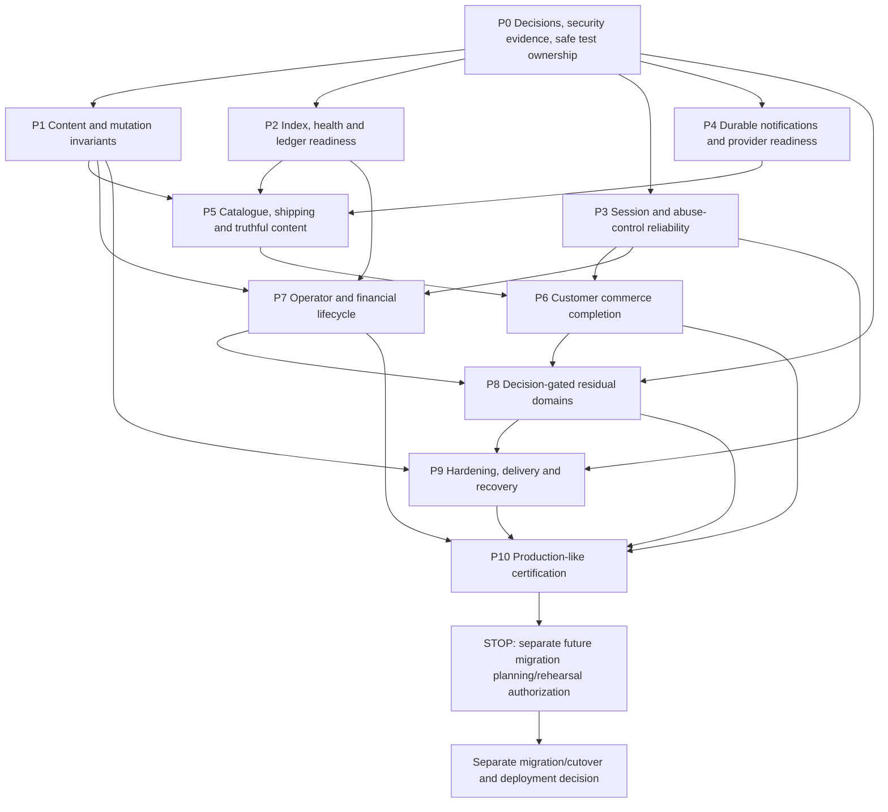

# Nest Electronics — Master Implementation Plan

## Current scope override — 2026-10-07

**G-ENTRY = PASS — CURRENT IMPLEMENTATION SCOPE.** Owner decision: [G_ENTRY_SCOPE_DECISION_2026-10-07.md](G_ENTRY_SCOPE_DECISION_2026-10-07.md). This section takes precedence over conflicting historical entry/certification dependencies and scope statements below; the plan is otherwise retained, not rewritten.

| Topic | Current disposition |
|---|---|
| Supabase / P0.2 / F31 / E02 | Current launch scope: **OUT OF SCOPE / LEGACY**. Launch dependency: **NO**. G-ENTRY blocker: **NO**. Legacy code untouched; no technical removal claimed; no access/ACL investigation or remediation work required/authorized for this launch. |
| Historical credential rotation / P0.3 / F37 | Current execution blocker: **NO**. Status: **DEFERRED / OUT OF CURRENT EXECUTION GATE**. No provider-state or technical remediation claim. |
| Temporary Mongo / OA-04 | Current G-ENTRY blocker: **NO**. Status: **TEMPORARY DEVELOPMENT ENVIRONMENT**. Final validation: **REQUIRED during production DB preparation/cutover**. |
| Final production database migration | **DEFERRED** until functional completion and separately authorized planning/rehearsal/execution; not performed or authorized here. |

P0 execution and OA-01 recording are complete for this narrowed entry scope; the documented 50/50 safeguard pass remains the evidence baseline. Earlier P0.2/P0.3/OA-04 verification gaps are reclassified, not marked technically completed. OA-01 is CLOSED with explicit inputs still needed by dependent tasks. D01 and other approved launch policies remain unchanged.

Apply this override to §§8–10,11–13,14,32–40 and conditional residual-domain references: Supabase-specific requirements are historical/out-of-current-launch-scope, not hidden dependencies or new remediation tasks. Historical credential evidence is deferred outside current execution. Final production topology, transactions, indexes, backup/recovery, data integrity, connection/security configuration and production-like database certification belong to separately authorized production DB preparation/cutover. Application invariant/index/ledger code work and safe isolated test requirements remain; no test guard may be bypassed. No claim that a temporary environment can run transaction tests is made.

Future commercial/provider/hosting inputs are retained at their actual task/production gates, not invented as global entry blockers. No P1, provisioning, deployment or database operation is authorized by this PASS. Historical BLOCKED statements below describe earlier scope and are superseded for current G-ENTRY.


> **OA-01 decision update — 2026-10-07:** The current owner-attributed launch decisions and D03/D04/D05 ID cross-reference are in [OWNER_DECISIONS_2026-10-07.md](OWNER_DECISIONS_2026-10-07.md). They supersede conflicting historical choices/conditional branches below, including COD-only/gateway alternatives and optional-feature inclusion. Original task descriptions are retained as history; apply the scope-impact section of that record before any separately authorized execution. G-ENTRY remains BLOCKED; this OA-01 pass authorizes no P1 or other action.

Planning date: 6 October 2026. **PLANNING ONLY — no execution authorized by this document.**

Primary source: [AUDIT.md](AUDIT.md), read completely, audited commit `de8a353808c74b3885c2700ab89d756176dcecc7`. Audit SHA-256: `AB22CB270C32123B4A0A534AEB821F43715CA96278E5ADA4C1D726B242541C8C`.

## 1. Executive Summary

This roadmap contains **11 current phases (P0–P10), 57 numbered delivery tasks, 30 launch decisions, and 18 external dependency entries**. Delivery tasks include code, configuration and verification work; these counts do not mean 57 new features. Every F01–F40 finding has a disposition. No finding is declared fixed by this plan.

The current product is **NOT READY** per the audit. Preserve the implemented Nest/Mongo transaction core, active storefront/admin integration, email abstraction, generated contract and existing tests. Close the specific remaining invariants, session failures, database-readiness gaps, provider and operational gaps, and incomplete customer/admin capabilities. Do not rebuild completed foundations.

**Flutter is deferred and has no implementation task. Final database migration/cutover is outside P0–P10.** Functional completion and production-like certification must precede a separate migration plan, rehearsal and authorization. The eventual release sequence is a gated future dependency, not a scheduled migration or permission to alter existing data.

Phase IDs are sequencing labels: **phase P3 is not audit priority P3**. Audit priorities and severities remain unchanged unless a documented decision or new evidence warrants reclassification.

## 2. Current Baseline

Accepted evidence from AUDIT §§1–4,19–20,33:

- [V/C] Next storefront and `/admin` primarily call Nest `/api/v1`; Mongo owns active auth, catalogue, cart, addresses, orders, inventory and most admin data. Supabase still serves blog and legacy coupon/review paths; guest cart/wishlist remain browser-local.
- [T] Three applications build/type-check; 77 selected unit tests pass; 70 OpenAPI paths/91 operations match runtime. This is existing evidence, not work to repeat as a baseline phase. Later checks are regression/release certification of changed code.
- [V] Development Mongo had 14 missing indexes, no shipping rates/media assets, 26 products without images, and 24 stocked products without ledger history. These are dated development observations, not claims about a production database.
- [V/C] Storefront invalid-session render produces 500; blog listing fails; contact simulates sending. F05–F15 identify content, role, media, session, merge and retry weaknesses.
- [C/A] Provider abstractions exist; real mail/media/monitoring/recovery are not certified. Optional domain scope and commercial policies are unresolved.

Repository baseline for this planning turn: HEAD unchanged, tracked/staged diffs empty, pre-existing untracked `AUDIT.md`. No application or external service was run for this plan. The only supplementary inspection was a read-only file listing to identify affected existing modules; notably checkout lives in **`apps/api/src/modules/orders/application/checkout.service.ts`**, not a separate checkout source module.

Evidence labels retain the audit's meaning: [V] observed live, [C] source, [T] executed test, [D] historical documentation, **[A] ASSUMPTION / DECISION REQUIRED**. Future test descriptions below are acceptance requirements, not already-passed evidence. `[VERIFY]` denotes a proposed file/location or contract whose exact name must be chosen during implementation; it does not mean the existing architecture must be rediscovered.

## 3. Planning Rules

1. Only this Markdown file may change now. No source/config/dependency/database/provider/DNS changes, installation, deployment, commit or push.
2. A later authorized phase starts with its entry criteria and ends with retained evidence. It cannot silently add scope or clear a failing gate.
3. Preserve current money units, ownership and transaction guarantees. Extend the established DTO/Server Action/API patterns; do not introduce browser service-role access or independent commerce writers.
4. External actions are separate **EXTERNAL ACCOUNT/CONFIGURATION** work, with named owner, environment and authorization; code readiness is not provider readiness.
5. Future development-data/index corrections must target an explicitly approved development environment and include a dry-run/diff, backups where relevant and narrow rollback. They are not Supabase data migration. No existing customer/product history is disposable by inference.
6. Tests use run-owned isolated databases/provider resources. No unconditional cleanup of a pre-existing scratch database. Never turn verification off to satisfy a production-auth gate.
7. Each task below includes finding IDs, dependencies, affected files/modules, method, tests and objective completion proof. A change to a public contract includes DTO/OpenAPI/client updates in the same delivery; those are not separate baseline projects.
8. Optional-feature decisions must be explicit. Until resolved, dependent branches are blocked; deferral requires coherent disabled/unavailable UI and no unsupported claims, not merely abandoning broken code.
9. Document evidence by release SHA, environment fingerprint with secrets redacted, test command/result, relevant IDs and reviewer. Do not record passwords/tokens/customer PII in the evidence bundle.
10. Task owners below are accountable roles, not invented people. The owner must assign a person before execution. Engineering approach proposals are not assertions about existing implementation.

## 4. Launch Scope

**Required:** secure/reliable current password auth and sessions; truthful catalogue/discovery; guest/auth cart; owned addresses; authoritative quote/order placement; complete approved order/refund operations; staff catalogue/media/inventory/shipping/customer/order/audit operation; real support/policy content; mail/media durability; isolated regression gates; production-like recovery/monitoring.

**Decision-gated:** online gateway, Google, coupons, reviews, campaigns, blog, account-synced wishlist, marketing analytics and carrier/maps automation. These branches are fully identified in P8 and cannot be counted complete until implemented or explicitly excluded. COD refund/accounting and safe treatment of legacy screens are required regardless of online-gateway scope.

**Fixed exclusions:** Flutter; final production data migration/cutover during current phases. Do not reopen either decision. No guest-checkout implementation is introduced; current sign-in-required checkout remains unless separately requested.

No arbitrary about/FAQ/compare pages, microservice rewrite, new carrier, payment provider, warehouse model or marketing platform is presumed necessary.

## 5. Launch Decisions

### LAUNCH DECISIONS

All rows are **[A] ASSUMPTION / DECISION REQUIRED**, owned by the product/store owner with the technical/security/operations role indicated. Record answer, approver, date, launch inclusion and downstream task changes in P0.1. A recommendation is limited to an existing supported path; it is not a new business requirement.

| ID | Question / why it matters | Options; evidence-supported recommendation | Blocks / change by answer |
|---|---|---|---|
| D01 | COD-only or online collection at launch? Determines financial scope. | COD-only, COD+selected gateway. Existing COD minimizes new integration; no gateway is selected. | P7.3, P8.6; gateway adds signed events/refunds/provider certification. |
| D02 | Return/refund/cancellation policy, partial returns, cash collection responsibility? | Approved full-return/manual settlement; partial/refund automation if required. No policy invented. | P7.2–3, P4.3; determines transitions, amounts, authorization and customer promises. |
| D03 | Which governorates/zones are serviceable? | All existing 27 names or explicit supported subset; no unsupported fallback. | P5.2; disabled zones must be rejected before order placement. |
| D04 | What are approved fees, remote-zone and failed-delivery fees? | Signed fee schedule; no guessed seed amounts. | P5.2, P7.3; controls quotes and reconciliation. |
| D05 | Is free shipping enabled, and at what threshold? | Disabled or one global post-discount threshold; current code supports both. | P5.2/P8.1; don't introduce per-zone thresholds without scope change. |
| D06 | Carrier, tracking, dispatch SLA, retries and return-to-origin owner? | Manual contracted workflow or selected API integration. Existing manual model supports the first. | P5.2/P7.4/E07; API automation only if selected. |
| D07 | Google login at launch? Linking/duplicate-email policy? | Defer or build Nest OAuth with explicit linking. No silent account merge. | P8.5/E05; no Supabase-only parallel identity. |
| D08 | Coupons at launch; stacking, caps, expiry/timezone, redemption and cancellation semantics? | Defer or shared Nest coupon engine. Legacy disconnected coupon UI is not a valid third option. | P8.1; pricing/transaction tests grow with selected rules. |
| D09 | Reviews at launch; eligibility, moderation, edits, rating aggregation? | Defer or purchase-linked reviews. Recommendation: never claim verification without evidence. | P8.2/P5.3; determines review authority and UI. |
| D10 | What are campaigns and which are required? | Featured/sale merchandising only; managed banners; scheduled promotions; attribution. No generic marketing suite assumption. | P8.7; approved subset defines editor/schema/scheduler. |
| D11 | Blog retained, replaced or deferred? | Safe single Supabase editorial source temporarily, new Nest/content source with synthetic content, or explicit deferral. | P8.3, P9.1; no historical content transfer now. |
| D12 | Wishlist local-only or account-synced? | Existing local slugs or Nest-owned sync. Local-only is supported today. | P8.4; no duplicate SQL/Mongo writer. |
| D13 | Tax, invoices, price display and net-revenue rules? | Owner-approved policy; qualified business/legal input where necessary. | P7.3/P8.6; tax/invoice implementation only to approved specification. |
| D14 | Mail account, sender/domain, reply-to and required locales? | Existing Resend adapter is supported; alternative needs explicit scope. | P4.1–3/E03; defines DNS, templates and recipients. |
| D15 | Durable media account, retention, sharing and deletion policy? | Existing Cloudinary adapter is supported; memory is development-only. | P1.3–5/P4.4/E04; retention affects destruction/recovery semantics. |
| D16 | Real support recipient/channel and response promise? | Working form to approved destination or truthful direct-contact flow. | P6.4/P5.5; simulation must disappear in either choice. |
| D17 | Who approves privacy/terms/shipping/returns content? | Approved required documents/routes; no invented legal prose. | P5.5/P8.8; blocks public-policy sign-off. |
| D18 | Analytics/Meta/GA scope, consent, attribution window and purchase definition? | Defer; operational metrics only; approved marketing events. | P8.8/E14–16; avoid PII and duplicate conversions. |
| D19 | Backup retention, RPO/RTO and restore ownership? | Explicit business tolerances; no invented numeric target. | P9.7/E01/E10; measured restore must meet signed values. |
| D20 | Hosting region/runtime/ingress and supported release toolchain? | Choose deployment compatible with three apps/Mongo transactions; keep pnpm 9 pin unless separate change approved. | P3.3/P9.5; Node support/security verified at execution, not inferred from old CI. |
| D21 | Production storefront/admin/API domains and ownership? | Approved owned hosts; defaults are not ownership evidence. | P4.1/P4.4/P5.4/P9.5/E08–09. |
| D22 | Opening-stock provenance, salesCount meaning and baseline date? | Approved physical/accounting evidence; synthetic fixture baseline for tests only. | P2.4/P5.3; cannot manufacture ledger history to make checks green. |
| D23 | How are seeded rating/review numbers represented? | Hide unproven claims; replace only with evidence-backed aggregates later. Recommended: no “verified” label without purchase linkage. | P5.3/P8.2; no data deletion now. |
| D24 | Who supplies/approves real product descriptions, images, availability and promises? | Store owner-owned catalogue acceptance set. | P5.3–5; separates test catalogue from production content acceptance. |
| D25 | Is permanent product deletion needed; what retention applies to sold/shared-media products? | Disable destructive capability safely, or implement fenced recoverable destruction. | P1.5; never permanently delete order-referenced products. |
| D26 | Required revocation immediacy for customer access tokens? | Immediate sensitive-operation/version enforcement or explicitly bounded token lifetime. | P3.4; determines lookup/cache policy and tests; staff immediate invalidation preserved. |
| D27 | Who owns legacy grants and historical-secret closure/risk decisions? | Named security/service owner with authoritative evidence. | P0.2–3; lack of access is unresolved, not a clean result. |
| D28 | Residual domain authority and staging/production switch boundaries? | Per-domain single source; Nest for shared commerce; blog choice D11. | P8/P9.1; new development implementations use isolated data, never dual-write/backfill. |
| D29 | Capacity/SLOs and single vs multi-instance topology? | Signed traffic/error/latency targets and topology. | P3.3/P9.2/P9.5–7/P10.4; dictates distributed limiter/cache proof. |
| D30 | Which transactional status/admin notifications and retention/replay policy? | Verification/reset/confirmation required; approve shipment/delivery/cancel/return/admin alert matrix. | P4.2–3/P9.6; delivery failures must be visible, not silent. |

## 6. Architecture Target State

```text
Browser → Next storefront / Next /admin
           └─ server-only clients + Server Actions / authorized route handlers
                 └─ Nest API → Mongo transactional business authority
                      ├─ durable notification dispatch → approved mail provider
                      ├─ coordinated media lifecycle → durable cloud storage/CDN
                      └─ approved payment/carrier adapters only if in scope

Guest cart / local-only wishlist → browser state with explicit merge semantics
Retained editorial source → one approved content adapter, never a commerce writer
```

This is a code/authority target for development and certification. It does not transfer existing Supabase data. If a new residual domain implementation is included, exercise it with run-owned synthetic data until a later separately authorized data transition. Do not expose simultaneous old/new writable domains to users.

Keep the monorepo and current API contracts where compatible; additions must be named as new contracts during their task design. No Flutter client, distributed microservice rewrite or new database technology is planned.

## 7. Authority Boundaries

| Domain | Single active authority / writes | Boundary and retirement condition |
|---|---|---|
| Auth/users/addresses | Nest + Mongo; Next cookie/session handlers own browser cookies | Supabase identity never substitutes for Nest subject; customer/staff ownership enforced in API. |
| Catalogue/taxonomy/prices | Nest + Mongo | Next projects data; denormalization/redirect/cache updates follow one consistency contract. |
| Inventory | Mongo product counters and event ledger under one transaction protocol | Reconcile all product IDs plus orphan event IDs; seeded counters require provenance. |
| Cart/orders/shipping/refunds | Nest + Mongo | Browser never supplies authoritative totals; payment/carrier responses are verified external evidence, not unrestricted writers. |
| Media | Mongo reference/lifecycle state + provider object | Database deletion claim excludes new retain operations; remote side effects occur after durable state transition. |
| Audit/notifications | Durable records associated with committed action | External delivery retries cannot duplicate commerce transitions. |
| Coupons/reviews if included | Nest domain contracts and Mongo in isolated development | No reuse of raw Supabase anon writes under Nest identity. Legacy data remains untouched until separate transition. |
| Blog | D11-selected editorial authority | Safe read-only legacy adapter is allowed; no implicit two-way synchronization. |
| Wishlist | D12-selected local state or Nest persistence | No parallel legacy wishlist action and new account writer. |
| Marketing | D10/D18-scoped configuration/events | Tracking never controls price/order/payment truth. |

For a deferred legacy feature, server routes/actions must become safely unavailable as well as hidden in navigation. For included features, switching development/test adapters is code completion, not authorization to switch production sources.

## 8. Dependency Graph



The graph is a **roll-up of task dependencies**, not a rule that every upstream phase must fully exit before any downstream task starts. Exact task prerequisites in §10 govern. In particular, P5 needs P4.4, not P4.3: status notifications P4.3 integrate after P7.2–3, avoiding a circular phase dependency. Customer verification needs P4.1–2. External account preparation E01–E18 can proceed after the relevant decision under later authorization. P4.4 requires P1.3–5 before destructive provider tests; P4.2 follows P1.6's durability contract. P9.4 CI, P9.5 environment packaging, P9.6 telemetry and P9.7 recovery can start before P8 exits, but cannot certify the final release until all included code is integrated.

Blocking decisions: D02/D03–06/D14–17/D19–29 for their named tasks. Verification-only blockers: P0.2/F31, P0.3/F37 and all P10 gates. No dependency requires running a final migration in order to complete current code or tests.

## 9. Phase Plan

All phase tasks are detailed in §10. “Exit” requires reviewed evidence, not just merged code. Phase owners: P0 product/security/test leads; P1–3 backend/security leads; P4 backend/operations; P5–8 full-stack/product; P9 platform; P10 QA/security/release owner.

| Phase / objective and reason | Entry / dependencies | Tasks / affected modules | Tests and acceptance / exit gate | Risks / external dependencies / production block | Complexity engineering / external / risk |
|---|---|---|---|---|---|
| **P0 — Decisions and bounded safety gates.** Resolve actual unknowns; enable safe regressions, not another audit. | Audit accepted; no implementation starts without later authorization. | P0.1–4; decision record, SQL/secret evidence, existing test setup. | Decisions needed by started work signed; F31/F37 evidence or explicit unresolved block; harness refuses non-owned DB. Exit G-ENTRY. | Access delays, destructive test cleanup; E01/E02/account owner. Yes. | M / L / HIGH |
| **P1 — Security and shared mutation invariants.** Remove XSS, global-role and media/product races; durable audit. | P0.4 for integration; D15/D25/D27; scoped work may proceed while unrelated decisions pending. | P1.1–6; content sinks, users, media, catalog, orders, audit. | Deterministic adversarial tests pass, no unauthorized/lost destructive mutation. Exit G-INVARIANTS. | Write skew, remote side effects; provider mocks first. Yes. | XL / M / HIGH |
| **P2 — Database and ledger readiness.** Correct actual missing constraints and false assurance. | P0.4; target-specific future DB authorization; D22 for baseline records. | P2.1–4; database scripts/health/inventory/seeds. | Exact index diff reviewed; unhealthy failures stay red; zero-ledger/orphan cases reported; approved dev evidence. Exit G-DATA. | Unique conflicts/TTL removal/data provenance; E01. Yes. | L / M / HIGH |
| **P3 — Sessions and abuse controls.** Make existing auth reliable through Next and deployment topology. | P0.4, D20/D26/D29; P2 indexes for integrated tests. | P3.1–5; both clients/session/proxy, auth guards/services. | Renew/cross-tab/replay/logout/reset/limits tests pass; no render writes. Exit G-AUTH. | Replay weakening, spoofed IP, distributed refresh; E10 ingress. Yes. | L / M / HIGH |
| **P4 — Provider-backed durable communication.** Make existing abstractions operational; add missing status delivery. | D14/D15/D21/D30; P1.6 for queue contract; P1.3–5 before media deletion certification. | P4.1–4; notifications/templates/provider config/media helpers. | Controlled receipt, bounded retry/dedup and real safe media round trip. Exit G-PROVIDERS subset. | Provider limits, domain verification, secrets; E03/E04/E08/E09. Yes. | L / L / HIGH |
| **P5 — Operable catalogue/shipping/content.** Turn seed shell into accurate store data and projections. | P1/P2 core; P4.4 for real media; D03–06/D17/D22–24. | P5.1–5; catalog/fulfilment/SEO/storefront policies. | No lost catalogue writes, approved supported rates, truthful content, SEO round trip. Exit G-CATALOGUE. | Unsafe bulk writes, stale caches, misleading promises; catalogue owner/carrier. Yes. | L / L / HIGH |
| **P6 — Complete customer journey.** Fix merge/retry/truncation/contact and failure states. | P3; P5.2 for checkout; P4 for delivery; component work can start earlier. | P6.1–5; cart/orders/checkout/contact/account. | Clean and returning customer E2E, multi-tab merge, post-TTL retry, pagination/error states. Exit G-CUSTOMER. | Accidental double-add/order, lost pending cart; E03 support channel. Yes. | L / M / HIGH |
| **P7 — Complete operator lifecycle.** Missing customer controls, cancel, refunds and coherent administration. | P1/P2/P3; D01/D02/D13; P5 shipping/catalogue. | P7.1–4; users/orders/revenue/admin components. | Role matrix, cancel/ship/return races, financial reconciliation, real admin browser flow. Exit G-ADMIN. | Financial policy, inventory double-restoration; carrier/cash operations. Yes. | XL / L / HIGH |
| **P8 — Resolve residual and selected domains.** No broken legacy feature left exposed. | D07–12/D18/D28; shared P1–7 contracts stable for included commerce additions. | P8.1–8; conditional new domains plus legacy callers. | Each branch implemented with contract/UI tests or signed deferral with safe removal from active paths. Exit G-SCOPE. | Scope creep/dual authority/provider integration; E02/E05–07/E14–17. Yes for decisions and selected features. | XL conditional / XL conditional / HIGH |
| **P9 — Release hardening and recovery.** Close CI, topology, observability, performance and maintainability gaps. | Respective P1–8 interfaces; D19–21/D29; early platform branches allowed. | P9.1–7; clients/config/workflows/docs/platform. | Fresh browser CI, bounded dependency behavior, ingress/backup/restore/alerts demonstrated. Exit G-OPERATIONS. | Public exposure, stale artifacts, untested restoration; E01/E08–13/E18. Yes. | XL / L / HIGH |
| **P10 — Certify the integrated candidate.** Evidence against audit DoD, not a new baseline. | All included P0–9 exits; no unresolved safety prerequisite; isolated production-like environment. | P10.1–5; test/evidence/release artifacts. | Full suites/provider/browser/security/recovery evidence tied to one SHA; all gates pass. Exit G-CANDIDATE; stop before migration. | False positives/mock bypass, evidence staleness; all required external owners. Yes. | L / L / HIGH |

Effort XS/S/M/L/XL is relative complexity, not calendar duration. External complexity is independent of engineering size; no hour estimates are asserted.

## 10. Detailed Task Breakdown

Task classifications: **FIX, BUILD, CONFIGURATION, VERIFICATION, BUSINESS DECISION, DEFERRED**. CODE and EXTERNAL explicitly separate execution surfaces. Each task's proof must also satisfy its phase exit. New files/contracts mentioned as proposals are `[VERIFY]`; existing directories are real. Regression tests should target outcomes/invariants rather than mirror implementations.

### P0.1 — Lock launch decisions and per-domain authority

**BUSINESS DECISION / S; addresses F08,F12,F16,F20,F22,F24,F26,F28,F29,F34,F38,F40.** Dependencies: none beyond this plan. Root cause: optional domains and operating policies are unresolved. Record D01–D30, accountable owners and include/defer outcomes; describe development/staging authority switches separately from production transition. Files: future decision record under existing `docs/` `[VERIFY filename]`; this plan remains the reference. Verification: every included branch has a policy and owner; deferred UI/action behavior specified; Flutter/migration remain excluded. Acceptance: no task depends on an implicit commercial rule. Risk: reducing launch scope without consent; unanswered decisions stay blocked.

### P0.2 — Close the live Supabase privilege uncertainty

**VERIFICATION, conditional FIX / M; addresses F31,F08.** Dependencies: D27/D28, authorized read-only account access E02. Root cause: dangerous SECURITY DEFINER bodies/grants are snapshot evidence only. Obtain current function definitions, execute ACLs, policies and deployment identifiers without calling mutation RPCs. Compare the specifically identified order/stock functions to `docs/db/functions.sql`; if exposed, require a separately reviewed least-privilege correction before release, without changing rows or migrating data. Files: SQL snapshot/evidence under `docs/db`; application legacy callers under admin/storefront `lib/supabase.ts`. Tests/proof: role/ownership denials in a disposable SQL test environment and authoritative current grant export. Acceptance: live exposure ruled out or remediated and verified; a 401 or inaccessible account is not closure. Risk: changing privileges may break residual features; reconcile with P8 first.

### P0.3 — Obtain historical-credential revocation evidence

**VERIFICATION / S; addresses F37.** Dependencies: D27, credential owner. EXTERNAL task: obtain provider/admin revocation evidence identifying the historical key by safe fingerprint, not full secret; rotate only under separate authorization if still valid. CODE evidence: preserve `SECURITY.md` and `scripts/scan-secrets.mjs` allowlist rationale with explicit scope/expiry of exceptions. Tests: existing scanner/canaries and safe owner evidence; do not probe a secret against arbitrary services. Acceptance: the credential is demonstrably revoked and current credentials cannot be recovered from public artifacts; unavailable evidence blocks gate. Risk: scanner green is not revocation proof.

### P0.4 — Make test resource ownership safe enough for the missing regressions

**FIX / M; addresses F32,F36.** Dependencies: none; no real service credentials required. Files: `apps/api/test/setup/{scratch-database,prepare-scratch-database,assert-scratch-database-is-clean}.ts`, existing Jest/Playwright setup `[VERIFY configuration file names]`. Replace fixed-name destructive fallback with run-owned isolated replica-set resources/ownership marker and explicit allowlist; refuse any unowned existing database, even if its name resembles scratch. Keep email mocked by default and Cloudinary opt-in. Tests: wrong URI, production-like name, reused marker, crash cleanup, concurrent runners; cleanup touches only resources created by run. Proof: safe refusal tests and independent two-run isolation. Risk: adopting random names without updating existing guard code is insufficient; preserve transaction topology.

### P1.1 — Close stored HTML and JSON-LD execution paths

**FIX / M; addresses F05,F35.** Dependencies: P0.4; D11 for retained blog behavior. Files: `apps/storefront/src/app/products/[slug]/page.tsx`, `app/blog/[slug]/page.tsx`, `components/blog/BlogContent.tsx`. Use a common safe JSON-for-script serialization boundary escaping script-breaking characters; sanitize retained article HTML with an explicitly approved element/attribute/URL policy on a trusted rendering boundary. Add a compatible CSP as defense in depth, not a substitute; new helper/config location `[VERIFY]`. Tests: script terminators, SVG/event attributes, javascript URLs, malformed markup and valid rich content; real browser proves no execution while JSON-LD still parses. Acceptance: no controlled payload executes in product/blog contexts and functionality remains. Risk: sanitizer/CSP breaking images/Next scripts; test production build behavior.

### P1.2 — Preserve at least one SUPER_ADMIN under concurrent changes

**FIX / M; addresses F06,F19.** Dependencies: P0.4. Files: `apps/api/src/modules/users/application/customers-admin.service.ts`, user repository/schema, `test/users/admin-customers.spec.ts`. Replace count-then-write with an invariant-preserving serialized operation: e.g. a shared transactional guard record touched by every privilege removal, with retry and count/check inside that serialization. A transaction over distinct user documents alone permits write skew and is not sufficient. Keep self-change prohibitions, current auth/version checks and audit. Tests: two admins target each other for demotion/delete, mixed delete/demote, retry/crash; one remains active. Acceptance: every successful interleaving preserves >=1 SUPER_ADMIN and unauthorized attempts fail. Risk: bootstrap/guard recovery and contention; define initial provisioning safely.

### P1.3 — Fence media destruction against attachment

**FIX / L; addresses F07.** Dependencies: P0.4, D15. Files: `modules/media/application/media.service.ts`, `infrastructure/repositories/media-asset.repository.ts`, `schemas/media-asset.schema.ts`, `catalog/application/product-image.service.ts`. Introduce a durable deletion claim/state using conditional zero-reference update; retain/attach must reject or conflict with claimed/deleted assets. Commit claim before remote destruction; finalize after provider success; retry recoverably after timeout/crash. Do not call Cloudinary within a retrying Mongo transaction. Tests: barrier-controlled zero-ref check versus attach, provider timeout/success-before-crash, repeated delete, shared image. Acceptance: no referenced asset is destroyed; unresolved deletion is visible/retryable. Risk: stranded claims; define recovery/reconciliation state without automatically deleting unknown assets.

### P1.4 — Make image arrangement conditional on the image set/version

**FIX / M; addresses F09.** Dependencies: P1.3 protocol, P0.4. Files: `modules/catalog/application/product-image.service.ts`, product repository/schema, `test/catalog/product-images.spec.ts`. Replace stale whole-array write with a conditional version/set update participating in the same mutation protocol as attach/detach; conflict must return explicit retryable feedback or safely reload/revalidate. Do not recalculate refcounts as an unrelated patch. Tests: arrange vs attach/detach, two arrangements, primary uniqueness, deleted asset, stale admin form. Proof: final set/reference counts agree and at most one primary image remains. Risk: losing legitimate alt/order edits; preserve metadata on retry.

### P1.5 — Fence permanent product deletion against checkout and partial media failure

**FIX / L; addresses F10,F07,F09.** Dependencies: P1.3–4, D25, P0.4. Files: `catalog/application/product-admin.service.ts`, `product-image.service.ts`, `orders/application/checkout.service.ts`, product/order repositories. If deletion is retained, use a shared product lifecycle fence that checkout's conditional stock write also respects; require order-reference validation inside the fenced transaction and durable one-time media-release intent. Remote deletion follows P1.3 after commit. If D25 defers permanent deletion, disable API capability and UI coherently while retaining safe soft-delete. Tests: checkout vs deletion, cancellation/return, shared assets, provider crash and repeated request. Acceptance: no order references a product destroyed by this race, no duplicate reference decrement, recovery is deterministic. Risk: simply checking inactive status before deletion is not a concurrency fence.

### P1.6 — Make staff audit evidence durable with domain writes

**FIX/BUILD / L; addresses F27,F25.** Dependencies: P0.4. Files: `modules/audit/application/audit.service.ts`, audit schema/domain, users/catalog/orders/inventory application services, admin `lib/audit/log-action.ts`. Define a common durable event contract: append audit event or durable audit intent in the domain transaction; for external side effects record initiation/outcome with stable operation ID. Preserve redaction and actor attribution. Residual Supabase operations cannot silently write Mongo IDs into SQL UUID fields; route their audit through the selected authority or disable that mutation pending P8. Tests: audit storage failure, commit failure, process crash, replay, secret redaction. Acceptance: every successful privileged mutation has durable evidence or intent, exactly once per operation; failed attempts distinguish outcomes. Risk: increased coupling/availability; explicit fail-closed versus durable-intent behavior per action.

### P2.1 — Make declared index readiness safely reproducible

**CONFIGURATION/FIX / M; addresses F02.** Dependencies: P0.4; later explicit target approval for existing development DB. Files: `apps/api/src/database/sync-indexes.ts`, affected module schemas, `test/infrastructure/index-health.spec.ts`. Produce reviewed desired-versus-actual index diff covering the audit's 14 missing indexes; preflight unique conflicts and TTL retention before any future application. Prefer bounded explicit creation/correction; never blindly drop all unexpected indexes. Exercise on isolated database first. Tests: duplicates block unique build, idempotent second run, TTL semantics/retention, unrelated indexes preserved. Acceptance: approved dev target and isolated candidate have all required constraints with recorded index output. Risk: index builds/TTL may alter availability or expire data; no migration/data deletion implied.

### P2.2 — Fail readiness closed when index inspection fails

**FIX / S; addresses F04,F34.** Dependencies: P0.4. Files: `apps/api/src/database/index-health.service.ts`, health module, `test/infrastructure/index-health.spec.ts`. Return a distinct inspection-failed state instead of empty missing list; health must return non-ready on permission errors/timeouts while distinguishing missing index from unavailable inspection. Bound probe work; redact internal errors. Tests: ping succeeds/diffIndexes throws, partial failures, timeout, healthy/missing indexes. Acceptance: the audit fake-model case returns unhealthy; liveness remains independent. Risk: false readiness flapping; choose documented timeout/retry behavior, not cached false-green.

### P2.3 — Reconcile products with no ledger and orphaned ledger IDs

**FIX / M; addresses F03.** Dependencies: P0.4. Files: `modules/inventory/application/inventory-admin.service.ts`, inventory/product repositories and tests. Drive reconciliation from union of product IDs and ledger IDs, with absent sum=0 and explicit missing-baseline/orphan classification; define checked count before result truncation. Read a consistent snapshot or detect concurrent mutation so a sale is not a false discrepancy. Tests: stocked/no events, zero stock/no events, orphan event, sales/cancel/return interleaving, >limit differences. Acceptance: the audited 24-stocked/no-history shape is flagged, never `checked:0` healthy. Risk: assuming zero sum proves provenance; report baseline status separately.

### P2.4 — Establish approved development ledger provenance without backfilling production

**CONFIGURATION/VERIFICATION / M; addresses F03,F28.** Dependencies: P2.1–3, D22/D24, explicit later dev target approval. Files: `database/seed/{catalog.seed-data,sandbox.seed}.ts`, inventory application/reconciliation; exact new provenance tooling `[VERIFY]`. Give new isolated fixtures paired opening events/counters; prepare a dry-run discrepancy/provenance report for existing development stock. Only approved evidence-backed adjustments/opening events may be applied later, with stable operation ID and audit; do not fabricate sales history or rewrite events to force balance. Tests: replay-safe fixture creation, duplicate import refusal, running balances. Acceptance: run-owned candidate reconciles; existing development discrepancies are resolved by approved records or remain visibly blocked. Risk: confusing demo counts with historical truth; no Supabase data imported.

### P3.1 — Move storefront renewal out of Server Component cookie writes

**FIX / M; addresses F01.** Dependencies: P0.4. Files: storefront `lib/api/{client,session,viewer}.ts`, `proxy.ts`, root layout; admin `app/session/renew/route.ts` is a reference, not blindly copied. Make render reads side-effect-free; perform renewal/cookie writes through an authorized route handler or Server Action, with validated same-origin return path and bounded redirect loop. Handle missing access/present refresh, invalid refresh and expired access distinctly. Tests: audit synthetic cookie reproduction, valid expired access, refresh-only, missing both, protected return URL, malicious redirect. Acceptance: no render cookie exception/500, correct return to checkout or explicit login. Risk: redirect loops/open redirect and stale auth caching.

### P3.2 — Coordinate refresh across concurrent renders/tabs/instances

**FIX / L; addresses F01,F32.** Dependencies: P3.1, existing token service contract. Files: both apps `lib/api/client.ts`/session helpers, storefront `components/cart/GuestCartMerge.tsx` as caller, API auth token/refresh repository. Design one logical refresh per session generation with server-backed coordination if multi-instance; process-only single-flight is insufficient. Preserve stolen-token replay detection; don't simply widen replay acceptance. Decide exact safe duplicate-response handling before changing token semantics. Tests: parallel root/checkout requests, two tabs, response reordering, logout during refresh, actual replay attack. Acceptance: legitimate concurrency retains a usable session without family revocation, stolen reuse still fails. Risk: incorrectly making reusable refresh tokens; security review required.

### P3.3 — Correct trusted client identity and distributed abuse quotas

**FIX/CONFIGURATION / L; addresses F11,F34.** Dependencies: D20/D29, P0.4; P9.5 supplies real ingress proof. Files: API `main.ts`, `modules/auth/guards/app-throttler.guard.ts`, auth controller/decorator, both Next API clients. Define trusted proxy chain and authenticated forwarding boundary; strip/reject spoofable client headers. Enforce independent IP/account and relevant global quotas instead of only tuple keys; share limiter across instances or explicitly constrain topology with validated capacity. Tests: many legitimate users behind Next, email spray, rotating IP/account, spoofed forwarded header, two API instances, provider down. Acceptance: legitimate users do not share the audit's 3/hour egress bucket and documented brute-force quotas hold. Risk: trusting arbitrary X-Forwarded-For or introducing a limiter outage bypass.

### P3.4 — Make customer revocation semantics explicit and enforced

**FIX/VERIFICATION / M; addresses F12.** Dependencies: D26, P3.1–2, P0.4. Files: API auth JWT/roles guards, credential repository/token service, cart/users/orders protected boundaries. Implement agreed token-version/disabled checks for protected operations, or document/test a consciously accepted bounded lifetime where appropriate; never relax immediate staff enforcement. Tests: logout-all/reset/disable/role change against already issued tokens, expiry, refresh denial and multi-instance caches. Acceptance: observed behavior matches approved revocation policy for every sensitive endpoint; no accidental stale-admin access. Risk: new hot-path DB reads; use bounded invalidation only with proof.

### P3.5 — Consume verification challenge atomically

**FIX / M; addresses F13.** Dependencies: P0.4. Files: `modules/auth/application/email-verification.service.ts`, `infrastructure/repositories/credential.repository.ts`. Final update must match user, token hash, expiry and unverified state, consume token in same atomic write; coordinate resend so superseded tokens cannot win after replacement. Preserve neutral/expired/consumed frontend messages. Tests: simultaneous verify, resend vs verify, expiry boundary, disabled account, retry. Acceptance: exactly one successful consume for a challenge; superseded/expired token never verifies. Risk: ordering legitimate resend/verify; define outcome by atomic winner.

### P4.1 — Configure and certify actual transactional email

**CONFIGURATION/VERIFICATION / M; addresses F24.** Dependencies: D14/D21, E03/E08/E09, P3.5. CODE: existing notifications adapter/environment schema/templates, correct link origins and startup rejection of console in production. EXTERNAL: owner supplies scoped key, verified sender/domain and DNS authentication under later authorization. Tests: controlled inbox register→verify and forgot→reset with normal verification/rate settings; assert provider acceptance plus inbox receipt, sender, links and expiry. Acceptance: evidence records receipt and usable links, no secret leakage. Risk: provider acceptance is not delivery; test bounce/invalid sender. No new abstraction task.

### P4.2 — Make notification dispatch durable and replay-safe

**BUILD / L; addresses F25,F27.** Dependencies: P1.6, P0.4; contract coordinated with P7.2–3. Files: `modules/notifications/application/notifications.service.ts`, orders/auth callers; new outbox/worker location `[VERIFY]`. Persist intent atomically with committed state where required; worker uses stable event/provider idempotency keys, bounded retries/backoff, terminal failure visibility and operator replay. Protect challenge-token secrets at rest/in logs and invalidate obsolete queued challenge messages. Tests: crash after commit/before send, provider accept then timeout, worker duplicate delivery, old verification token, prolonged outage. Acceptance: no lost committed notification intent and no duplicate business transition; external mail duplicates bounded/detected by provider contract, not impossible exactly-once claims. Risk: worker lifecycle/retention/security.

### P4.3 — Add approved status and operator notification events

**BUILD / M; addresses F25,F21,F22.** Dependencies: D30, P4.2, P7.2–3 event contracts. Files: order lifecycle service, notifications data types and `apps/api/src/templates/email/en` (new template names `[VERIFY]`). Emit approved shipment/delivery/cancel/return/refund events with immutable event IDs, locale and safe customer projection; add only approved admin alerts. Tests: each accepted transition produces one intent, failed/replayed transition produces none, template amounts/status/links correct. Acceptance: selected status matrix reaches controlled recipients with no internal notes/PII leakage. Risk: sending “refunded” before financial confirmation.

### P4.4 — Make Cloudinary configuration coherent end to end

**CONFIGURATION/VERIFICATION / M; addresses F28,F07,F09,F10.** Dependencies: D15/D21, P1.3–5, E04. CODE: existing media provider/config and both apps `lib/images.ts`/Next image configuration; set/validate required server and public cloud-name components consistently. EXTERNAL: separate controlled test account/folder, scoped credentials and retention policy. Tests: actual upload→attach→optimized storefront image→replace/detach→safe deletion; restart application to prove persistence; invalid formats/oversize still rejected. Acceptance: real fetched pixels and durable ledger/provider agreement, with no placeholder/interception substituting for proof. Risk: deleting shared/production assets; tests use owned resources only.

### P5.1 — Make catalogue edits, redirects and caches coherent

**FIX / L; addresses F23.** Dependencies: P1.4–5, P2.1, D29. Files: `modules/catalog/application` product/category/brand services and repositories, slug redirects/cache paths `[VERIFY exact helper]`. Add version-aware updates and an explicit atomic or durable propagation protocol for taxonomy snapshots/slug redirects. Ensure failed rename cannot silently strand old URL. Use shared invalidation/versioning or explicitly bounded cache behavior across chosen instance topology. Tests: simultaneous pricing edits, rename crash, descendant category move, brand update, two-instance reads. Acceptance: conflict surfaced instead of silent lost update; projections/redirects converge within agreed bound. Risk: huge taxonomy transactions; batchable durable propagation must expose pending state.

### P5.2 — Complete shipping rate initialization and operational editing

**FIX/CONFIGURATION / M; addresses F16,F28.** Dependencies: D03–06, P2.1, P0.4. Files: `database/seed/{shipping-seed,shipping.seed-data}.ts`, fulfilment service/admin service/controllers, admin settings page. Replace guessed seed assumptions with an approved complete configuration workflow; explicit validation and dry-run; don't force creation through an update-only editor. Provide honest missing/unsupported-zone feedback and rate coverage readiness. Keep one global post-discount threshold and fail missing row even when free threshold met. Tests: all supported zones, missing/unsupported, threshold below/equal/above, changed fee at checkout, editor errors. Acceptance: isolated candidate and explicitly approved dev data support every accepted address; no silent zero fee. Risk: fee changes affect quotes; order snapshot remains immutable. No data touched during planning.

### P5.3 — Replace misleading demo presentation with approved catalogue content

**FIX/CONFIGURATION / M; addresses F28,F38,F03.** Dependencies: D22–24, P2.4, P4.4. Files: storefront product page/cards, `database/seed/catalog.seed-data.ts`, catalogue admin UI. Remove unsupported “verified reviews” claims immediately in later code work; display ratings only with defined provenance. Build a reviewed content acceptance set for development/staging using supplied product images/text and truthful stock; do not copy production/Supabase records now. Tests: no seed count yields verified badge, missing image/stock fallback truthful, price units and primary image correct. Acceptance: approved content checklist and no unsubstantiated claims. Risk: mistaken bulk deletion of seed/historical rows; any future data change is separate and narrow.

### P5.4 — Connect editable SEO fields and correct search artifacts

**FIX / M; addresses F35,F05.** Dependencies: P1.1, P5.1, D11/D21. Files: catalog public projection/DTO, storefront product/category/brand metadata pages, `app/sitemap.ts`, `app/robots.ts` `[VERIFY filenames if route-based]`. Carry approved SEO fields to public DTO and metadata with fallbacks; omit auth/search/non-indexable pages; use real modified timestamps; paginate/split sitemap beyond existing ceiling; include retained blog only via chosen authority. Tests: admin edit→public metadata round trip, canonical host, safe structured data/money, >10k synthetic catalogue, no private URLs. Acceptance: parseable sitemap/schema and owner-verified domain configuration; Search Console evidence external if used. Risk: accidentally indexing staging/private pages.

### P5.5 — Align support, legal and delivery promises with approved policy

**BUILD/FIX / M; addresses F28,F17.** Dependencies: D02–06/D16–17/D24. Files: storefront `app/contact/page.tsx`, chrome/auth/product delivery copy and approved new legal routes `[VERIFY names]`. Replace placeholder phone/service claims with approved content; publish required policy pages and links without inventing legal terms. Ensure unsupported delivery promises disappear in both shared chrome and auth panels. Tests: link checks, policy route availability, copy matching zone/fee/return policy, mobile reading/navigation. Acceptance: owner-signed content and zero promised broken routes. Risk: treating engineering text as legal approval.

### P6.1 — Make guest-cart merge a server-idempotent operation

**FIX/BUILD / L; addresses F14.** Dependencies: P3.1–2, P2.1, P0.4. Files: storefront `lib/cart/merge-guest-cart.ts`, `components/cart/GuestCartMerge.tsx`, API cart service/repository/controller/DTO. Introduce an explicit merge contract `[VERIFY route]` with user-bound operation ID and immutable input hash; apply stock/quantity normalization once in transaction/atomic protocol. Keep pending local state until acknowledgement of that operation; cross-tab retries reuse ID, not additive reconstruction. Tests: two tabs, reconnect, partial timeout, changed guest plan, another user's ID, clamping/unavailable product. Acceptance: intended quantity applied once; failures retain recoverable guest data. Risk: local-only lock insufficient; operation identity lifetime must be explicit.

### P6.2 — Preserve placement retry semantics beyond idempotency TTL

**FIX / M; addresses F15.** Dependencies: P2.1, P0.4; coordinate P7.3/P8.1/6. Files: orders checkout service, idempotency/order repositories/schemas and request DTO. Persist a durable request fingerprint with order result; resolve owner/key/hash before mutable-cart validation on replay. Specify behavior for older orders lacking fingerprint without inventing one. Tests: expired coordination record, empty/changed cart, same key different address/note, another user, simultaneous retry, lost response. Acceptance: replay returns original or explicit conflict consistently; exactly one order/stock event/notification intent. Risk: incompatible retry semantics for legacy records; document safe conflict path.

### P6.3 — Expose complete category, brand and customer order pagination

**FIX / S; addresses F18.** Dependencies: existing list APIs, P3.1 for authenticated history. Files: storefront `app/categories/[slug]/page.tsx`, `app/brands/[slug]/page.tsx`, `app/account/orders/page.tsx`. Parse bounded page/cursor parameters, preserve filters and canonical behavior, expose next/previous/empty/error states using API metadata. Tests: >24 category/brand products and >20 owned orders, last/invalid page, filter change and cross-user isolation. Acceptance: all eligible records reachable without duplicates/skips under documented ordering. Risk: deep page links/SEO; retain stable sort.

### P6.4 — Replace simulated contact success with a real outcome

**FIX/BUILD / M; addresses F17.** Dependencies: D16, P5.5, P4.2 if form delivery selected. Files: storefront contact page/components; new Nest support contract `[VERIFY]` only if approved. Use validated rate-limited server submission to approved destination with receipt/failure semantics, or replace form with truthful direct contact. Tests: controlled receipt, spam/rate limits, invalid input, provider outage, retry and accessibility. Acceptance: success appears only after durable acceptance; never timer-only acknowledgement. Risk: open relay/PII retention; do not email arbitrary user-supplied recipients.

### P6.5 — Close customer journey failure and responsive states

**FIX/VERIFICATION / M; addresses F30,F32,F01,F28.** Dependencies: P3/P5 and P6.1–4, P7.3 return policy interface. Files: storefront `components/{cart,checkout}`, `app/account`, auth pages and shared error/loading boundaries. Complete observable transitions for empty/stale cart, expired session, no address, missing rate, quote change, submission timeout and unavailable API; expose approved cancellation/return support path. Reuse existing design, not redesign. Tests: mobile/desktop/keyboard, back/reload/double submit, retry after error, zero unexpected console/network failures. Acceptance: user can recover without data loss or false success; protected information not flashed. Risk: suppressing real errors to satisfy browser assertions.

### P7.1 — Connect existing customer lifecycle APIs to guarded admin controls

**BUILD / M; addresses F19,F06,F12.** Dependencies: P1.2/P1.6/P3.4. Files: admin `components/customers/CustomersTable.tsx`, customers page, `lib/api/{endpoints,types}.ts`; API users admin DTO/controller as needed. Add detail and supported role/soft-delete controls with current privilege checks, confirmation and conflict/last-admin errors. Don't label soft delete as reversible disable unless backend supports reversal. Tests: CUSTOMER/ADMIN/SUPER_ADMIN matrix, stale identity, self/last admin, concurrent updates, error feedback. Acceptance: authorized operator can perform supported lifecycle actions through UI and see audit trail. Risk: inventing restore/disable semantics; add only if separately approved.

### P7.2 — Add staff cancellation through the existing state machine

**BUILD / M; addresses F21,F27.** Dependencies: D02, P1.5–6, P2.3, P6.2. Files: orders `admin-orders.controller.ts`, `admin-order-actions.ts`, `order-lifecycle.service.ts`, admin `components/orders/OrderDetail.tsx`. Add documented staff cancel contract `[VERIFY route]` using shared transition/ownership-role/audit/inventory transaction, not direct status patch. Tests: PLACED/CONFIRMED allowed by policy, ship vs cancel, repeated cancel, forbidden role, exactly one stock restoration/event. Acceptance: operator cancellation visible to customer with approved notification and immutable reason/actor. Risk: divergent staff/customer cancellation implementations.

### P7.3 — Implement approved return/refund and cash reconciliation semantics

**BUILD / L; addresses F22,F27.** Dependencies: D01–02/D13, P1.6/P2.3/P6.2. Files: orders lifecycle/schema, `domain/revenue.ts`, dashboard service, admin order detail/API DTOs. Model financial outcome independently from inventory return; record pending/confirmed refund or cash adjustment, amount/reason/actor/external reference with idempotency. Implement partial returns/tax invoices only if approved; do not infer refund from RETURNED or reset PAID blindly. Reflect gross/collected/refunded/net figures consistently. Tests: return before/after delivery, duplicate settlement, partial amounts if selected, failure/retry, concurrent return/refund, no double stock restoration. Acceptance: order totals and cash/refund ledger reconcile to approved examples, customer/admin display truthful state. Risk: new financial policy decisions; unresolved policy blocks task.

### P7.4 — Make admin operations usable and failure-visible end to end

**FIX/VERIFICATION / M; addresses F30,F32,F16,F19,F21,F22,F28.** Dependencies: P5/P7.1–3, P4.4. Files: admin dashboard/catalogue/inventory/settings/orders/audit components and actions. Complete missing unavailable/conflict/empty states, permissions, field feedback and responsive/keyboard behavior for actual workflows; missing rate data must not appear as healthy empty settings. Tests: create/edit/publish product, taxonomy, image replace, stock adjustment, rate update, customer action, fulfilment/refund, audit lookup with API outage/conflict injection. Acceptance: each authorized task completes through UI, unauthorized controls/API denied, no fake zero/success. Risk: UI-only permission checks; API remains enforcement authority.

### P8.1 — Resolve coupons as an included Nest feature or explicit deferral

**BUILD or DEFERRED / L conditional; addresses F20,F08.** Dependencies: D08/D28, P6.2/P7.3. Existing files: admin coupons page/actions, `lib/services.ts`; new API coupon module/contracts `[VERIFY]`. Included branch: server-authoritative validity/discount/usage reservation in order transaction, idempotent redemption/release, guarded admin CRUD and quote/checkout UI under approved stacking/caps/expiry. Deferred branch: disable legacy route/actions/links and show no redeemable offer. Tests: expiry boundaries, concurrency at last use, own/key replay, returns/cancellation rules, cents arithmetic. Acceptance: one active code authority with isolated fixtures; no Supabase backfill/cutover. Risk: discounts invalidating quote/refund semantics.

### P8.2 — Resolve reviews with real verification provenance

**BUILD or DEFERRED / L conditional; addresses F20,F38,F08.** Dependencies: D09/D23/D28, P5.3/P7.3. Files: admin reviews route/actions, storefront product presentation; new Nest review domain `[VERIFY]`. Included: purchase eligibility, ownership, moderation, aggregate update and pagination under approved policy; verified marker derives from actual eligible order link. Deferred: remove disconnected moderation/submission paths and unproven badges; keep honest no-review display. Tests: nonbuyer, duplicate/edited review, moderation/aggregate concurrency, removed/returned purchase policy. Acceptance: displayed count/rating matches source records and no SQL/Mongo competing writer. Risk: importing invented seed reviews; prohibited.

### P8.3 — Resolve blog source and runtime failure coherently

**FIX/BUILD or DEFERRED / M conditional; addresses F08,F05,F40.** Dependencies: D11/D28, P1.1, P0.2 if Supabase retained. Files: storefront `app/blog`, `components/blog`, `lib/services.ts`, `packages/services`/providers blog path `[VERIFY exact class file]`. Retained source: explicit credentials/access and error handling distinguish unavailable from not-found, sanitized content. New source: implement selected adapter/contracts with synthetic content only. Deferred: coherent removed/disabled routes and links with deliberate HTTP/SEO behavior. Tests: source unavailable, article missing, sanitized rich text, pagination/related links and sitemap. Acceptance: no unexplained 500/false 404 and one editorial authority. Risk: interpreting source switch as permission to migrate historical content.

### P8.4 — Make wishlist authority explicit

**FIX/BUILD or DEFERRED expansion / M conditional; addresses F40,F08.** Dependencies: D12/D28, P3.1. Files: storefront wishlist page/state and legacy wishlist actions `[VERIFY exact filename]`, providers/services if referenced. Local branch: keep local slugs, handle unavailable products and remove obsolete active action path. Account-sync branch: new Nest owned list/merge contract with idempotent merge and API-backed UI. Tests: reload, stale slug, logout/account switch, duplicate add, cross-user denial if server-backed. Acceptance: documented local-only limitation or working account sync; no two writers. Risk: unannounced data loss from clearing local state.

### P8.5 — Implement Google only if selected

**BUILD or DEFERRED / L conditional; addresses F26.** Dependencies: D07/D21/D28, P3, E05. Files: existing auth/users modules and storefront auth pages; new callback/provider files/routes `[VERIFY]`. Included: authorization code/state/nonce/PKCE as appropriate to chosen web flow, verified issuer/audience/redirect handling, explicit account linking, secure Nest session issuance. Tests: state/replay/issuer mismatch, duplicate email/link denial, unverified email, cancellation, controlled provider callback. Deferred: no dead button or misleading support claim. Acceptance: one Nest identity and audited linking policy; no Supabase auth fork. Risk: account takeover through email-only auto-linking. No mobile implementation.

### P8.6 — Implement a payment gateway only if selected

**BUILD or DEFERRED / XL conditional; addresses F22.** Dependencies: D01–02/D13, P7.3/P6.2, E06. Files: orders/payment contract boundary `[VERIFY new module]`, checkout/admin UI. Included: server-priced intent, stable idempotency, signature-verified durable webhook inbox, out-of-order/duplicate event handling, refund and settlement reconciliation, customer return URL that does not assert payment truth. Define inventory reservation/release policy before implementation. Tests: timeout/duplicate/forged/out-of-order webhook, payment success with lost redirect, failed/cancelled payment, refund retries and settlement mismatch. Acceptance: sandbox money/order/stock ledger reconciles, no double charge or premature PAID. Deferred: COD-only UI plus P7.3 cash refund workflow. Risk: holding Mongo transactions open across network calls; forbidden approach.

### P8.7 — Build only the approved campaign capability

**BUILD or DEFERRED / L conditional; addresses F29.** Dependencies: D10, P5.1/P8.1 if discounts selected. Files: catalogue featured/sale fields and storefront home; new admin/API campaign structures `[VERIFY]`. Implement approved banners/scheduling/merchandising with validation, timezone, publication and preview; discounts reuse the price engine rather than independent arithmetic. Deferred: existing truthful featured/sale merchandising only, no campaign management claim. Tests: start/end boundary, overlap/priority policy, unauthorized publish, safe links/content. Acceptance: operator-created approved campaign changes visible behavior deterministically. Risk: scope expansion into ad-buying/email automation not requested.

### P8.8 — Implement selected consent-aware marketing events

**BUILD or DEFERRED / M conditional; addresses F29,F35.** Dependencies: D18/D17, P6/P7.3, E14–16. Files: storefront shared event boundary `[VERIFY]`, checkout/order confirmation and approved API attribution fields `[VERIFY]`. Define purchase event at agreed commercial milestone, stable dedup ID, currency/minor-unit conversion, UTM retention and consent behavior; no tokens/addresses/emails in browser analytics payloads. Tests: reload/retry produces one event per agreed semantics, denied consent, ad blocker, failed order, refund event if required. Acceptance: controlled analytics property receives expected event once; telemetry failure never blocks checkout. Deferred: no unapproved pixels or marketing tracking. Risk: confusing placed COD order with collected revenue.

### P9.1 — Retire inactive duplicate paths and update contradictory docs

**FIX / M; addresses F40,F08.** Dependencies: P8 decisions/selected implementations, P5/P7 stable interfaces. Files: `packages/{providers,services,repositories,types}`, storefront `lib/services.ts`/legacy actions, admin `lib/services.ts`, root/child documentation. Use active import evidence to remove or isolate obsolete code in a later authorized change; retain intentional `/shop` redirects and historical SQL evidence with dated labels. Align generated types with their retained authority; do not regenerate SQL types from guesses. Tests: compile/import-boundary assertions and retained blog behavior; no legacy commerce writes reachable. Acceptance: docs describe current authority accurately; no unsupported active duplicate service. Risk: deleting still-used blog providers; no cleanup executed now.

### P9.2 — Bound dependency waits and measure rendering/cache behavior

**FIX/VERIFICATION / M; addresses F33,F23.** Dependencies: P3, P5.1, D29. Files: both `lib/api/client.ts`, storefront layout/viewer, sitemap, media reconciliation. Add explicit abort deadlines and safe retry policy (never blindly retry non-idempotent writes); deduplicate viewer reads per request, separate public-cache from personalized data where supported; bound/paginate large reconciliation/sitemap work. Tests: stalled API, cancellation, personalized cache isolation, multi-instance catalogue invalidation; measure agreed dataset/load against D29. Acceptance: bounded failure and recorded latency/query/bundle evidence, no cross-user cache leakage. Risk: premature caching correctness regression; optimize only measured/proven path.

### P9.3 — Align browser CORS and request-origin protections

**FIX/VERIFICATION / S; addresses F39,F01,F11.** Dependencies: D20/D21, P3.1/P3.3. Files: API `main.ts`, both Next config/proxy/action boundaries. Add needed PUT to explicit allowed methods and test allowed/denied origins with credentials; validate renewal and Server Action origin/redirect behavior behind ingress. Tests: PUT preflight, hostile origin, missing credentials, same-site behavior and production secure cookies. Acceptance: supported direct browser call works without broad wildcard relaxation; cross-origin unauthorized writes rejected. Risk: treating CORS as authentication or broadening cookie scope.

### P9.4 — Add release-fidelity CI gates on the supported pinned toolchain

**FIX/CONFIGURATION / M; addresses F32,F36.** Dependencies: P0.4, D20, changed-contract tasks. Files: existing `.github/workflows`, package manager/engine config only if separately approved, Jest/Playwright configs, API OpenAPI scripts. Extend existing CI, not recreate baseline: run frontend browser suites, fresh production artifacts/no reuse, normal verification/rate settings lane, full API transactions/contracts and dependency advisory/license evidence. Keep fast mocked lane separate from provider-certified lane. Tests: intentional hydration/API/schema failure makes gate red; unsafe DB URI refused; stale build not reused. Acceptance: immutable artifact/SHA and lockfile-controlled install evidence with triaged advisories; no blanket dependency upgrade task. Risk: live provider credentials in PR jobs; use protected opt-in environment.

### P9.5 — Package a production-like environment and ingress without cutting over

**CONFIGURATION/BUILD / L; addresses F34,F36,F11.** Dependencies: D19–21/D29, E01/E08–10; P2.2/P3.3 interfaces. Files: existing app start/build configuration and deployment docs; chosen infrastructure/container files `[VERIFY]`. Specify three app services, exact env schema, secret injection, health/readiness, trusted proxy, TLS/secure cookies, origins, resource/shutdown policies, worker lifecycle and chosen scaling constraints. Provision only separately authorized isolated staging/test environment later, with synthetic data and no production traffic/data switch. Tests: artifact startup, missing-secret fail-fast, rolling restart, two-instance behavior if selected, no public debug/secrets. Acceptance: reproducible candidate environment and rollbackable app artifact; this is not final deployment. Risk: accidentally exposing demo credentials or using production DB.

### P9.6 — Make failures observable and actionable

**BUILD/CONFIGURATION / M; addresses F34,F04,F25,F27.** Dependencies: D29/D30, P2.2/P4.2/P1.6, E11–13. Files: API logging/filter/health paths, both frontend logger/error boundaries, worker telemetry `[VERIFY]`. Add correlation IDs and safe structured events/metrics for readiness, auth abuse, checkout failure, ledger mismatch, audit/outbox backlog, provider failure and refund mismatch; configure log/error sinks and alert routing with ownership. Tests: inject each critical failure, assert redacted searchable signal and delivered actionable alert; simulate sink outage without leaking secrets. Acceptance: an operator can identify failing domain and trace an order operation; alert acknowledgement/runbook evidence. Risk: logging tokens/challenge payloads/PII or noisy alerts hiding incidents.

### P9.7 — Demonstrate backup, restore and application rollback

**CONFIGURATION/VERIFICATION / L; addresses F34,F02,F03,F28.** Dependencies: D19/D15, E01/E04/E10, P9.5, P2/P5 schema state. EXTERNAL: backup/PITR/retention and access configured by owner later. CODE/docs: restore/rollback runbook under `docs/` `[VERIFY]`, compatible version strategy. Restore owned representative Mongo backup into a new isolated target; verify indexes, ledger/order/media references and application operation; exercise previous artifact rollback without dropping newer data. Include retained Supabase/content/media recovery responsibilities. Acceptance: measured RPO/RTO meet signed values; failed restoration alerts; no “backup enabled” substitute. Risk: overwriting live DB or rolling back code to incompatible schema; target identity checks mandatory.

### P10.1 — Certify all API, contract and concurrency regressions

**VERIFICATION / M; addresses F02,F03,F04,F06,F07,F09,F10,F11,F13,F14,F15,F32,F36.** Dependencies: included P1–9 code, P9.4–5. Files: existing `apps/api/test`, new regressions from tasks. Execute unit/integration/concurrency/contract suites against a run-owned replica set, including failure injection and exact generated OpenAPI artifact comparison. Acceptance: all required assertions pass with zero unexplained skips; record version/index output/seed provenance and cleanup ownership. Risk: relaxed fixture assumptions; production-like configuration lane must be explicit.

### P10.2 — Certify real customer and admin browser journeys

**VERIFICATION / M; addresses F01,F16,F17,F18,F19,F20,F21,F22,F28,F30,F32,F35,F38.** Dependencies: P10.1, P6/P7/P8 included branches, P9.5. Files: existing frontend E2E suites, added scenarios §27. Run fresh production artifacts at mobile/desktop widths with normal auth settings; verify persisted state through API and record allowed expected errors. Acceptance: all in-scope journeys pass with zero unexpected console/hydration/network failures, truthful content and complete pagination. Risk: UI passing from mocked service responses; prohibit mocks in certification lane except dedicated failure injection.

### P10.3 — Certify approved providers with controlled resources

**VERIFICATION / M; addresses F24,F25,F28,F22,F26,F29.** Dependencies: P4/P8 selected branches, E03–07/E14–16 as applicable. No real financial purchase required: approved sandbox/test accounts and controlled recipients/resources. Prove actual email receipt, persistent optimized image round trip, OAuth if selected, gateway/refund/carrier/analytics evidence where selected. Acceptance: provider receipts/events match persisted business IDs; failures recover, cleanup limited to run-created resources. Risk: accidentally sending to customers/deleting shared media/real charge; explicit environment allowlist.

### P10.4 — Verify security, capacity and recovery on the candidate

**VERIFICATION / L; addresses F05,F06,F11,F12,F13,F31,F33,F34,F37,F39.** Dependencies: P0.2–3, P9.2–3/P9.6–7, P10.1–3. Run scoped XSS/auth/ownership/CSRF/rate-limit checks, current dependency/security evidence and D29 load profile; attach restore/rollback/alert drill evidence for same candidate. Acceptance: no unresolved P0; measured targets met; no live legacy privilege/credential uncertainty hidden by 401. Risk: tests against production data; use isolated environment and authoritative owner exports for historical/live privilege facts.

### P10.5 — Seal the functional-completion evidence and stop at migration boundary

**VERIFICATION / S; addresses F01–F40.** Dependencies: P10.1–4 and all required decisions/gates. Create traceable checklist and evidence manifest under `docs/` `[VERIFY]`, mark each finding resolved/deferred-with-scope/verified with reviewer and exact SHA. Acceptance: §35 measurable DoD satisfied for application/production-like readiness; list remaining future migration/deployment gates explicitly. No final production-readiness claim before those gates. Risk: stale evidence after code/config changes; invalidate affected checks and rerun only impacted gates. **Stop: request a separate later migration-planning authorization; do not execute or schedule it here.**

## 11. F01–F40 Coverage Matrix

All **40/40** have a disposition. None is FALSE/ALREADY RESOLVED on the available evidence. “Planned” is future work; “Business Decision” means an implementation/deferral branch is defined but not selected. Audit severity/priority are preserved in AUDIT §29; this table adds executable disposition rather than reclassifying it.

| Finding | Work classification | Phase / task IDs | Disposition / closure evidence |
|---|---|---|---|
| F01 | FIX | P3.1,P3.2,P10.2 | Planned; invalid/expired/parallel session browser regressions |
| F02 | CONFIGURATION + VERIFICATION | P2.1,P10.1 | Planned; approved exact index diff/constraints and isolated tests |
| F03 | FIX + CONFIGURATION | P2.3,P2.4,P10.1 | Planned; missing-baseline/orphan/concurrent ledger proof |
| F04 | FIX | P2.2,P10.1 | Planned; inspection-error readiness remains red |
| F05 | FIX | P1.1,P10.4 | Planned; content payloads never execute |
| F06 | FIX | P1.2,P7.1,P10.1 | Planned; simultaneous removal leaves an active super-admin |
| F07 | FIX | P1.3,P4.4,P10.1 | Planned; reference/delete race and crash recovery |
| F08 | FIX/BUILD/BUSINESS DECISION | P0.1,P0.2,P8.1–4,P9.1 | Business Decision; each residual authority connected safely or deferred coherently |
| F09 | FIX | P1.4,P10.1 | Planned; image set/ledger consistency on concurrent arrange |
| F10 | FIX/BUSINESS DECISION | P1.5,P10.1 | Planned; fence deletion or safely disable it; no order/reference loss |
| F11 | FIX + CONFIGURATION | P3.3,P9.5,P10.4 | Planned; actual ingress and distributed abuse tests |
| F12 | FIX/VERIFICATION/BUSINESS DECISION | P3.4,P10.4 | Business Decision; revocation policy demonstrated per endpoint |
| F13 | FIX | P3.5,P10.1 | Planned; challenge atomic-consume races |
| F14 | FIX/BUILD | P6.1,P10.1–2 | Planned; one user-bound merge effect across tabs/retries |
| F15 | FIX | P6.2,P10.1 | Planned; post-TTL fingerprint and immutable result proof |
| F16 | CONFIGURATION/FIX/BUSINESS DECISION | P5.2,P10.2 | Planned after D03–06; rate coverage and quote boundaries |
| F17 | FIX/BUILD | P6.4,P5.5,P10.2 | Planned; actual durable contact acceptance or truthful direct channel |
| F18 | FIX | P6.3,P10.2 | Planned; complete reachable records beyond page limits |
| F19 | BUILD | P7.1,P7.4,P10.2 | Planned; guarded customer lifecycle controls |
| F20 | BUILD/BUSINESS DECISION | P8.1,P8.2,P10.2 | Business Decision; integrated coupon/review tests or explicit deferral |
| F21 | BUILD | P7.2,P4.3,P10.2 | Planned; staff cancel lifecycle and stock proof |
| F22 | BUILD/BUSINESS DECISION | P7.3,P8.6,P10.3 | Business Decision for policy/gateway; COD refund correctness remains required |
| F23 | FIX | P5.1,P9.2,P10.1 | Planned; edit conflict/projection/redirect/cache evidence |
| F24 | CONFIGURATION/VERIFICATION | P4.1,P10.3 | Planned; controlled inbox receipt and usable verified-domain links |
| F25 | BUILD | P4.2,P4.3,P9.6,P10.3 | Planned; durable intent/retry and approved status messages |
| F26 | BUILD or DEFERRED | P8.5,P10.3 | Business Decision; Google only if selected; no Flutter work |
| F27 | FIX/BUILD | P1.6,P9.6,P10.1 | Planned; durable audit evidence with successful mutation |
| F28 | CONFIGURATION/BUILD/BUSINESS DECISION | P4.4,P5.2–5,P10.2–3 | Planned with owner content/provider policy approval |
| F29 | BUILD or DEFERRED | P8.7,P8.8,P10.3 | Business Decision; selected marketing capability and no hidden tracking |
| F30 | FIX/VERIFICATION | P6.5,P7.4,P10.2 | Planned; authenticated responsive/keyboard states |
| F31 | VERIFICATION; conditional FIX | P0.2,P10.4 | Verification Gate; authoritative current grants/denial proof |
| F32 | FIX/VERIFICATION | P0.4,P9.4,P10.1–3 | Planned; safe isolation and production-fidelity CI/browser evidence |
| F33 | FIX/VERIFICATION | P9.2,P10.4 | Planned; bounded requests/cache isolation and measured targets |
| F34 | BUILD/CONFIGURATION/VERIFICATION | P2.2,P3.3,P9.5–7,P10.4 | Planned; topology/recovery/alerts evidence |
| F35 | FIX | P5.4,P10.2 | Planned; SEO edit round trip, safe sitemap/indexing |
| F36 | CONFIGURATION/VERIFICATION | P0.4,P9.4,P9.5,P10.1 | Planned; supported pinned toolchain and current advisory evidence |
| F37 | VERIFICATION | P0.3,P10.4 | Verification Gate; owner revocation proof, not scanner alone |
| F38 | FIX/BUSINESS DECISION | P5.3,P8.2,P10.2 | Planned; no seeded “verified” claim without purchase evidence |
| F39 | FIX | P9.3,P10.4 | Planned; allowed PUT preflight and hostile-origin denial |
| F40 | FIX | P8.3–4,P9.1 | Planned; active import boundaries and accurate dated docs |

## 12. External Services Matrix

There are **18 dependency entries**, including conditional services and a build network dependency; this does not mean 18 new paid accounts. Named individuals/accounts are **[A]** until D decisions assign them. All EXTERNAL work requires later authorization; no accounts/APIs/DNS were accessed or changed for this plan.

| ID / service | Purpose / current state (audit) | Required state | Owner/account needed | Configuration surface: CODE versus EXTERNAL | Verification | Blocks |
|---|---|---|---|---|---|---|
| E01 MongoDB/Atlas | Active dev replica set, missing indexes | Isolated test/candidate DB; durable production topology later | Database/platform owner; scoped roles | CODE schema/index/health protocol; EXTERNAL URI/network/backup/PITR | Constraints, transactions, restore, reconciliation | P2,P9.5/7,P10 |
| E02 Supabase residual | Blog/coupons/reviews; anon 401; grants unknown | Authoritative read access and safe retained scope | Supabase project/security owner | CODE residual adapter/disable branch; EXTERNAL key/grants evidence and approved privilege correction | Current grant export; isolated denial tests; retained blog read | P0.2,P8.3; release F31 |
| E03 Resend | Adapter exists; console selected | Verified sender/domain and controlled delivery | Mail/domain owner | CODE env/template/outbox integration; EXTERNAL key/domain/sender/quota | Inbox receipt, bounce/failure/replay | P4.1–3,P10.3 |
| E04 Cloudinary | Adapter exists; memory selected; no images | Durable scoped media environment and retention | Media/account owner | CODE cloud-name/URL/lifecycle configuration; EXTERNAL account/key/test folder | Restart-persistent pixels and safe delete/recovery | P4.4,P5.3,P9.7 |
| E05 Google OAuth | No active flow | Only if D07 includes | OAuth/domain owner | CODE Nest callback/linking; EXTERNAL client/redirect consent settings | Controlled callback/link/replay cases | P8.5 conditional |
| E06 Selected payment gateway | No gateway | Approved sandbox then production credentials if D01 includes | Finance/payment owner | CODE intent/webhook/refund; EXTERNAL merchant onboarding/keys/endpoints | Sandbox charges/refunds/webhook reconciliation | P8.6 conditional |
| E07 Carrier | Manual fields; no API | Contracted manual operating process or selected sandbox | Fulfilment owner | CODE tracking/fees or conditional adapter; EXTERNAL contract/SLA/credentials | Shipment/tracking/return drill; API sandbox if selected | P5.2,P7.4; API conditional |
| E08 DNS | Defaults not ownership proof | Owned approved site/API/mail names | Domain administrator | CODE origins; EXTERNAL records and mail authentication | Resolution, sender-domain evidence | P4.1,P9.5 |
| E09 TLS | Production ingress unverified | Valid certificates/renewal/secure routing | Platform/domain owner | CODE secure cookies/proxy handling; EXTERNAL certificate/ingress settings | HTTPS chain, expiry alert, cookies/HSTS behavior | P9.3/5,P10.4 |
| E10 Hosting | Three apps, proposals only | Candidate environment + eventual supported production service | Platform owner | CODE build/start/worker/health config; EXTERNAL region/secrets/resources/access | Artifact startup/restart/rollback and ingress | P9.5–7 |
| E11 Error tracking | No certified sink | Error capture and incident ownership | Operations owner | CODE redacted exception integration; EXTERNAL project/access/retention | Controlled exception delivered and correlated | P9.6 |
| E12 Logging | Structured local logs | Durable searchable least-privilege logs | Operations/security owner | CODE correlation/redaction; EXTERNAL sink/retention/access | Trace known order flow; log outage/security checks | P9.6 |
| E13 Monitoring/alerting | Health endpoints only | Availability/queue/data-integrity alerts with responder | Operations/on-call owner | CODE metrics/probes; EXTERNAL checks/routes/escalation | Failure injection→alert→acknowledgement | P9.6–7 |
| E14 Analytics governance/platform | No conversion pipeline | Approved events, consent and ownership if selected | Product/privacy owner | CODE event contract; EXTERNAL property/account/retention | Consent and dedup evidence | P8.8 conditional |
| E15 Meta | No integration | Approved Pixel/events target if selected | Marketing/privacy owner | CODE approved consent-aware events; EXTERNAL business/property access | Controlled test events without PII | P8.8 conditional |
| E16 Google Analytics | No integration | Approved property/measurement if selected | Marketing/privacy owner | CODE approved event transport; EXTERNAL property/access | Controlled purchase/currency/refund semantics | P8.8 conditional |
| E17 Maps/geocoding | None | Only if D06/address policy later requires | Product/provider owner | CODE new adapter only after explicit scope; EXTERNAL key/quotas | Selected address cases/privacy | Conditional; no default build task |
| E18 Google Fonts/build network | Audit network-restricted build failed, retry passed | Reproducible font build/delivery strategy | Build/platform owner | CODE approved bundled/cache strategy if needed; EXTERNAL build egress policy | Cold protected-environment build succeeds | P9.4–5 |

## 13. Database Strategy

### Stage A — Current Development Database

P2 is about the already-active Mongo implementation: reviewed index differences, fail-closed readiness, complete reconciliation and approved development provenance. Future execution must distinguish **run-owned isolated data** from existing `nest_electronics_dev` and pre-existing scratch resources. No automatic cleanup/reset/dropDatabase is authorized by this plan. The 14 audited missing indexes are the initial candidate set, not permission to apply a stale diff blindly.

Before an approved development correction: identify target, inspect only affected constraints/conflicts, preserve recovery evidence, show exact intended changes, and refuse unapproved deletion/TTL effects. Existing stock without provenance remains a visible discrepancy until the owner provides evidence. A synthetic opening balance is valid only for clearly synthetic fixtures. Shipping rate initialization is configuration for the accepted geography, not historical-data import.

### Stage B — Functional Completion

Mongo remains active for domains already moved to Nest. Build any approved coupon/review or other Nest domain using new isolated fixtures, DTOs and admin/customer APIs. Remove active dual writers in development code; use explicit environment-specific single-source selection when retained editorial code needs it. An environment must never write both Supabase and Mongo for the same commercial operation.

No customer, order, inventory, review, media or blog historical dataset is transferred. No production source switch, schema demolition or user-ID remapping is performed. Legacy data is preserved for later decisions; code completion can be proven against synthetic fixtures without silently requiring migration.

### Stage C — Final Migration/Cutover (DEFERRED, UNSCHEDULED)

This is a **future gate specification only**, not a migration plan or current phase. It begins only after P10 functional/production-like completion and a separate human authorization to plan/rehearse it. Detailed mappings, scripts, timing and cutover commands must be produced then, not guessed now.

Future prerequisites/evidence:

- Named source/target owners, approved retention and identity/financial mappings, verified backup/restore and immutable release candidate.
- Data validation covering counts, identity uniqueness, references, order money/status/history, stock/event reconciliation, media existence/reference ownership, review provenance and retained content.
- Isolated dry run against authorized copies, repeatability report and reconciliation exceptions resolved without hiding discrepancies.
- Approved rollback strategy identifying write boundary and post-cutover writes; restoring a pre-cutover snapshot is not safe if it loses new orders. Define stop/rollback criteria and recovery owner.
- A single writer at every instant; no ad hoc dual writes. Read-only freeze/traffic control details must be designed in that later plan.
- Explicit migration execution authorization after rehearsal; then target readiness, row/document/reference reconciliation, customer/admin/auth/payment/media checks, and continued post-cutover validation.

No migration date, script, run command, data-copy task or production index execution is included here. P10.5 exits with **migration/deployment still pending**, not a claim of live production readiness.

## 14. Security Plan

P1.1 prevents stored content execution at the sink; P1.2 serializes the global staff invariant; P1.3–5 share one media/product mutation protocol. P3.1–5 close cookie/refresh/revocation/challenge/throttling boundaries. P9.3 verifies real origins/ingress. P0.2 and P0.3 are evidence gates for conditional SQL exposure and historical credentials.

Required security cases: unauthenticated/incorrect-role/cross-user API requests; injected product/article strings; cookie flags/origin/redirect/renewal CSRF behavior; stolen refresh replay; actual two-instance rate limits; disabled-user access under D26; challenge reuse and expiry; log/artifact secret redaction. Do not expose service-role credentials to solve Nest/Supabase identity mismatch.

All new mutation contracts use the existing DTO validation, API authorization/ownership, Server Actions and durable audit patterns. Security changes must preserve valid legitimate flows, not pass by disabling all functionality. A scoped threat review of changed boundaries is required; a new generic whole-repository audit is not.

## 15. Commerce Completion Plan

Retain integer minor-unit pricing, order snapshots, conditional stock decrement and transactional cart clearing. Remaining work is P6.1 merge-once semantics, P6.2 durable retry contract, P5.2 shipping policy/data, P7.2 staff cancellation, P7.3 refunds/cash reporting, and P8.1/6 only if selected.

For each price-affecting change, assert `subtotal - discount + shipping + approved tax = total` using the approved rounding policy and immutable order snapshot. Never accept client-supplied price/stock as authority. Quote changes must be shown before placing an altered commercial intent according to approved UI behavior; quote is not a stock reservation. Online-payment stock reservation rules are D01-dependent and cannot be invented by gateway code.

Concurrency checks must show no negative stock, duplicate order, double inventory restoration, duplicate redemption/refund or provider retry that repeats an order transition. Inventory reconciliation includes zero-history products and orphan events, even if all happy-path writes are transactional.

## 16. Storefront Completion Plan

Use existing routes/components, not a redesign. Required work is P3 sessions; P5 truthful content/SEO/policy; P6 complete paging/cart/contact/error handling; P8 selected features. Keep `/shop` compatibility redirects. Do not add every absent informational route from the audit merely because it is absent.

Customer test data must include no products, unavailable/sold-out products, price change, >24 taxonomy results, >20 orders, no addresses, invalid/missing session, delayed API, and controlled mail failure. Checkout must preserve intent through login, address creation, renewal and retry. Wishlist behavior must state whether it is local-only. Missing shipping configuration is an actionable unavailable state, never free shipping.

Mobile targets: at least 390×844 and 1440×900 (audit comparison), plus one intermediate tablet width selected by QA. Keyboard navigation, focus restoration, visible labels, error announcements and no unexpected horizontal overflow are acceptance evidence; screenshots alone do not establish functioning checkout.

## 17. Admin Completion Plan

P7.1 uses already-existing customer APIs; do not rebuild them unnecessarily. P7.2 extends the same order transition service, not a separate admin status patcher. P7.3 supplies the missing financial workflow. P7.4 covers actual catalogue/category/brand/media/inventory/shipping/order/audit operation and failure states.

Permissions are asserted on API and UI for CUSTOMER, ADMIN and SUPER_ADMIN. Concurrency errors must be intelligible and preserve unsaved input. Missing provider/index/rate/ledger readiness must not be presented as healthy zero/empty data. Retained coupon/review screens become Nest-connected or safely unavailable via P8; an anonymous Supabase write under a Nest admin identity is not acceptable.

Acceptance includes operator-created product visible in storefront, image replacement without shared-asset loss, stock event/history/reconciliation agreement, approved rate change reflected in new quote only, staff cancellation, return/refund evidence and durable audit search. Authenticated mobile operation is verified rather than inferred from CSS.

## 18. Email Plan

Keep the existing provider abstraction and Resend path. P4.1 supplies account/domain/link configuration and real receipt evidence. P4.2 creates durable dispatch semantics, bounded retries and replay/retention. P4.3 adds approved missing status emails. Do not claim these exist because order confirmation exists.

Tests distinguish enqueue success, provider acceptance and inbox delivery. A provider failure never rolls back an already committed order, but must leave visible retryable intent. Verification/reset challenge messages must not leak tokens in logs; queued obsolete challenges must not mislead customers. Local unit tests remain mocked; protected provider certification uses controlled recipients, real verification enabled and no shared production mailbox.

## 19. Media/Cloud Plan

Use one lifecycle protocol for attachment, reordering, destruction and permanent product deletion. A zero-reference read is not authorization to destroy later. A conditional durable deletion claim and attach predicate must conflict; remote calls occur outside retrying Mongo transactions and are reconciled afterward.

P4.4 proves cloud-name/URL/Next optimization configuration and persistence; P5.3 supplies approved real catalogue presentation. Reconciliation must distinguish referenced, claimed, missing, orphaned and provider-only assets without automatically deleting unknown objects. Backup/recovery covers media as well as Mongo references. Test deletion only on run-owned assets and shared-image cases created within the run.

## 20. Shipping Plan

Preserve the existing governorate model and global optional threshold. D03–06 determine supported zones, fees and operating SLA. P5.2 validates a complete approved configuration and makes update-only settings honest when data is absent. A carrier contract/manual process may be sufficient if approved; no carrier API is invented.

Edge cases: missing row, unsupported address, zero fee explicitly approved, threshold equality, coupon reducing eligible subtotal, rate change between quote/place, retry after placement and historical order immutability. Public dispatch/delivery promises must reflect D06; maps/geocoding remains conditional, not a default dependency.

## 21. Payment/Refund Plan

Regardless of D01, P7.3 must distinguish collected COD cash, inventory returned and money refunded. Record who confirmed settlement, amount/reference, pending/failed state and audit. Reporting must define gross versus net against D13, not equate all PAID orders with permanent retained revenue.

If online gateway is included, P8.6 is a conditional extension behind P7.3/P6.2: stable request/event identity, signature verification, durable webhook processing and financial reconciliation. Browser success URLs never establish payment. Use provider sandbox for certification, not real charges. If gateway is deferred, remove online-payment promises and keep complete COD/refund operations. Partial refunds/invoices are implemented only after signed policy, not inferred requirements.

## 22. Coupon/Review Plan

P8.1 and P8.2 explicitly replace the disconnected legacy domain behavior in code if selected, with isolated fixtures and no data transfer. Coupon price rules and redemption uniqueness belong in the same authoritative order protocol. Review eligibility and aggregates derive from approved purchase/moderation records.

If deferred, both server mutations and exposed controls are disabled coherently; hiding a menu is insufficient. F38 is not deferred with reviews: unsupported “verified” claims must be removed regardless of D09. Legacy records remain preserved for future migration decisions.

## 23. Blog/Content Plan

D11 permits a temporarily retained single editorial source, a new development implementation or explicit deferral. P8.3 must distinguish content missing from source unavailable, prevent raw HTML execution and align routes/SEO/navigation. New Nest/content integration uses synthetic or newly approved test content; it does not import historical Supabase articles.

P5.5 supplies owner-approved policy/support/shipping text. Content approval is external business work; engineers verify presentation, routing and safety rather than inventing legal/service commitments.

## 24. Marketing/Analytics Plan

P8.7 scopes campaign management to D10; P8.8 scopes tracking to D18. Existing featured/sale fields remain valid. Do not add Meta/GA simply because their names appear in the audit. If included, events have documented consent, currency, identity minimization, dedup and lifecycle semantics; a placed COD order and collected revenue are different facts.

Business/marketing owners provide account access, approved event definitions and data retention. Automated test traffic uses separate test properties. Telemetry outage/ad blocking must not block buying. Unsupported promotional percentages or tracking claims cannot be retained as placeholders.

## 25. Testing Strategy

Tests are implemented with their owning task, not postponed wholesale to P10. P10 reruns the integrated evidence on a named candidate. Existing baseline/abstraction/cold-check projects are not repeated.

| Class | Primary task coverage | Required proof |
|---|---|---|
| Unit | P1.1,P2.3,P3.5,P5.2,P6.2,P7.3,P8 rules | Money/serialization/policy/state rules and edge cases |
| Integration | P1–7/P8 selected | Real Mongo replica transactions, repository predicates, authorization and rollback |
| Concurrency | P1.2–5,P2.3,P3.2/5,P6.1/2,P7.2/3,P8.1/2/6 | Deterministic barriers + final invariants, not timing-only sleeps |
| Contract | Every new/changed API task; P9.4/P10.1 | DTO validation, error envelopes, OpenAPI/client alignment and browsable artifact |
| Browser E2E | P6.5,P7.4,P10.2 | Real Next UI/session/Server Actions + persisted API state |
| Provider E2E | P4.1/4,P8 selected,P10.3 | Controlled actual service receipt/object/event; mock lane labelled separately |
| Security | P0.2/3,P1,P3,P9.3,P10.4 | Adversarial denial, XSS, replay, origin, abuse, secrets |
| Production-like | P9.4–7/P10 | Supported pinned toolchain, fresh artifacts, isolated DB, normal auth/limits, real test providers |

No numeric coverage percentage substitutes for invariant/journey proof. CI must run API and frontend suites, retain logs/traces with redaction, and fail on unexpected errors or skipped required cases. Approved expected negative-test 4xx responses are enumerated; “zero unexpected errors” does not forbid correctly rejected malicious input.

## 26. Concurrency Test Plan

| Audit finding / owner task | Controlled interleaving | Required final invariant |
|---|---|---|
| F06 / P1.2 | Two super-admins each delete/demote the other after shared start; mixed operations and transient transaction retry | At least one active super-admin; denied loser; durable audit |
| F07 / P1.3 | Delete claim versus retain/attach; remote success then worker crash | Referenced asset never destroyed; claimed asset cannot be newly retained; retry finalizes once |
| F09 / P1.4 | Arrange snapshot then attach/detach/second arrange commits | Version conflict or revalidated result; image set and refcounts agree |
| F10 / P1.5 | Checkout races deletion fence, including media failure and retry | No committed order loses required product; release exactly once; no remote call within Mongo retry |
| F13 / P3.5 | Verify/verify and resend/verify around expiry | One challenge consumption; superseded/expired challenge denied |
| F01 / P3.2 | Root/checkout/two tabs and two instances renew same generation; logout/replay races | Legitimate session survives; stolen replay fails; no forbidden cookie writes |
| F14 / P6.1 | Two tabs replay merge; timeout after commit then retry | One merge result per ID/hash/user, no lost guest intent |
| F15 / P6.2 | TTL record removed in isolated fixture, lost response, concurrent replays with same/different body | One order and stock/event effect; same result or deterministic conflict |
| F03 / P2.3 | Reconcile while sale/cancel/return/adjustment occurs; product without events | Consistent snapshot/report, no missing products or false healthy count |
| F21/F22 / P7.2–3 | Ship/cancel race; return/return; refund/refund; refund provider timeout | Valid state winner; inventory and money restoration independently once |
| F20 / P8.1–2 | Last coupon use simultaneously; review moderation/aggregate edits | No excess redemptions; aggregate equals accepted reviews |
| F23 / P5.1 | Concurrent price/taxonomy/slug edits and cache readers | No silent lost update; redirects/projections follow documented consistency |

Use transaction-capable isolated databases with installed required indexes. Inject barriers at actual read/write boundaries through test seams; verify persisted documents/events, not only HTTP status. Include crashes/retries because transaction callbacks can rerun. No concurrency exploit is run against existing development/customer data.

## 27. Browser E2E Plan

**Customer sequence:** fresh visitor → browse/search/filter/stock → add guest items → register → receive controlled verification → verify → login with preserved return path → merge once → manage first/default address → quote with approved fee → place once → receive confirmation → see persisted order/history → cancel eligible order or follow approved return path. Repeat with expired access/refresh-only cookies, two tabs, lost placement response and existing >20-order history.

**Admin sequence:** staff login/renew → create taxonomy/product → upload real owned image/publish → customer sees changes → adjust stock/reconcile → update shipping fee → manage customer under correct role → confirm/ship/delivery failure/retry/deliver → approved cancel/return/refund → inspect durable audit and metrics. Exercise SUPER_ADMIN-only denials and final-admin protection.

**Additional cases:** retained blog outage vs 404, contact receipt/error, legal links, search no-results, unavailable images, app/API timeout, unauthorized route, all included P8 features, keyboard dialog/focus and responsive tables/forms. Use 390×844, 1440×900 and one intermediate viewport. No mocked product pixels/provider transport in provider certification; fast UI fixture suites remain separately labelled.

Evidence: Playwright result/trace, zero unexpected console/hydration errors, zero unexpected 4xx/5xx, request/operation IDs and API persistence checks for resulting order/stock/refund. Screenshot-only checks cannot close customer/admin gates.

## 28. Production-like Verification Plan

P9.5 supplies a separately authorized isolated candidate environment, with no production traffic or historical data transfer. Use exact supported Node/pnpm versions resolved in D20, frozen lockfile, fresh builds and immutable artifact identity. Tests cannot silently use an already-running frontend/API or `.next-e2e` cache from another revision.

Keep verification required, normal abuse limits enabled and production cookie/HTTPS/origin semantics. Have separate fast mocked-provider and controlled-provider lanes; passing the former never certifies Resend/Cloudinary. Test replica-set transactions, all declared indexes, service restart and selected instance count. Build-font access is made reproducible through E18.

Candidate configuration manifest includes redacted environment names/flags, provider mode, DB ownership marker, schemas/index declarations and artifact SHA. Any code or material config change invalidates affected gate evidence. No new generic baseline phase is added.

## 29. DevOps/Infrastructure Plan

P9.4 extends existing CI to frontend browser and release-fidelity checks; preserve read-only workflow token defaults and protected secrets. P9.5 defines hosting-specific packaging after D20, not before provider choice. P9.6/7 provide operational proof.

Required artifacts: repeatable app/worker build-start configuration, environment validation, access/secret ownership, readiness/liveness behavior, trusted ingress/client IP, scoped origins/TLS/cookies, chosen scaling/cache/limiter policy, artifact rollback procedure and deployment smoke checks. Keep migration/index execution out of automatic application startup; schema changes require reviewed operational handling later. Provisioning a test environment later is distinct from public deployment/cutover.

Dependency advisories are verified during implementation/release against then-current sources; this plan neither declares a CVE nor authorizes blanket upgrades. Fix only actual required incompatibilities/security findings through reviewed changes and regressions.

## 30. Backup/Restore Plan

D19 assigns RPO/RTO/retention and owners. P9.7 demonstrates restoration into a new isolated DB, never overwriting the source. Record backup point, restoration finish, data-loss interval, access controls and encrypted storage settings. Restore checks include index definitions, order uniqueness, money totals, inventory reconciliation, audit/outbox state and media reference availability.

Test application rollback independently from data rollback. If new code writes a representation old code cannot understand, rollback must be explicitly constrained or forward-compatible; a successful process restart is not proof. Retained Supabase and Cloudinary need documented recovery responsibility, not an assumption Mongo backups contain them.

The later final-migration plan will extend these capabilities; this task does not rehearse data migration. A normal backup restore drill with owned representative candidate data is not a production cutover.

## 31. Monitoring/Observability Plan

P9.6 maps each important failure to signal, threshold from D29, owner and runbook:

| Signal | Evidence/action |
|---|---|
| API readiness/index inspection failure | Non-ready status, reason, alert; never missing permission reported healthy |
| Auth renewal/abuse spike | Redacted error/code and trusted actor/IP context; detect loops without logging tokens |
| Checkout/order failure | Correlated request/order/idempotency IDs, stage and safe error; retry guidance |
| Inventory/media mismatch | Count/classification and affected safe IDs; no automatic destructive repair |
| Audit/outbox backlog/terminal failure | Durable event IDs/age, replay controls and owner |
| Refund/settlement mismatch | Finance alert with safe reference, no card/payment secrets |
| External provider degradation | Acceptance/delivery/object errors distinguished; bounded retries |
| Backup/restore/TLS/check availability | Failure/expiry alert and tested acknowledgement route |

Deliberate test failures must produce searchable records and delivered alerts. Monitoring itself must have retention/access control; no sensitive challenge/reset links or environment secrets in logs. Operator runbooks link to evidence and safe actions, not broad reset scripts.

## 32. Risk Register

Probability is a planning estimate **[A]**, not a measured failure rate. Impact and triggers are tied to audit evidence.

| Risk | Probability | Impact | Mitigation | Trigger | Owner |
|---|---|---|---|---|---|
| Supabase residual authority/privileges | HIGH | Security exposure or broken legacy feature | P0.2/P8 single source, scoped grants evidence | Missing access, anonymous writes, inconsistent identity | Security + domain lead |
| Premature database migration | MEDIUM | Data loss/dual authority | Hard stop after P10; separate authorization and plan | Any proposed backfill/cutover in P0–10 | Release/database owner |
| Provider credentials delayed | HIGH | Customer delivery/media blocked | Separate E account work from code, controlled env | Console/memory remains selected | Account owner |
| Cloudinary data loss | HIGH source-level risk | Referenced images destroyed | P1.3–5 fenced lifecycle and crash tests | Delete/attach/retry collision | Media lead |
| Email nondelivery | HIGH | Verification/order communication fails | Real receipt + durable dispatch/alerts | Provider accepted but inbox absent; backlog | Mail/operations owner |
| Inventory provenance absent | HIGH | False reconciliation/business losses | P2.3/4 report unknowns; owner evidence | Stock with no events | Store/inventory owner |
| Shipping policy/config incomplete | HIGH | Checkout unavailable/wrong fees | D03–06/P5.2 coverage and boundary tests | Missing rate/unsupported zone | Fulfilment owner |
| Online-payment scope expansion | MEDIUM | Critical path grows; financial risk | D01 signed scope; P8.6 isolated branch | Gateway requested late | Product/finance owner |
| Concurrency regression across teams | HIGH | Lost role/image/order/stock integrity | Shared mutation contract and serialized ownership | Multiple writers change same predicate | Backend lead |
| Staging mistaken for production approval | MEDIUM | Unsafe public deployment | Explicit G-CANDIDATE vs final release gates | “All tests green” used as cutover authority | Release owner |
| Backup cannot restore | MEDIUM | Irrecoverable outage | P9.7 measured drill | Backup existence offered without restore result | Platform/database owner |
| Historical credential still valid | UNKNOWN | Unauthorized external access | P0.3 authoritative revocation | Owner cannot produce revocation evidence | Security/account owner |
| Stale docs drive wrong implementation | HIGH | Reintroduced Supabase/wrong policy | Audit primary, P9.1 dated authority docs | Historical phase claim conflicts with current task | Technical lead |
| Fixture false positives | HIGH | Broken actual site certified | P0.4/P9.4 normal-auth real UI/provider lanes | Disabled verification/mocked images in certificate | QA lead |
| Toolchain/network drift | MEDIUM | Irreproducible build/release | D20/E18 pinned supported environment | New pnpm lock changes/font outage | Build owner |
| Multi-instance assumptions ignored | MEDIUM | Limits bypass/cache staleness/refresh race | D29, P3.2/3, P5.1 test selected topology | Scale-out added without certification | Platform/backend lead |
| Sensitive data in logs/fixtures | MEDIUM | Privacy/credential exposure | Redaction, owned synthetic fixtures, scoped access | Tokens/PII in traces | Security/QA lead |
| Unapproved legal/financial promises | MEDIUM | Customer/commercial harm | D02/D13/D17 sign-off, truthful copy | Placeholder copied as policy | Product/store owner |

## 33. File/Module Impact Map

Paths are existing repository-relative directories/files unless explicitly `[VERIFY]`. Abbreviations: **A**=`apps/api/src`; **S**=`apps/storefront/src`; **M**=`apps/admin/src`; **T**=`apps/api/test`. These expand to real roots, not proposed packages. `—` means no direct change expected. Every task includes tests even if the compact map lists only production surfaces.

| Task | Backend | Storefront | Admin | Packages / docs / tests | DB | External |
|---|---|---|---|---|---|---|
| P0.1 | — | — | — | `docs/` decision record [VERIFY] | — | Decision owners |
| P0.2 | Residual contract only if required | `S/lib/supabase.ts` | `M/lib/supabase.ts` | `docs/db/functions.sql` evidence | SQL grants read; conditional approved fix | E02 |
| P0.3 | — | — | — | `SECURITY.md`, `scripts/scan-secrets.mjs` | — | Key owner |
| P0.4 | — | E2E setup [VERIFY] | E2E setup [VERIFY] | `T/setup`, Jest/Playwright configs | Owned test DB only | E01 test runtime |
| P1.1 | — | Product/blog pages, `BlogContent.tsx` | — | Shared helper [VERIFY] | — | — |
| P1.2 | `A/modules/users/application/customers-admin.service.ts` | — | Later customer UI | `T/users/admin-customers.spec.ts` | User/global serialization protocol [VERIFY] | — |
| P1.3 | `A/modules/media`, product image service | — | Existing image errors | `T/media` | Media claim state | E04 only later tests |
| P1.4 | Product image service/repository | — | Image conflict feedback | `T/catalog/product-images.spec.ts` | Product version predicate | — |
| P1.5 | Product admin, checkout, media protocol | — | Permanent-delete capability | `T/catalog`, `T/checkout` | Product fence/release intent | E04 only controlled tests |
| P1.6 | `A/modules/audit` and mutation callers | — | `M/lib/audit/log-action.ts` | `T/audit` | Durable audit/intent | — |
| P2.1 | `A/database/sync-indexes.ts`, schemas | — | — | `T/infrastructure` | Approved index diff | E01 |
| P2.2 | `A/database/index-health.service.ts`, health | — | — | `T/infrastructure/index-health.spec.ts` | Read-only inspection | — |
| P2.3 | Inventory admin service/repositories | — | Reconcile report projection if needed | Inventory tests | Snapshot/union read | — |
| P2.4 | `A/database/seed`, inventory | — | — | Fixture/provenance evidence | Owned fixtures; approved dev correction later | Store owner |
| P3.1 | Auth contract if needed | `S/lib/api`, `proxy.ts`, layout; handler [VERIFY] | Renewal route reference | Browser regression | Sessions | — |
| P3.2 | Auth token/refresh repository | API/session helpers | API/session helpers | Auth/browser concurrency | Coordination [VERIFY] | Topology |
| P3.3 | `A/main.ts`, auth throttler/controller | API client trusted forwarding | API client trusted forwarding | Abuse tests | Limiter store choice [VERIFY] | E10 ingress |
| P3.4 | Auth/credential/protected handlers | Session outcomes | Identity outcomes | Auth/users tests | Version checks | — |
| P3.5 | Verification service/credential repository | Verification feedback | — | Auth tests | Atomic challenge update | — |
| P4.1 | Notifications/config/templates | Link origins | — | Notification tests | — | E03/E08/E09 |
| P4.2 | Notifications/auth/orders; worker [VERIFY] | — | Replay visibility if approved | Notification/audit tests | Outbox [VERIFY] | E03 |
| P4.3 | Order lifecycle/templates | Order status links | Approved operator alerts | `A/templates/email/en`, tests | Notification intent | E03 |
| P4.4 | Media/config | `S/lib/images.ts`, Next config | `M/lib/images.ts`, Next config | Provider tests | Media ledger | E04 |
| P5.1 | Catalogue/taxonomy/redirect/cache | Catalogue refresh | Edit conflict UI | Catalogue tests | Version/projection writes | Topology |
| P5.2 | Fulfilment/shipping seed/admin API | Quote/missing-zone feedback | Settings | Fulfilment tests | Approved rates | E07/owner |
| P5.3 | Catalogue fixtures | Product/cards/review labels | Approved catalogue entry | Content acceptance evidence | Owned fixtures; no migration | E04/store owner |
| P5.4 | Public catalogue DTO/projection | Metadata/sitemap/robots | SEO edit existing UI | Contract/SEO tests | Read projection | Domain owner |
| P5.5 | — | Contact/chrome/policy routes [VERIFY] | — | Approved content | — | Policy owner |
| P6.1 | Cart controller/service/repository | `S/lib/cart`, `GuestCartMerge.tsx` | — | Cart/browser tests | Merge idempotency [VERIFY] | — |
| P6.2 | Checkout/idempotency/order repositories | Retry feedback | — | `T/checkout` | Durable request fingerprint | — |
| P6.3 | Existing list contract | Taxonomy/order-history pages | — | Pagination E2E | — | — |
| P6.4 | Support submission [VERIFY] if selected | Contact | — | Contact/security tests | Receipt if approved [VERIFY] | Support/E03 |
| P6.5 | Existing contracts | Cart/checkout/account/auth | — | Customer E2E | — | — |
| P7.1 | Existing customer APIs as needed | — | Customers table/page/actions | `T/users`, admin E2E | — | — |
| P7.2 | Admin orders/lifecycle | Customer status | OrderDetail/API actions | Order/concurrency tests | Transactional cancel | — |
| P7.3 | Orders/schema/revenue/dashboard | Return/refund state | Order/financial UI | Money/transition tests | Settlement ledger [VERIFY] | Finance |
| P7.4 | Existing APIs | Public product check | Catalogue/inventory/settings/orders/audit | Admin E2E | — | Carrier/media |
| P8.1 | Coupon domain [VERIFY] | Quote/redeem if selected | Coupons route/actions | Shared contract tests | New isolated domain only | Decision owner |
| P8.2 | Review domain [VERIFY] | Product/review UI | Reviews route/actions | Review tests | New isolated domain only | Decision owner |
| P8.3 | Selected content adapter [VERIFY] | Blog/components/services | Only if approved editor | Blog providers/services | No historical transfer | E02 or selected source |
| P8.4 | Wishlist domain only if selected [VERIFY] | Wishlist/state/legacy action | — | Relevant providers/types | Conditional owned list | — |
| P8.5 | Auth/OAuth callbacks [VERIFY] | Login/linking UI | — | Auth/provider tests | Linked identity [VERIFY] | E05 |
| P8.6 | Payment boundary [VERIFY], orders | Checkout/payment outcome | Refund/payment outcome | Gateway tests | Event/settlement IDs [VERIFY] | E06 |
| P8.7 | Campaign boundary [VERIFY] | Home/merchandising | Campaign UI [VERIFY] | Campaign tests | Conditional config [VERIFY] | Marketing owner |
| P8.8 | Attribution boundary [VERIFY] | Event/consent integration | Approved reporting only | Analytics tests | Conditional attribution | E14–16 |
| P9.1 | Obsolete paths if proven | Legacy factory/actions | Legacy factory/actions | `packages/*`, docs | No data cleanup | — |
| P9.2 | Media reconciliation bounds | API client/viewer/sitemap | API client | Performance/failure tests | Bounded reads/cache | — |
| P9.3 | `A/main.ts` | Origin/cookie boundaries | Origin/cookie boundaries | Security tests | — | E09/E10 |
| P9.4 | Contract/build scripts | E2E config | E2E config | `.github/workflows`, toolchain config | Owned test resources | Protected CI |
| P9.5 | Start/worker/env configuration | Build/start/ingress | Build/start/basePath | Deployment artifacts [VERIFY] | Isolated candidate | E01/E08–10/E18 |
| P9.6 | Logs/health/worker signals | Logger/error boundaries | Logger/error boundaries | Alert/runbook evidence | Read metrics | E11–13 |
| P9.7 | Recovery compatibility | Rollback smoke | Rollback smoke | Recovery runbook [VERIFY] | Owned restore target | E01/E02/E04/E10 |
| P10.1 | Test target only | Contract consumers | Contract consumers | `T/*`, contract evidence | Isolated replica | — |
| P10.2 | API persistence assertions | Real browser suite | Real browser suite | E2E evidence | Owned test data | — |
| P10.3 | Provider test boundary | Receipt/pixel/callback proof | Media/refund proof | Provider evidence | Owned resources | Selected E services |
| P10.4 | Security/load target | Security/browser target | Security/browser target | Candidate evidence | Owned target/read exports | Service owners |
| P10.5 | — | — | — | Evidence manifest [VERIFY] | No change | Release sign-off |

## 34. Production Gates

**G-ENTRY:** P0.4 isolation safe; decisions required for a task are signed before that task; F31/F37 may remain pending during independent code work but block candidate release. No blanket permission for all external actions.

**G-INVARIANTS:** F05,F06,F07,F09,F10 regressions pass; P1.6 durable audit protocol proven. A disabled destructive capability can satisfy F10 only if both API/UI paths are inaccessible and the owner explicitly approves that scope.

**G-DATA:** required constraints present on candidate, inspection errors fail closed, stock ledger reports missing baseline/orphans, approved shipping coverage ready. Production-target application of constraints belongs to later authorized operations, not this planning task.

### GATE P0

All **15 audit P0 findings** require the following evidence. No silent risk acceptance is allowed. If a named owner accepts residual risk, record exact condition, compensating control, expiry and reviewer; acceptance is not labelled “fixed” and must not contradict mandatory business/security requirements.

| P0 finding | Required task / regression or explicit verification |
|---|---|
| F01 | P3.1–2: invalid, expired, refresh-only and parallel browser sessions without 500/replay damage |
| F02 | P2.1: index manifest matches candidate, unique/TTL behavior verified |
| F03 | P2.3–4: zero-ledger stocked and orphan cases detected; provenance and reconciliation |
| F04 | P2.2: ping-success/index-inspection-failure returns non-ready |
| F05 | P1.1: controlled stored payload cannot execute in real browser |
| F06 | P1.2: concurrent remove/demote preserves one super-admin |
| F07 | P1.3: deletion claim vs attachment and crash recovery |
| F09 | P1.4: arrange vs attach/detach preserves references |
| F10 | P1.5: checkout/deletion fence, no duplicate release or safe capability disablement |
| F11 | P3.3/P9.5: real trusted ingress, legitimate shared egress and abuse/distributed quotas |
| F16 | P5.2: every accepted zone priced, missing zone denied, threshold boundaries |
| F24 | P4.1/P10.3: actual controlled mail receipt with verified sender/usable links |
| F31 | P0.2: authoritative current SQL grants/bodies and denial evidence; unknown is blocked |
| F34 | P9.5–7/P10.4: ingress/scaling, backup/restore/rollback, health and alerts demonstrated |
| F37 | P0.3: credential-owner revocation proof; scanner alone insufficient |

Worker/limiter/cache behavior under the selected topology is part of F34 evidence. The 15 distinct IDs are F01,F02,F03,F04,F05,F06,F07,F09,F10,F11,F16,F24,F31,F34,F37; none is omitted.

**GATE CUSTOMER:** P10.2 proves register→verify→login→renew→browse/search/filter→cart/merge→address→quote→order→confirmation→history→cancel/approved return path with persisted API/ledger state.

**GATE ADMIN:** P10.2 proves catalogue→categories→brands→images→inventory→shipping→customers→orders→returns/refunds→audit, including role denials and mobile/error states.

**GATE PROVIDERS:** actual controlled email/media tests plus selected OAuth/payment/carrier/analytics integrations; provider acceptance distinguished from final delivery/result. Manual carrier operations have owner-approved drill evidence if no API.

**GATE RECOVERY:** backup→restore to new target→data/index/media reconciliation→application smoke; previous artifact rollback; readiness/monitoring/alert delivery; measured D19 objectives met.

**G-SCOPE/G-CANDIDATE:** every optional branch has explicit outcome, every in-scope task has evidence, all required gates pass on the same candidate. Production data migration and deployment remain future gates. P0 closure alone does not establish feature completeness.

## 35. Definition of Done

AUDIT §32 is canonical. The table makes its criteria measurable without replacing them or treating Flutter as current scope.

| Canonical criterion | Measurable completion evidence / accountable role |
|---|---|
| No unresolved P0/invariant failure | §34 exact ID set closed with adversarial test/export evidence; security/backend sign-off, scoped exceptions explicit |
| Complete customer operation | Fresh production-artifact Playwright journey §27 passes with normal verification; API proves exactly one order, correct money, stock and owned history; QA/product |
| Complete operator operation | Admin journey and role matrix pass; each successful privileged action has durable audit record/intent; operator accepts workflows |
| Database authority/index/ledger correctness | Candidate index diff zero required omissions, no inspection false-green, all seeded test product IDs reconciled plus orphan case; single-writer contract tests |
| Durable safe media/accurate catalogue | Real optimized pixels persist after restart; shared-image/delete/arrange races pass; provider and ledger agree; owner approves catalogue content |
| Reliable customer email | Controlled verification/reset/order receipt and usable correct-domain links; worker crash/provider outage leaves recoverable intent; no duplicate commerce transition |
| Approved payment/shipping/refund behavior | Signed D policies; boundary quotes and cash/refund ledger reconcile; gateway sandbox webhook/refund proof if included; finance/fulfilment |
| Full isolated test gates | All required unit/integration/concurrency/contract/browser tests pass on exact supported versions/SHA; no unexplained skip/mock substitution; QA/build |
| Responsive/error/legal/SEO | Defined three viewport set, keyboard/focus/error tests pass; >limit pagination accessible; approved policy/support routes and metadata round trip verified |
| Secure ingress/credentials/dependencies | HTTPS/cookies/origin/client-IP/rate tests pass; authoritative revoked-key evidence; current advisory triage and redacted artifact/log scan; security/platform |
| Operational readiness | Actual alerts received/acknowledged; restore and rollback measured within D19; worker/sink failure drills; named responder/runbooks; operations |
| Final migration separate | P10 report explicitly excludes migration execution; future prerequisite/checklist approved only after functional completion; no early copy/cutover |
| Release-specific evidence/exclusions | Evidence manifest names SHA/environment/config and every include/defer decision; no future/unknown capability described as complete; release owner |

**Application complete / production-like candidate** is the P10 result. **PRODUCTION READY** additionally requires the future authorized data transition (if needed), actual production environment verification, smoke/reconciliation and release approval. This avoids claiming readiness merely because staging tests pass.

## 36. Final Execution Order

This is a dependency-safe **topological execution order**, not a calendar. Each step can begin only after its task-level decision/access requirements. Parallel notation `||` means independent work can proceed; shared invariant owners must still coordinate (§38). All 57 numbered tasks appear below exactly once in the primary order.

1. **P0:** P0.1 → (P0.2 || P0.3 || P0.4). Unanswered decisions block only dependent work, but F31/F37 block certification.
2. **P1/P2 foundations:** (P1.1 || P1.2 || P1.3 || P1.6 || P2.1 || P2.2 || P2.3), all using safe P0.4 resources. Coordinate audit protocol before later service rewrites.
3. **Shared media/data completion:** P1.3 → P1.4 → P1.5; (P2.1 + P2.2 + P2.3 + D22) → P2.4.
4. **P3:** P3.1 → P3.2 → P3.4; P3.3 || P3.5 can proceed under their separate decisions. Review shared auth files before integrating.
5. **Early platform and providers:** P9.4 || P9.5 can start on stable contracts; P4.1 after P3.5/account setup; P4.2 after P1.6; P4.4 after P1.3–5. **P4.3 deliberately waits for order lifecycle work.**
6. **P5:** P5.1 || P5.2; then P5.3 with P2.4/P4.4; P5.4 after P1.1/P5.1/domain/blog choice; P5.5 after approved policies.
7. **Customer/backend contracts:** P6.1 || P6.2 || P6.3; P6.4 after support/mail/policy readiness. Keep cart/idempotency contract changes coordinated.
8. **P7 and status integration:** P7.1 || P7.2 || P7.3 after their safety prerequisites; then P4.3 → P7.4. P6.5 now integrates completed customer handling and approved return behavior.
9. **P8 decision-gated branches:** P8.1 || P8.2 || P8.3 || P8.4 || P8.5 || P8.6 || P8.7 || P8.8 under task prerequisites. If discounts are part of campaigns, P8.1 → P8.7. Shared checkout/revenue integrations serialize; all selected branches converge before certification. Deferral executes the documented safe-surface branch, not an imaginary feature build.
10. **P9 completion:** P9.1 after residual authority outcomes; P9.2 || P9.3 || P9.6; P9.7 after P9.5 and final schema/content/recovery prerequisites. Integrate already-started P9.4/P9.5 with final code; no duplicate task execution implied.
11. **P10:** P10.1 → P10.2 → P10.3 → P10.4 → P10.5. Some collection can overlap, but sign-off requires all evidence for the same candidate.

### Eventual production release sequence — outside current execution authorization

1. Development implementation functionally complete (P0–P9 selected scope).
2. All P0 findings closed with evidence; business decisions locked.
3. Production provider accounts/ownership ready; controlled test accounts separately scoped.
4. Production-like environment uses immutable candidate and safe isolated data.
5. Full isolated API/contract/concurrency suites; real browser E2E; controlled provider certification.
6. Security/credential/privilege and backup/restore/rollback evidence accepted (P10).
7. **Stop. Separate authorization to create the final migration plan/rehearsal.** No current schedule or scripts.
8. Future migration rehearsal/data validation/reconciliation and rollback design approved.
9. Separate authorization to execute migration/cutover.
10. Authorized data transition with one writer and explicit write/traffic boundary, followed by post-transition reconciliation.
11. Activate/deploy the approved production release under its separate release authorization; infrastructure and inactive artifacts may have been prepared earlier. Exact traffic-versus-data sequence must be resolved in the future cutover plan to avoid an availability gap.
12. Production smoke checks for customer/admin/auth/quote/order/provider paths using explicitly approved controlled operations.
13. Post-cutover reconciliation, monitoring and alert observation against agreed stop conditions.
14. Maintain rollback readiness and accountable response until release owner closes the observation window.

Migration preparation, rehearsal, execution and public deployment are **not numbered current phases/tasks** and are not authorized by their appearance in this dependency sequence.

## 37. Critical Path

No defensible calendar critical path exists until external lead times and launch choices are known. The mandatory dependency spine is:

**P0.4 → shared invariants P1.2–6 + data P2 → sessions P3 → shipping/media/catalogue P4.4/P5 → retry/merge and operator financial lifecycle P6/P7 → final selected domain integration → P9 operational/recovery readiness → P10 certification → separate future migration authorization/rehearsal/execution → deployment approval.**

Parallel gating prerequisites can dominate elapsed time: D decisions, F31 current grants, F37 revocation evidence, email domain/account readiness, approved inventory/shipping provenance and restore objectives. An unresolved one blocks release even if code is finished. If gateway/Google/campaigns are included, their selected task becomes a launch dependency; no estimate assumes they are absent.

### Non-Critical Path

Work that can proceed alongside the spine without blocking its engineering progress: safe content serialization, pagination, approved policy copy, SEO projection, customer admin UI after invariant closure, docs cleanup after domain decisions, and early provider/platform account preparation. They may still be required release gates. “Non-critical” does **not** mean optional or safe to omit; it means they need not serialize the core transaction work.

## 38. Parallel Workstreams

| Track | Work | Coordination / convergence |
|---|---|---|
| A Security/invariants | P1, P0.2–3 | One owner for user privilege protocol; media/product team owns P1.3–5 as a sequence. Converges at G-INVARIANTS. |
| B Data/test safety | P0.4,P2,P9.4 | Own resource isolation/index protocols; do not run another team's cleanup. Supplies all integration tracks. |
| C Auth/edge | P3,P9.3 | One coordinated change set for session/token/limiter semantics; platform supplies trusted ingress. Converges at G-AUTH. |
| D Providers/platform | E setup,P4.1/2/4,P9.5–7 | External setup independent after decisions; destructive media tests wait for Track A; status templates wait P7 events. |
| E Catalogue/customer | P5,P6 | P5.1 and media work share product predicates; P6.1/P6.2 contracts finalized before browser integration. |
| F Admin/finance | P7 | Coordinate orders schema/revenue with P6.2/P8.1/P8.6 and P4.3. No parallel independent rewrites of lifecycle. |
| G Selected residual domains | P8 | Blog/wishlist/OAuth can branch with isolated ownership; coupon/gateway/campaign discount changes serialize against checkout/revenue contract. |
| H Certification | P10 | Test authoring occurs earlier; final execution converges on immutable artifact and all required provider/operational gates. |

Before parallel changes to shared schemas/services, agree an invariant/contract owner and integration order. Use independent reviewable changes and regenerate the public contract once integrations are reconciled. Parallel work is not authorization to spawn agents or create chats in this planning task.

## 39. Deferred Work

- **Flutter: fixed out-of-scope decision. No client/API-mobile-specific implementation tasks.** Existing API contract remains maintained for current clients.
- **Final database migration/cutover: deferred until functional completion and production-like readiness, then separately planned/rehearsed/authorized.** No data-copy/backfill/current migration task.
- Public production deployment: future separate release authorization after required migration/data-readiness gate; not executed now.
- Google, online gateway, campaigns, coupons/reviews, blog, synced wishlist and marketing analytics remain decision-gated rather than silently excluded. Only a signed decision moves one to deferred; required safe surface/authority cleanup still occurs.
- Maps/geocoding and carrier API automation: no implementation unless approved operating requirements demand them. Manual contracted shipping is a supported option.
- Any new variant/warehouse/recommendation/guest-checkout/internationalization expansion not required by the audit's remaining scope requires a separate request; no invented backlog is included.

## 40. Final Production Readiness Checklist

Execution checklist (future evidence, all initially unchecked):

- [ ] D01–D30 answered where relevant; all selected/excluded scope signed; Flutter remains deferred.
- [ ] F01–F40 disposition evidence attached; no unresolved P0 hidden as an assumption.
- [ ] G-INVARIANTS, G-DATA and G-AUTH pass; all required constraints and ledger provenance demonstrated.
- [ ] GATE CUSTOMER and GATE ADMIN pass through real UI with persisted state verification.
- [ ] GATE PROVIDERS passes with actual controlled email/media and selected services.
- [ ] GATE RECOVERY passes with measured restore/rollback, alert delivery and owners.
- [ ] Full isolated/concurrency/contract/browser/security gates pass on the pinned supported release toolchain.
- [ ] Approved truthful catalogue, policies, support, shipping/refund promises and SEO are verified.
- [ ] No active dual writer; retained residual source is explicit; no historical data was silently imported.
- [ ] P10.5 evidence manifest identifies candidate SHA/configuration and accepted scope; production migration still separate.
- [ ] Later migration plan/rehearsal separately authorized only after functional completion, with reconciliation/rollback evidence.
- [ ] Later migration/cutover and deployment separately authorized; post-cutover validation/smoke/monitoring accepted.

### Planning-only completion verification

This document was checked for 40 required sections, 11 phases, 57 task definitions, D01–D30, E01–E18, all F01–F40 dispositions and every audit P0 ID. All tasks derive from audit findings; no baseline/audit recreation task is present. Proposed filenames/contracts are marked `[VERIFY]`, and business/external choices remain explicit [A]. No test/provider/account/database/application/configuration command was executed to implement these tasks.

Repository acceptance for this turn: `AUDIT.md` retains the SHA-256 above; HEAD remains `de8a353808c74b3885c2700ab89d756176dcecc7`; tracked/staged diffs remain empty. Pre-existing `AUDIT.md` remains untracked and unchanged; only `MASTER_IMPLEMENTATION_PLAN.md` is newly created. No dependency, database, external account or Git history change.

## MASTER EXECUTION ORDER

1. P0.1 → P0.2 || P0.3 || P0.4: decisions, bounded security evidence and safe test ownership.
2. P1.1–6 || P2.1–4: shared invariants and data readiness; preserve P1.3 → P1.4 → P1.5 and P2.1–3 → P2.4.
3. P3.1 → P3.2 → P3.4, alongside P3.3/P3.5: reliable sessions and abuse controls.
4. P4.1/P4.2/P4.4 plus early P9.4/P9.5: provider and candidate-environment foundations.
5. P5.1–5 → P6.1–4 → P7.1–3 → P4.3 → P7.4/P6.5: complete catalogue, customer and operator workflows.
6. P8.1–8 selected branches; resolve every other branch with signed deferral and safe active behavior.
7. Finish P9.1–7; every operational, regression, authority and recovery condition converges.
8. P10.1 → P10.2 → P10.3 → P10.4 → P10.5: certify one immutable candidate, then **STOP**.
9. Future only: separate migration planning/rehearsal authorization → execution authorization → cutover/reconciliation → deployment authorization/smoke/monitoring.

**Critical path:** the mandatory invariant/data/auth/commerce/recovery/certification spine plus any blocking external decision/provider evidence (§37). **Non-critical parallel branches:** scoped content/SEO/pagination/docs and independent account/platform preparation, still required if in launch (§38). **Deferred:** Flutter; final migration until functional completion; unconfirmed optional domains pending explicit decisions (§39).

**Planning only. No implementation, migration, deployment, commit or push performed.**
