# NEST ELECTRO — REMAINING WORK ROADMAP
## Prioritized, Dependency-Aware Execution Roadmap to Production Readiness

- **Document Version:** 1.0.0
- **Target Release:** Nest Electro v1.0 Production Launch
- **Total Estimated Effort:** **13 to 18 Engineering Days** (Full-Stack Engineer + DevOps/SecOps)
- **Execution Policy:** Strictly audit-driven and dependency-aware. Do not start downstream phases until critical blockers are unblocked.

---

## 1. High-Level Dependency Graph & Critical Path

```mermaid
flowchart TD
    subgraph Step1["Step 1: Unblock Core Runtime (Days 1-2)"]
        A01["Fix A01: Add @Global to DatabaseModule\n(Unblock API Bootstrap)"]
        F01["Fix F01: Storefront SSR /session/renew\n(Stop 500 Crashes)"]
        A03["Fix A03: Admin 10MB Action Limit\n(Stop Image Upload Crashes)"]
        F16["Fix F16: Seed 27 Governorates\n(Unblock Shipping Quotes)"]
    end

    subgraph Step2["Step 2: Core Data & Concurrency Hardening (Days 3-4)"]
        A05["Fix A05 & A06: Optimistic Versioning on Products"]
        A07["Fix A07: Fix Slug Check /admin BasePath"]
        P2_1["Sync Declared Indexes (P2.1) & Fix Health Probe (P2.2)"]
        F03["Fix F03: Inventory Reconciliation Blind Spot"]
    end

    subgraph Step3["Step 3: Implement Approved Payment Model (Days 5-8)"]
        P_PAY_API["Backend: Add WALLET/INSTAPAY to PaymentMethod\nAdd PENDING_VERIFICATION to PaymentStatus"]
        P_PAY_FE["Storefront: Checkout Payment Selector,\nTransfer Instructions & WhatsApp Prefill Handoff"]
        P_PAY_ADM["Admin: Verification Queue & Approve/Reject Actions\nDecouple Delivery from Auto-Marking Paid"]
    end

    subgraph Step4["Step 4: Customer Journey & Operational Polish (Days 9-11)"]
        P6_3["Add Pagination to Categories, Brands & Orders (F18)"]
        P5_5["Replace Simulated Contact Form with WhatsApp Link (F17)"]
        P7_2["Add Staff Order Cancellation Endpoint (F21)"]
        P4_2["Implement MongoDB Notification Outbox & Retry (F25)"]
        F38["Remove Fake 'Verified Reviews' Claims (F38)"]
        CVE["Patch Next.js Vulnerabilities (A02)"]
    end

    subgraph Step5["Step 5: External Accounts & Infrastructure (Days 12-14)"]
        EXT_MAIL["Configure Production Resend (Domain, SPF, DKIM)"]
        EXT_MEDIA["Configure Production Cloudinary Account"]
        EXT_HOST["Deploy Production Ingress, TLS & Reverse Proxy"]
        EXT_PROXY["Configure Express Trust Proxy for Throttler (F11)"]
    end

    subgraph Step6["Step 6: Final DB Preparation & Production Gates (Days 15-17)"]
        PROD_DB["Provision Production Mongo Replica Set (3-Node)"]
        PROD_SEED["Seed Approved Production Content & Opening Stock (D22/D24)"]
        PROD_CERT["Run Full Integration, Concurrency & Playwright E2E Suites"]
        PROD_REC["Execute Backup PITR & Rollback Drill (D19)"]
    end

    Step1 --> Step2
    Step2 --> Step3
    Step3 --> Step4
    Step4 --> Step5
    Step5 --> Step6
```

---

## 2. Category A: Required Application Work

Technical defects and missing features in application code that must be implemented before launch:

### A.1 Critical Platform Fixes (P0 / P1)
| Task ID | Component | Description & Action Required | Priority | Dependencies | Est. Effort | Completion Criteria |
|---|---|---|:---:|---|:---:|---|
| **ACT-01** | `apps/api/src/database/database.module.ts` | **Fix API Bootstrap (A01):** Add `@Global()` decorator to `DatabaseModule` so `TransactionService` and `IndexHealthService` are available globally across `UsersModule`, `FulfilmentModule`, and `MediaModule`. | **P0** | None | 2 hours | API boots with `NestFactory.create(AppModule)` without `UnknownDependenciesException`; full E2E suites start successfully. |
| **ACT-02** | `apps/storefront/src/lib/api/` | **Fix Storefront SSR Session Renewal (F01):** Create dedicated Route Handler `/session/renew` (mirroring admin's implementation). When `apiFetch` encounters an expired access token during SSR, redirect to `/session/renew?next=...` instead of invoking `writeSession()` during Server Component render. | **P0** | None | 1 day | Expired session navigation to `/account` or `/checkout` transparently renews tokens without throwing Next.js cookie mutation errors. |
| **ACT-03** | `apps/admin/next.config.ts`, `ProductImageManager.tsx` | **Fix Admin Image Upload Crash (A03):** In `apps/admin/next.config.ts`, add `experimental: { serverActions: { bodySizeLimit: '10mb' } }`. In `ProductImageManager.tsx`, wrap the upload action call in a try/catch to retain editor state on network transport failure. | **P1** | None | 4 hours | Uploading valid 3–8 MB PNG/JPEG images succeeds without triggering route error boundaries. |
| **ACT-04** | `apps/api/src/modules/catalog/` | **Fix Product Edit Concurrency & Recount (A05, A06):** Add `expectedVersion` check to `ProductAdminService.update()`. Increment `productVersion` on every save. Move redirect recording and taxonomy recount into safe post-commit handler so thrown recount errors do not falsely report mutation failure. | **P1** | ACT-01 | 1 day | Concurrent edits return 409 conflict. No "Nothing changed" message is displayed when product data was already mutated in DB. |
| **ACT-05** | `apps/admin/src/components/products/ProductForm.tsx` | **Fix Slug Check BasePath (A07):** In `ProductForm.tsx`, prepend `/admin` to `/api/check-slug` URL (`/admin/api/check-slug?...`). | **P1** | None | 1 hour | Typing a product name sends request to `/admin/api/check-slug` and correctly displays "Available" or "Taken". Zero 404s in console. |
| **ACT-06** | `apps/api/src/modules/fulfilment/` | **Seed Shipping Rates & Allow Admin Insertion (F16):** Seed all 27 Egyptian governorates in `shippingRates` collection. Add `POST /admin/shipping-rates` endpoint and admin UI button to allow operators to insert missing governorate rows. | **P1** | ACT-01 | 6 hours | Every governorate quotes an approved fee. Checkout never raises `SHIPPING_RATE_MISSING`. |
| **ACT-07** | `apps/admin/package.json`, `apps/storefront/package.json` | **Patch Next.js CVEs (A02):** Upgrade `next` from `16.2.4` to latest patched release (`16.3.3` or latest stable 16.x) in both frontends. | **P1** | None | 1 day | `pnpm audit --prod` clears GHSA-m99w-x7hq-7vfj and GHSA-p293-qw3h-jr36 advisories. All pages and actions build cleanly. |

---

### A.2 Implementation of Approved Manual Payment Workflow (P0)
Per Owner Decision D01 and Section 4 of Audit:

| Task ID | Component | Description & Action Required | Priority | Dependencies | Est. Effort | Completion Criteria |
|---|---|---|:---:|---|:---:|---|
| **PAY-01** | `apps/api/.../orders/domain/order-status.ts` | **Expand Status & Method Vocabulary:** 1. In `PaymentMethod`, add `WALLET = 'WALLET'`, `INSTAPAY = 'INSTAPAY'`. 2. In `PaymentStatus`, add `PENDING_VERIFICATION = 'PENDING_VERIFICATION'`, `REJECTED = 'REJECTED'`. | **P0** | ACT-01 | 4 hours | Domain enums compile and validate in DTOs. |
| **PAY-02** | `apps/api/.../orders/infrastructure/schemas/order.schema.ts` | **Update Order Schema for Payment Evidence:** Add `payment.transferDetails` sub-document: `senderIdentifier: string`, `transferReference: string`, `submittedAt: Date`, `verifiedAt: Date`, `rejectionReason: string`. | **P0** | PAY-01 | 4 hours | Schema supports storing manual transfer evidence. |
| **PAY-03** | `apps/storefront/src/app/checkout/` | **Storefront Payment Selector & Transfer Instructions:** 1. In `CheckoutForm.tsx`, allow selecting COD, Electronic Wallet, or InstaPay. 2. When Wallet or InstaPay is selected, display owner-approved account numbers / InstaPay addresses. 3. Allow customer to input their transfer sender phone/account identifier. 4. Submit selected method in placement command. | **P0** | PAY-01 | 1.5 days | Customer can choose Wallet or InstaPay, read instructions, and submit order with initial status `PENDING_VERIFICATION`. |
| **PAY-04** | `apps/storefront/src/app/checkout/`, `orders/[id]/` | **WhatsApp Handoff Link Generator:** Upon placing a manual order, generate a prefilled WhatsApp link with text: `Hello Nest Electro, I transferred for Order #ORD-... from account 010... Please find my transfer screenshot attached.` | **P0** | PAY-03 | 6 hours | Order confirmation page and email provide clear WhatsApp handoff button with prefilled message. |
| **PAY-05** | `apps/api/.../orders/presentation/admin-orders.controller.ts` | **Admin Verification Queue & Endpoints:** 1. Expose `GET /admin/orders/verification-queue` listing manual orders with `payment.status == PENDING_VERIFICATION`. 2. Expose `POST /admin/orders/:id/approve-payment` requiring `ADMIN`/`SUPER_ADMIN`. Validates amount, marks `payment.status = PAID`, sets `verifiedAt`, records audit row. 3. Expose `POST /admin/orders/:id/reject-payment` accepting `reason`. Sets `payment.status = REJECTED`, keeps order unpaid, records audit row. | **P0** | PAY-02 | 1.5 days | Admin can inspect submitted evidence and approve or reject payment with full audit trail. |
| **PAY-06** | `apps/api/.../order-lifecycle.service.ts` | **Decouple Delivery from Auto-Marking Paid:** In `OrderLifecycleService.effectsFor(DELIVERED)`, check `order.payment.method`. ONLY set `payment.status = PAID` if method is `COD`. For `WALLET` and `INSTAPAY`, delivery must NOT mark payment paid (only admin approval can do so). | **P0** | PAY-05 | 4 hours | Manual transfer order advanced to DELIVERED stays UNPAID unless previously approved by admin. |

---

### A.3 Customer Journey & Operational Polish (P1 / P2)
| Task ID | Component | Description & Action Required | Priority | Dependencies | Est. Effort | Completion Criteria |
|---|---|---|:---:|---|:---:|---|
| **POL-01** | Storefront Category, Brand & Orders | **Implement Pagination Controls (F18):** In `categories/[slug]/page.tsx`, `brands/[slug]/page.tsx`, and `account/orders/page.tsx`, parse `?page=` from searchParams, pass to API, and render paged navigation controls with prev/next buttons. | **P1** | None | 1 day | Catalog items 25+ and order records 21+ can be viewed and navigated cleanly. |
| **POL-02** | `apps/storefront/src/app/contact/page.tsx` | **Replace Fake Contact Form (F17):** Replace client-side dummy `setTimeout` with a direct WhatsApp customer support card / link using approved support number per D16, or wire to a real email notification handler. | **P1** | None | 6 hours | Zero simulated forms. Real WhatsApp link or working contact email. |
| **POL-03** | `apps/api/.../admin-orders.controller.ts` | **Implement Staff Order Cancellation (F21):** Expose `POST /admin/orders/:id/cancel` endpoint accepting `reason` and `note`, delegating to `OrderLifecycleService.transitionByStaff(CANCELLED)`. Connect to cancel button in Admin `OrderDetail.tsx`. | **P1** | ACT-01 | 6 hours | Operator can cancel an order over the phone and atomically restore inventory. |
| **POL-04** | `apps/storefront/src/app/products/[slug]/page.tsx` | **Remove Synthetic Review Claims (F38):** Remove the "38 verified reviews" label from product detail page and JSON-LD structured data until reviews feature is launched per D23. | **P2** | None | 2 hours | No unproven or fabricated review claims displayed to customers. |
| **POL-05** | `apps/storefront/src/app/blog/` | **Contain Deferred Blog Route (F08):** In `apps/storefront/src/app/blog/page.tsx`, wrap Supabase calls in try/catch; if Supabase fails, render graceful "Blog under maintenance" notice or redirect to home per D11. | **P2** | None | 4 hours | Navigating to `/blog` never returns a 500 error. |
| **POL-06** | `apps/admin/src/app/(dashboard)/coupons/` | **Fail Closed on Identity Failure (A04):** In `coupons/page.tsx` and `reviews/page.tsx`, verify `requireAdmin()` returns a valid actor. If null, immediately redirect to `/admin/login`. | **P2** | None | 4 hours | Protected legacy pages never query Supabase when API identity check fails. |
| **POL-07** | `apps/admin/src/components/customers/CustomersTable.tsx` | **Fix Filter Reset Race (A08):** In `CustomersTable.tsx`, synchronize local `searchInput` state and cancel pending debounce timer when "Clear" is clicked. | **P2** | None | 2 hours | Clicking "Clear" instantly and permanently resets input and URL parameters. |
| **POL-08** | `apps/api/.../inventory-admin.service.ts` | **Fix Reconciliation Blind Spot (F03):** Update `InventoryAdminService.reconcile()` to query all products with `stock.onHand > 0` and verify each product has matching ledger events. | **P2** | ACT-01 | 6 hours | Products with stock but zero ledger history report as reconciliation discrepancies. |
| **POL-09** | `apps/api/.../index-health.service.ts` | **Fail Closed on Index Errors (F04):** Update `IndexHealthService` so inspection errors cause readiness probe to fail closed with 503 instead of reporting false-green. | **P2** | ACT-01 | 4 hours | Index inspection failures are visibly surfaced in health probe. |
| **POL-10** | `apps/api/.../notifications/` | **Implement Notification Outbox & Retries (F25):** Create MongoDB `outbox` collection. When transactional emails are triggered, write outbox document inside or immediately post-transaction. Background worker polls outbox, dispatches to Resend, and retries with exponential backoff. | **P2** | ACT-01 | 2 days | Transient email provider failures do not drop customer emails. |
| **POL-11** | `apps/api/.../cart/`, `apps/storefront/...` | **Server-Idempotent Cart Merge (F14):** Build atomic `POST /cart/merge` endpoint in `CartModule` accepting list of guest lines. Storefront sends single payload upon login. | **P2** | ACT-01 | 1 day | Guest cart merge executes in single request; immune to tab races or partial merge drops. |

---

## 3. Category B: Required Business Decisions

Only business inputs that genuinely remain unresolved. Approved policy directions (D01, D02, D07, D08, D09, D11, D12, D18) are LOCKED and must NOT be reopened.

| Decision ID | Open Business Input | Operational / Financial Impact | Required Before | Approver Role |
|---|---|---|---|---|
| **D01-B** | **Manual Transfer Receiving Details:** Exact Vodafone Cash / Orange Cash wallet phone numbers and InstaPay handle/address to display to customers. | Displayed during checkout and in order confirmation instructions. | PAY-03 (Checkout UI implementation) | Store Owner |
| **D04-B** | **Official Shipping Rates Table:** Signed delivery fee per governorate across the 27 Egyptian governorates (e.g. Cairo/Giza: 50 EGP, Alex/Delta: 70 EGP, Upper Egypt: 90 EGP, Frontier: 120 EGP). | Initialized in database; quotes delivery fees at checkout. | ACT-06 (Shipping rate seeding) | Store Owner / Finance |
| **D05-B** | **Free Shipping Enablement & Threshold:** Confirm whether free shipping is enabled at launch, and if so, the exact order amount threshold (e.g. Free shipping above 1,500 EGP). | Configured in `fulfilment.config.ts`. Set to `null` (disabled) if not approved. | ACT-06 / Launch Acceptance | Store Owner |
| **D16-B** | **Official Customer Support WhatsApp Number:** The operational mobile number dedicated to customer support and receiving payment verification transfer screenshots. | Displayed on `/contact` page, footer, checkout handoff, and order emails. | PAY-04 & POL-02 | Store Owner / Operations |
| **D17-B** | **Approved Legal & Policy Text:** Final text for Terms & Conditions, Privacy Policy, Delivery Policy, and Return/Refund Policy. | Published on storefront legal routes to replace 404 pages. | Public Launch Gate | Store Owner / Legal |
| **D22-B** | **Production Opening Stock Provenance:** Signed opening inventory counts per SKU with effective date. | Seeded into production MongoDB as opening balance events. | Final DB Preparation (Step 6) | Store Owner / Inventory Lead |

---

## 4. Category C: External Account and Provider Setup

Infrastructure and third-party SaaS setup required before production deployment:

| Provider / Service | Environment | Setup & Configuration Tasks | Dependencies | Account Owner |
|---|---|---|---|---|
| **Resend (Email)** | Production | 1. Create production Resend account. 2. Add custom domain (`nest-electronics.com`) and configure DNS records (DKIM, SPF, DMARC, MX). 3. Verify sending domain in Resend dashboard. 4. Generate production API key and set `EMAIL_PROVIDER=resend`, `RESEND_API_KEY`, `EMAIL_FROM=support@nest-electronics.com`. | Domain ownership | DevOps / Infrastructure Lead |
| **Cloudinary (Media)** | Production | 1. Create dedicated production Cloudinary account. 2. Configure upload preset and access permissions. 3. Set `MEDIA_PROVIDER=cloudinary`, `CLOUDINARY_CLOUD_NAME`, `CLOUDINARY_API_KEY`, `CLOUDINARY_API_SECRET`. 4. Verify HTTPS image transformations and asset durability. | Payment method | DevOps / Infrastructure Lead |
| **Domain & DNS (Cloudflare / Registrar)** | Production | 1. Configure DNS records for storefront (`nest-electronics.com`) and API/Admin (`api.nest-electronics.com`, `admin.nest-electronics.com`). 2. Configure TLS/SSL certificates (Full Strict mode). 3. Set reverse proxy headers (`X-Forwarded-For`, `X-Forwarded-Proto`). | Domain ownership | DevOps / Infrastructure Lead |
| **Sentry (Error Tracking)** | Production | 1. Create Sentry project for Next.js (storefront & admin) and NestJS API. 2. Add `SENTRY_DSN` to production environment variables. 3. Verify error grouping and alerting rules. | Production runtime | DevOps / Lead Engineer |

---

## 5. Category D: Final Database Preparation (Separately Authorized Phase)

Per Owner Decisions, current MongoDB is temporary development infrastructure. Production database preparation must follow this strict sequence:

1. **Topology Provisioning:** Provision dedicated 3-node MongoDB replica set (e.g. MongoDB Atlas M10+ or managed self-hosted replica set) in target cloud region with automated daily snapshots and point-in-time recovery (PITR).
2. **Security & Network Fencing:** Configure IP access allowlists (restricting access to API container egress IPs only), enable TLS/SSL connections, and enforce SCRAM-SHA-256 authentication with a dedicated application user.
3. **Index Synchronization:** Run `pnpm --filter api indexes:sync` against the production database. Execute `IndexHealthService.verify()` to verify all 45 declared indexes exist and report healthy.
4. **Governorate Shipping Seed:** Run `shipping:seed` against production database with owner-approved rate schedule (D04-B).
5. **Initial Catalog & Opening Inventory Import:**
   - Import owner-approved categories and brands.
   - Import owner-approved product catalog with real specifications, prices, and Cloudinary media assets (D24).
   - Write signed opening stock quantities to `products.stock.onHand` and write matching `OPENING_BALANCE` events to `inventoryEvents` (D22).
   - Execute `InventoryAdminService.reconcile()` to verify zero discrepancies across entire catalog.
6. **Production Initial Admin Provisioning:** Run `pnpm --filter api staff:provision` to create the initial root `SUPER_ADMIN` account with strong random password delivered securely to project owner.

---

## 6. Category E: Production Certification Gates

Final verification gates that must pass before opening the store to public traffic:

| Gate | Verification Method & Target | Success Criteria | Responsible Role |
|---|---|---|---|
| **Gate 1: Build & Static Analysis** | Execute Turbo typecheck, lint, and production builds across all 3 apps (`api`, `admin`, `storefront`). | Zero type errors, zero lint errors, exit code 0 for all builds. | QA Lead |
| **Gate 2: Security & Dependency Scan** | Run `npm audit --prod` and `node scripts/scan-secrets.mjs`. | Zero critical/high CVEs; zero secrets in codebase. | SecOps Lead |
| **Gate 3: Unit & Regression Gate** | Run full Jest suites (`p0`, `p1`, domain unit tests). | 100% pass across all unit test suites. | QA Lead |
| **Gate 4: E2E Browser Testing** | Execute Playwright browser test suites against running production-candidate instance across Desktop (1440px) and Mobile (390px). | 1. Customer registers, verifies email, logs in, browses catalog, adds to cart, checks out with COD, views order history. 2. Customer checks out with Electronic Wallet, receives WhatsApp handoff link. 3. Admin logs in, reviews manual transfer in verification queue, approves payment, dispatches order with tracking number. 4. Admin confirms stock decrements and ledger events reconcile. | QA Lead / Full-Stack Engineer |
| **Gate 5: Provider Failover Testing** | Inject synthetic network failure / timeout into Resend and Cloudinary adapters. | Application continues functioning; failed emails stored in outbox for retry; no unhandled promise rejections. | DevOps / Lead Engineer |
| **Gate 6: Disaster Recovery Drill** | Trigger manual backup snapshot; restore snapshot into isolated staging replica set; verify data checksums and record restore duration (RTO/RPO). | Restored database passes index health and inventory reconciliation with zero data corruption. | Database Architect / DevOps |

---
*(End of Remaining Work Roadmap)*
