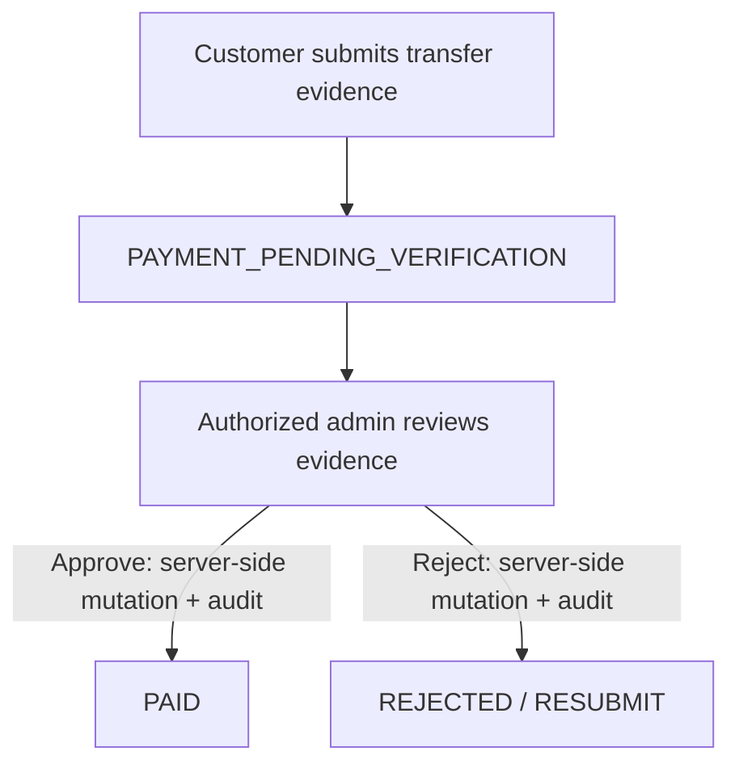

# P0 launch decisions and authority record

> **Current decision record — OA-01, 2026-10-07:** [OWNER_DECISIONS_2026-10-07.md](../OWNER_DECISIONS_2026-10-07.md) records Project Owner — Kerolles Sobhy's approved D01–D30 directions, exact open-input statuses, future task impacts and D03/D04/D05 cross-reference. It supersedes conflicting decision/open-scope statements below. The original P0 record is preserved verbatim as historical evidence; policy-direction closure is not full input closure or G-ENTRY PASS.

Recorded 2026-10-06, Africa/Cairo. Scope: **P0.1 only**. Source order: the current owner's P0 execution instruction overrides older assumptions; `MASTER_IMPLEMENTATION_PLAN.md` and `AUDIT.md` remain the baseline. They have not been rewritten. A documented architecture choice does not establish an approved account, commercial policy or production configuration.

Evidence: **[C]** source/configuration inspected; **[D]** repository documentation; **[OWNER]** explicit instruction in this conversation; **[A]** unresolved decision. No live business functionality is certified by this record.

## D01–D30 decision matrix

`OPEN / BLOCKED` means **BLOCKED — OWNER DECISION REQUIRED** for the unresolved part. No accountable individual was supplied for unresolved decisions; the repository/store owner must assign the named owner role below. An OPEN optional feature stays held/deferred, rather than silently becoming a launch requirement.

| ID | Decision | Status | Evidence/source | Impacted phases/tasks | Owner/action required |
|---|---|---|---|---|---|
| D01 | **Cash on Delivery + Manual Electronic Transfer (Wallet/InstaPay) with mandatory admin verification. No online payment gateway for launch.** | LOCKED | [OWNER] current P0 execution instruction; supersedes COD-only assumption in ADR-ORDER-004 and the old D01 choices | P6.5, P7.3–4, P4.3, P8.8, P10.1–3; P8.6 gateway branch DEFERRED | Store owner supplies receiving wallet/InstaPay instructions and WhatsApp destination; names authorized verification operators. Approval of the payment model is not approval of unknown account details. |
| D02 | Existing separate fulfilment/payment axes and manual refund-outcome recording retained as architecture. Return windows, eligibility, partial returns, refund settlement, cancellation and failed-payment handling are unapproved. | PARTLY ESTABLISHED; OPEN / BLOCKED | [D] ADR-ORDER-001/004; `ORDER-LIFECYCLE.md` §§3–4; [A] plan D02 | P7.2–3, P4.3, P6.5 | Store/finance owner approves policy, who settles refunds, manual-transfer rejection/resubmission/expiry rules and whether fulfilment may advance pending verification. Do not infer a stock reservation or timeout rule. |
| D03 | Serviceable governorates/zones not approved; a seeded list is not a signed service area. | OPEN / BLOCKED | [D] plan D03; ADR OPEN-001 | P5.2 | Operations owner supplies supported/disabled zones. |
| D04 | Shipping, remote-zone and failed-delivery fees not approved. | OPEN / BLOCKED | [D] plan D04; ADR OPEN-001 | P5.2, P7.3 | Operations/finance owner supplies fee schedule and responsibility for failed delivery. |
| D05 | Free-shipping enablement and threshold not approved. | OPEN / BLOCKED | [D] plan D05; ADR OPEN-001 | P5.2, P8.1 | Store owner chooses disabled or an approved threshold and calculation basis. |
| D06 | Existing manual carrier/tracking model does not establish a carrier contract, dispatch SLA or retry policy. | OPEN / BLOCKED | [D] plan D06; ADR OPEN-005 | P5.2, P7.4 | Operations owner identifies carrier, tracking format, dispatch/retry/return-to-origin responsibility. No carrier API authorized. |
| D07 | Google OAuth deferred from v1; Nest email/password remains identity authority. | ESTABLISHED / DEFERRED | [D] frozen ADR-AUTH-001/005; [OWNER] unapproved optional domains deferred | P8.5 deferred; P3 unaffected | No current implementation action. Owner must explicitly reopen scope and approve linking policy before a later OAuth phase. |
| D08 | Prior frozen decision calls for customer coupon validation/redemption: one coupon/order, no stacking, percentage basis points/fixed minor units, order snapshot. Current launch inclusion and remaining commercial rules are not locked. | PARTLY ESTABLISHED; OPEN / BLOCKED | [D] ADR-DISCOUNT-001–003 versus current plan D08 | P8.1, P5.2, P6.5 | Store owner confirms launch inclusion, caps, expiry/timezone, redemption/cancellation rules. Preserve established engineering rules if included; do not implement now. |
| D09 | Historical review design proposes moderation, pending-only edits, one review/user/product and delivered-order provenance; eligibility versus mere verified-purchase flag remains open. | OPEN / BLOCKED | [D] `BEHAVIOR-DECISIONS.md` R1–R7 is frozen **pending review**; ADR OPEN-007; plan D09 | P8.2, P5.3 | Store owner approves launch inclusion, eligibility and moderation ownership. Review images/helpfulness votes remain deferred. |
| D10 | Campaign meaning and launch subset not approved. | OPEN / BLOCKED | [D] plan D10; audit F20 | P8.7 | Store owner selects any required banners/promotions/scheduling/attribution. Existing featured/sale fields do not approve a marketing suite. |
| D11 | Blog launch and single editorial authority not approved. | OPEN / BLOCKED | [D] ADR OPEN-003; plan D11; audit F08 | P8.3, P9.1; retained content safety P1.1 | Content/store owner selects retain safely, replace in development or defer. No historical content transfer authorized. |
| D12 | Local client wishlist retained for MVP; account-synced persistence is post-MVP. | ESTABLISHED; sync DEFERRED | [D] ADR OPEN-008; [C] audit records current local slug storage | P8.4, P9.1 | No sync implementation authorized. Owner must explicitly approve any later account-sync scope. Legacy SQL wishlist is not a second active authority. |
| D13 | EGP integer minor units and VAT-inclusive prices are established. Invoice breakdown/rate, accounting treatment and net revenue require business approval. Manual evidence is never paid revenue. | PARTLY ESTABLISHED; OPEN / BLOCKED | [D] ADR-MONEY-001–003, OPEN-002; [OWNER] D01 financial invariant | P7.3, P5.3, P8.8, P10 | Finance owner approves tax/invoice and COD collection policy. A seeded VAT rate is not evidence of legal compliance. |
| D14 | Provider abstraction and existing Resend/Brevo adapters are established; production provider/account/domain/sender/reply-to/locales are not. Automated tests use console/mocks. | OPEN / BLOCKED for production | [D] ADR OPEN-004; `DEPLOYMENT-DECISION.md`; [C] audit/email adapters | P4.1–3, P10.3 | Email/domain owner selects account and verified domain, sender, reply-to, required locales and deliverability evidence. No DNS or provider change now. |
| D15 | `Client → Nest → Cloudinary`, publicId/version metadata and SVG rejection are established. Durable account, ownership/retention/sharing/deletion/recovery policy remain open. | PARTLY ESTABLISHED; OPEN / BLOCKED | [D] ADR-MEDIA-001–004; audit F07/F09/F10/F16 | P1.3–5, P4.4, P5.1 | Media owner supplies production account and policy; any provider test needs a separately attested disposable account. |
| D16 | WhatsApp is the approved **manual payment evidence** channel. General support destination, actual WhatsApp number and response promise are unknown. | PARTLY LOCKED; OPEN / BLOCKED | [OWNER] D01; [D] plan D16, audit F26 | P6.4–5, P5.5, P7.3–4 | Store/support owner supplies contact destination, staffing and promised response times. No contact/account numbers fabricated. |
| D17 | Privacy, terms, delivery/returns content and approver not supplied. | OPEN / BLOCKED | [D] plan D17, audit F24 | P5.5, P8.8 | Store/legal owner approves real policies and receipt/evidence handling, including sender identifiers sent over WhatsApp. |
| D18 | Analytics/Meta/GA, consent and attribution scope not approved. Manual evidence submission must not emit a paid-purchase recognition event. | OPEN / BLOCKED | [D] plan D18; [OWNER] D01 financial invariant | P8.8, P9.6, P10.3 | Business/privacy owner chooses scope and paid-versus-order-submitted event semantics. Marketing integrations stay deferred until approved. |
| D19 | Backup retention, RPO/RTO and restore owner not approved. | OPEN / BLOCKED | [D] plan D19, audit F34 | P9.7, P10.4 | Operations/store owner signs tolerances and appoints restore operator. |
| D20 | Hosting region, runtime and ingress not selected by an owner; deployment recommendations are not approvals. Existing package-manager pin is preserved. | OPEN / BLOCKED | [D] plan D20; `docs/deployment/DEPLOYMENT-DECISION.md` recommendations | P3.3, P9.4–5, P10.4 | Infrastructure owner approves platform/region/topology and supported release runtime. No infrastructure altered. |
| D21 | Production storefront/admin/API domains and controlling accounts not established. | OPEN / BLOCKED | [D] plan D21 | P4.1, P4.4, P5.4, P9.5 | Domain owner supplies owned hosts and DNS/TLS responsibility. No DNS change authorized. |
| D22 | Inventory owns stock mutations; immutable ledger/opening balance is established. Real opening-stock provenance/date and salesCount meaning not approved. | PARTLY ESTABLISHED; OPEN / BLOCKED | [D] ADR-INVENTORY-001–003; audit F02/F03 | P2.4, P5.3; manual-payment implications P7.3 | Inventory/finance owner supplies physical/accounting evidence. New manual-payment gap requires explicit policy; do not invent history or change stock now. |
| D23 | Treatment of seeded ratings/review counts is unapproved; synthetic claims cannot be certified as real verified purchases. | OPEN / BLOCKED | [D] plan D23; audit F38 | P5.3, P8.2 | Catalogue/store owner approves honest display/removal/replacement policy. No data deletion now. |
| D24 | Real catalogue, image rights, availability and delivery promises not approved. | OPEN / BLOCKED | [D] plan D24; audit F38 | P5.3–5 | Catalogue owner supplies and signs off production content. Test seeds are not production content evidence. |
| D25 | Permanent product deletion and sold/shared-media retention policy not locked. | OPEN / BLOCKED | [D] plan D25; audit F10 | P1.5 | Store/data owner approves retention or disables permanent deletion in a later authorized phase. No deletion now. |
| D26 | Existing 15-minute access / rotating 30-day refresh architecture is documented; required customer revocation immediacy remains unapproved. | PARTLY ESTABLISHED; OPEN / BLOCKED | [D] ADR-AUTH-002/003; plan D26; audit F12 | P3.4 | Security owner approves immediate sensitive-operation enforcement or explicitly bounded lifetime. Do not weaken staff invalidation. |
| D27 | Responsible Supabase/security/credential owner not named; live ACL and historical revocation proof are outstanding. | OPEN / BLOCKED — OWNER ACTION REQUIRED | [D] audit F31/F37; P0.2/P0.3 findings in completion report | P0.2–3, G-ENTRY, P10.4 | Repository owner appoints service/security owners and supplies authoritative read-only grant export and revocation evidence. |
| D28 | Nest API + MongoDB is shared commerce/payment authority. No dual writes; residual blog/coupon/review paths need explicit later resolution. Production transition remains separate. | CORE LOCKED; residual boundaries OPEN / BLOCKED | [OWNER] current payment boundary and migration prohibition; [D] plan §§6–7/13, audit architecture | P8.1–4, P9.1, P10.5 | Architecture/store owner locks remaining residual-domain choices and environment-specific switch approval. No migration/backfill/cutover now. |
| D29 | Capacity/SLOs and deployment instance count not approved. Single-instance historical assumption is explicitly unverified. | OPEN / BLOCKED | [D] ADR OPEN-006, ADR-REDIS-001; plan D29 | P3.3, P9.2, P9.5–7, P10.4 | Business/infrastructure owner supplies traffic/latency/error targets and topology. |
| D30 | Verification/reset/confirmation are required by the baseline. Status/admin alert selection, retention/replay and manual-payment review notices need approval. | PARTLY ESTABLISHED; OPEN / BLOCKED | [D] plan D30/P4.2–3; [OWNER] D01 requires auditable verification actions, not an assumed alert channel | P4.2–3, P7.3–4, P9.6 | Store/support owner approves notification matrix, recipients and retry/retention policy. Never describe pending evidence as payment confirmed. |

## Locked launch scope

Required: COD; manual Wallet/InstaPay transfer with admin verification; the customer order lifecycle; admin order/payment operations and an audit trail for every verification action. These are requirements for later execution, **not features built by P0**.

Deferred: online payment gateways (including Stripe, Paymob, PayTabs and Fawry), Flutter, final production database migration/cutover, and optional domains without explicit launch approval. D08 retains prior coupon engineering decisions but does not silently resolve current commercial launch questions. Google and account-synced wishlist remain deferred under the established v1 scope.

## Payment decision and authority

**COD:** customer chooses `COD`; order placement requires no payment-verification step. It follows the approved normal fulfilment state machine. Existing COD collection-on-delivery semantics are separate from manual-transfer verification; a verification hold must not accidentally be applied to COD.

**Manual electronic transfer:** customer chooses Wallet/InstaPay manual payment. Checkout displays the currently configured instructions/account information. The customer transfers externally, then is directed to WhatsApp and sends the order number, sender phone/account number and a screenshot of the transfer receipt. Those items are **evidence only**. The order remains conceptually `PAYMENT_PENDING_VERIFICATION` and appears in the admin pending-verification queue. An authorized admin may approve to `PAID` or reject for a `REJECTED`/resubmission outcome according to the eventual domain mapping. Every manual verification action must be audited.

**Authority:** Nest API + MongoDB owns payment state and authorization. Browser state, a screenshot, WhatsApp, a customer-supplied account identifier or a transfer claim cannot confirm payment. Only an authorized server-side admin approval may transition a manual transfer from pending verification to paid. The system must not recognize revenue, settle wallet balances, release financial value or otherwise treat that transfer as paid before approval. No wallet ledger or settlement feature is being invented by this rule.

**Existing model mapping [C]:** `apps/api/src/modules/orders/domain/order-status.ts` currently has `PaymentMethod.COD` and `PaymentStatus.PENDING | PAID | REFUNDED`, separate from `OrderStatus`. It has no manual-transfer method or verification/rejection state. Reuse `PENDING` as the unpaid payment axis for the conceptual `PAYMENT_PENDING_VERIFICATION` case; a later, explicitly authorized design must discriminate manual method/channel and verification outcome. Preserve `PAID` as the payment result. `REJECTED` is not an existing enum: choose the minimum compatible review/resubmission representation later rather than adding duplicate order/payment axes in P0. Neither a general `CONFIRMED` order transition nor the existing COD `DELIVERED → PAID` rule may become a manual-transfer approval bypass.

**Deferred to P6.5/P7.3–4:** checkout instructions and WhatsApp handoff, method/channel representation, pending-payment queue, guarded approve/reject/resubmit mutation, auditable actor/time/outcome, authorization and replay/race regression tests, financial reporting boundaries. P4.3/P8.8 handle approved notices/events; P10 certifies. P8.6's gateway implementation is deferred, not repurposed into permission to add a gateway. The old plan needs this D01 addendum applied when those phases are explicitly authorized. No payment code was changed now.

## Authority and environment boundaries

| Domain | Active/target authority and boundary | P0 disposition |
|---|---|---|
| Identity, users, products, categories/brands, authenticated cart, addresses, checkout, orders, stock/ledger, shipping rules | Nest API + MongoDB; clients consume API. Guest basket is local provisional state; server owns quotes/totals. | Established architecture; no rewrite or database change. |
| Payments/manual approval and audit | Nest API + MongoDB; server-side authorized admin mutation owns confirmation. | D01 locked; implementation deferred. |
| Email | Nest decides notifications; selected provider transports them. Automated tests console/mock. | Production provider/account approval pending D14/D30. |
| Media | Nest metadata/references; Cloudinary bytes for approved production deployment. Tests memory by default. | No provider/data change; dedicated provider-test account required. |
| Wishlist | Local browser state for MVP. | Server sync deferred; no SQL/Mongo dual write. |
| Coupons/reviews/blog | Audit identifies residual Supabase dependencies; inclusion and safe authority transition depend on D08–D11/D28. | Unresolved authority is a gate, not an assertion of migration completion. Legacy commerce SQL privileges remain unknown live. |
| Marketing/content/support | Owner-approved scope and authority only. | No optional implementation or external integration authorized. |

Development uses fresh isolated synthetic fixtures for approved work. A future staging switch must be explicit per domain, with a single writer and its contract verified. Production Supabase data, grants, identities and storage remain untouched. Functional completion and production readiness come first; a **separate** migration plan/rehearsal/authorization follows. This record does not authorize migration, dual writes, data cleanup or cutover.

## P0.1 closure

The decision record is complete; the decision gate is **BLOCKED**. D01 is locked, established decisions are preserved, and every D02–D30 has an explicit disposition. Open owner decisions are not replaced with defaults. See `../P0_COMPLETION_REPORT.md` for execution evidence and G-ENTRY.
